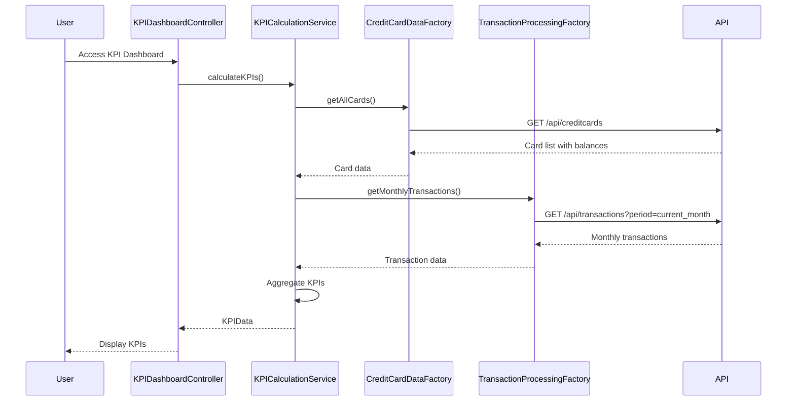

# Low-Level Design: Dashboard KPIs and Credit Card Overview
**Epic ID:** QE-8603  
**Branch:** PERFTEST20261109190052

---

## a. Architecture Mapping

- **Dashboard UI** → AngularJS Module (`app.kpiDashboard`) + Controller (`KPIDashboardController`)
- **KPI Calculation Engine** → Service (`KPICalculationService`) for real-time KPI computation
- **Credit Card Data Service** → Factory (`CreditCardDataFactory`) for card details and balances
- **Transaction Processing Service** → Factory (`TransactionProcessingFactory`) for monthly spend and outstanding calculations

**Recommended Folder Structure:**
```
app/
├── modules/kpiDashboard/
│   ├── controllers/kpiDashboard.controller.js
│   ├── services/kpiCalculation.service.js
│   ├── factories/creditCardData.factory.js
│   ├── factories/transactionProcessing.factory.js
│   └── views/kpi-dashboard.html
```

---

## b. Component Specifications

| Component Name | Artifact Type | Responsibility | Key Dependencies |
|----------------|---------------|----------------|------------------|
| KPIDashboardController | Controller | Manages KPI dashboard view, fetches and displays four KPIs, handles multi-card aggregation | KPICalculationService, $scope |
| KPICalculationService | Service | Computes monthly spend, total credit limit, available credit, and outstanding amount in real-time | CreditCardDataFactory, TransactionProcessingFactory |
| CreditCardDataFactory | Factory | Retrieves credit card details, credit limits, and current balances from REST API | $http, $q |
| TransactionProcessingFactory | Factory | Fetches transaction data for monthly spend and outstanding amount calculations | $http, $q |

---

## c. Data Model

**KPIData Model:**
```javascript
{
  monthlySpend: Number,
  totalCreditLimit: Number,
  availableCredit: Number,
  outstandingAmount: Number
}
```

**CreditCard Model:**
```javascript
{
  cardId: String,
  cardNumber: String, // Masked
  creditLimit: Number,
  currentBalance: Number,
  availableCredit: Number
}
```

**MonthlyTransaction Model:**
```javascript
{
  transactionId: String,
  cardId: String,
  amount: Number,
  date: Date
}
```

---

## d. Data Flow

User accesses KPI dashboard → KPIDashboardController calls KPICalculationService.calculateKPIs() → KPICalculationService fetches all cards via CreditCardDataFactory (REST API) → Service fetches current month transactions via TransactionProcessingFactory (REST API) → KPICalculationService aggregates total credit limit (sum of all card limits), computes available credit (total limit - sum of current balances), calculates outstanding amount (sum of all card balances), and monthly spend (sum of current month transaction amounts) → Service returns KPIData object → Controller binds to view → UI displays four KPI cards with responsive layout.

---

## e. Primary Sequence Diagram



---

## f. Implementation Notes

- Use AngularJS $q.all() in KPICalculationService to parallelize card and transaction API calls for optimized dashboard load time.
- Implement Bootstrap responsive grid (col-lg-3, col-md-6, col-sm-12) for KPI card layout across device sizes.
- Apply AngularJS currency and number filters in view for formatted KPI display.
- KPICalculationService should use ES6 reduce() for clean aggregation of credit limits, balances, and transaction amounts.
- Cache card data in CreditCardDataFactory using $cacheFactory to minimize redundant API calls during user session.

---

## g. Error Handling

HTTP interceptor handles API errors; KPICalculationService returns partial KPIs if one data source fails; toast notification alerts user of incomplete data.

---

## h. Security Notes

Token-based authentication required for all API endpoints; card numbers masked on client-side; standard input validation applied.

---

**End of LLD for QE-8603**