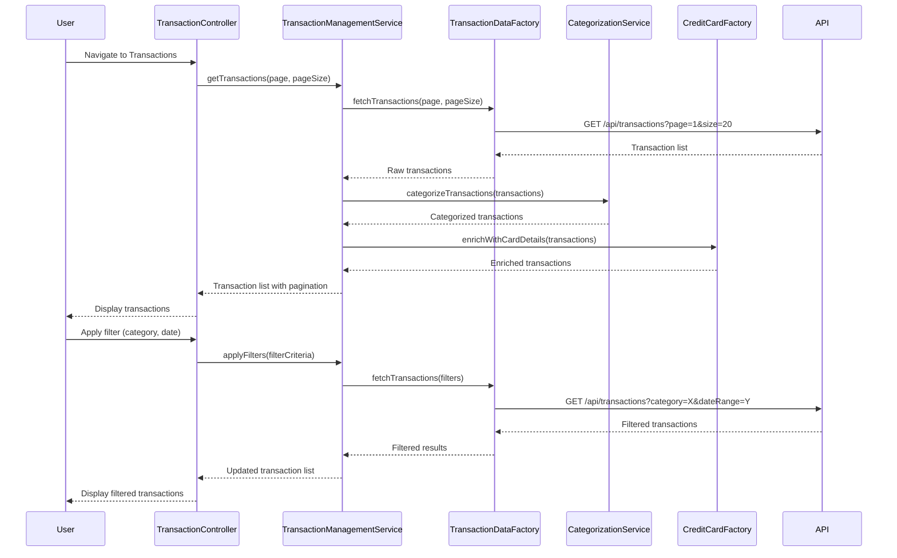

# Low-Level Design: Transaction Management and Display
**Epic ID:** QE-8604  
**Branch:** PERFTEST20261109190052

---

## a. Architecture Mapping

- **User Interface** → AngularJS Module (`app.transactions`) + Controller (`TransactionController`)
- **Transaction Management Module** → Service (`TransactionManagementService`) for transaction operations and filtering
- **Transaction Data Service** → Factory (`TransactionDataFactory`) for REST API integration
- **Credit Card Service** → Factory (`CreditCardFactory`) for card association
- **Categorization Service** → Service (`CategorizationService`) for transaction category assignment

**Recommended Folder Structure:**
```
app/
├── modules/transactions/
│   ├── controllers/transaction.controller.js
│   ├── services/transactionManagement.service.js
│   ├── services/categorization.service.js
│   ├── factories/transactionData.factory.js
│   ├── factories/creditCard.factory.js
│   └── views/transactions.html
```

---

## b. Component Specifications

| Component Name | Artifact Type | Responsibility | Key Dependencies |
|----------------|---------------|----------------|------------------|
| TransactionController | Controller | Manages transaction list view, handles search/filter inputs, pagination, and transaction detail display | TransactionManagementService, $scope |
| TransactionManagementService | Service | Orchestrates transaction retrieval, applies filters (date, amount, category, card), manages pagination state | TransactionDataFactory, CreditCardFactory, CategorizationService |
| TransactionDataFactory | Factory | Fetches transaction history from REST API with query parameters for filtering | $http, $q |
| CreditCardFactory | Factory | Retrieves card details for associating transactions with specific cards | $http, $q |
| CategorizationService | Service | Assigns categories to transactions based on merchant or transaction type | None |

---

## c. Data Model

**Transaction Model:**
```javascript
{
  transactionId: String,
  cardId: String,
  cardNumber: String, // Masked (last 4 digits)
  amount: Number,
  date: Date,
  category: String,
  merchantName: String,
  description: String,
  transactionType: String // Debit/Credit
}
```

**FilterCriteria Model:**
```javascript
{
  dateRange: {startDate: Date, endDate: Date},
  amountRange: {min: Number, max: Number},
  categories: Array<String>,
  cardIds: Array<String>,
  searchTerm: String
}
```

**PaginationState Model:**
```javascript
{
  currentPage: Number,
  pageSize: Number,
  totalRecords: Number
}
```

---

 ## d. Data Flow

User navigates to transaction view → TransactionController initializes and calls TransactionManagementService.getTransactions() → TransactionDataFactory fetches paginated transactions via REST API → CategorizationService assigns categories to each transaction → CreditCardFactory enriches transactions with card details → TransactionManagementService returns transaction list → Controller binds to view → User applies filters (date, category, card) → Controller updates filter criteria and calls TransactionManagementService.applyFilters() → Service re-fetches filtered transactions → View updates with filtered results and pagination controls.

---

## e. Primary Sequence Diagram



---

## f. Implementation Notes

- Use AngularJS ng-repeat with track by transactionId for efficient list rendering and updates.
- Implement pagination using UI Bootstrap pagination directive with server-side pagination support.
- TransactionDataFactory should support query parameters (page, size, filters) for efficient API calls with large datasets.
- Apply AngularJS date and currency filters in view for formatted transaction display.
- Use ES6 arrow functions and array methods (filter, map) in TransactionManagementService for clean filter logic.

---

## g. Error Handling

HTTP interceptor handles API errors; TransactionManagementService displays user-friendly error messages; empty state view shown when no transactions found.

---

## h. Security Notes

Token-based auth required for transaction API; card numbers masked to last 4 digits; standard input validation on filter inputs.

---

**End of LLD for QE-8604**