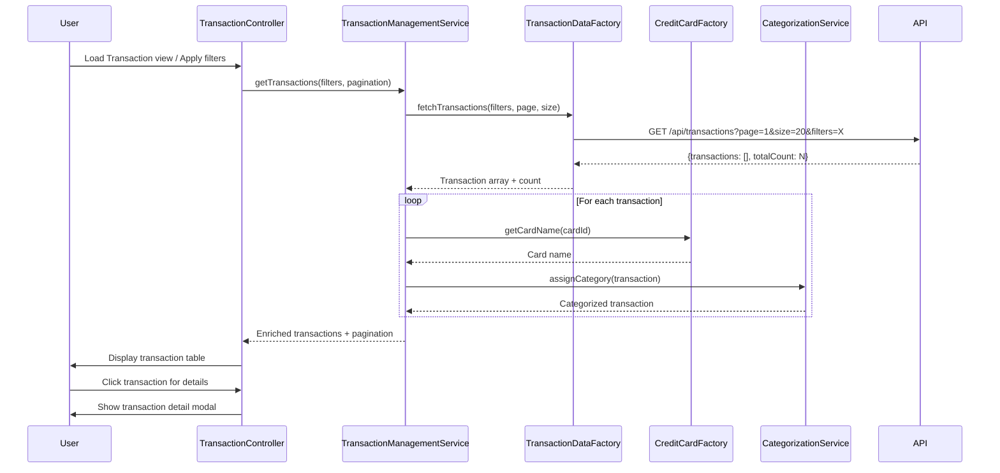

# Low-Level Design: Transaction Management and Display
**Epic ID:** QE-8604

## a. Architecture Mapping

- **User Interface** → AngularJS Module (`transactionModule`) + Controller (`TransactionController`)
- **Transaction Management Service** → AngularJS Service (`TransactionManagementService`) for business logic and state management
- **Transaction Data Service** → AngularJS Factory (`TransactionDataFactory`) for REST API integration
- **Credit Card Service** → AngularJS Factory (`CreditCardFactory`) for card association
- **Categorization Service** → AngularJS Service (`CategorizationService`) for transaction categorization

**Recommended Folder Structure:**
```
app/
├── modules/
│   └── transactions/
│       ├── controllers/
│       ├── services/
│       ├── views/
│       └── transaction.module.js
├── shared/
│   ├── factories/
│   └── filters/
└── assets/
```

## b. Component Specifications

| Component Name | Artifact Type | Responsibility | Key Dependencies |
|----------------|---------------|----------------|------------------|
| TransactionController | Controller | Manages transaction view state, handles search/filter inputs, coordinates pagination | TransactionManagementService, $scope, $location |
| TransactionManagementService | Service | Orchestrates transaction retrieval, applies filters, manages pagination state | TransactionDataFactory, CreditCardFactory, CategorizationService, $q |
| TransactionDataFactory | Factory | Fetches paginated transaction data from REST API with query parameters | $http, $q |
| CreditCardFactory | Factory | Retrieves credit card information for transaction-card association | $http, $q |
| CategorizationService | Service | Assigns categories to transactions and provides category filter options | None |
| transactionTable | Directive | Renders paginated transaction table with sortable columns and responsive layout | None |
| transactionDetail | Directive | Displays detailed transaction information in modal or expanded row | None |

## c. Data Model

**Transaction Model:**
```javascript
{
  transactionId: String,
  cardId: String,
  cardName: String,
  amount: Number,
  category: String,
  date: Date,
  merchantName: String,
  description: String,
  status: String // Posted, Pending
}
```

**TransactionFilter Model:**
```javascript
{
  cardId: String,
  category: String,
  startDate: Date,
  endDate: Date,
  searchTerm: String,
  minAmount: Number,
  maxAmount: Number
}
```

**PaginationState Model:**
```javascript
{
  currentPage: Number,
  pageSize: Number,
  totalRecords: Number,
  totalPages: Number
}
```

## d. Data Flow

User navigates to Transaction Management view → TransactionController initializes with default pagination (page 1, size 20) and calls TransactionManagementService.getTransactions(filters, pagination) → Service invokes TransactionDataFactory.fetchTransactions() with query parameters → REST API returns paginated transaction array with total count → For each transaction, CreditCardFactory.getCardName(cardId) retrieves associated card information → CategorizationService.assignCategory(transaction) ensures category assignment → TransactionManagementService returns enriched transaction list and pagination metadata to Controller → Controller binds data to $scope → View renders transactions using transactionTable directive with ng-repeat → User applies filters or searches triggering service call with updated parameters → Results update via two-way binding.

## e. Primary Sequence Diagram



## f. Implementation Notes

- Implement server-side pagination with query parameters (page, size) in TransactionDataFactory for efficient large dataset handling
- Use AngularJS $location service to sync pagination and filter state with URL query parameters for bookmarkable views
- Apply ES6 async/await pattern wrapped in $q for cleaner promise handling in TransactionManagementService
- Implement debounce on search input using ng-model-options="{debounce: 500}" to reduce API calls during typing
- Cache card names in CreditCardFactory using object map to avoid repeated lookups for same cardId

## g. Error Handling

HTTP interceptor handles API errors; TransactionManagementService returns empty array with error flag; controller displays Bootstrap alert with retry option.

## h. Security Notes

Standard input validation and secure API calls assumed; transaction data requires authenticated session with valid JWT token.