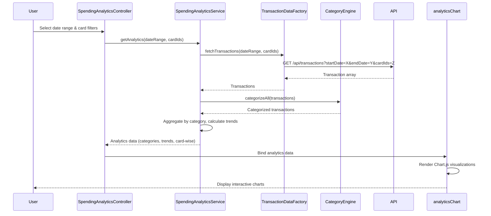

# Low-Level Design: Spending Analytics and Visualization
**Epic ID:** QE-8605

## a. Architecture Mapping

- **User Interface** → AngularJS Module (`spendingAnalyticsModule`) + Controller (`SpendingAnalyticsController`)
- **Analytics Service** → AngularJS Service (`SpendingAnalyticsService`) for analytics calculations and data processing
- **Transaction Data Service** → AngularJS Factory (`TransactionDataFactory`) for transaction API integration
- **Categorization Engine** → AngularJS Service (`CategoryEngine`) for automatic transaction categorization
- **Visualization Component** → AngularJS Directive (`analyticsChart`) wrapping Chart.js for interactive charts

**Recommended Folder Structure:**
```
app/
├── modules/
│   └── spending-analytics/
│       ├── controllers/
│       ├── services/
│       ├── directives/
│       ├── views/
│       └── spending-analytics.module.js
├── shared/
│   └── factories/
└── assets/
    └── libs/
```

## b. Component Specifications

| Component Name | Artifact Type | Responsibility | Key Dependencies |
|----------------|---------------|----------------|------------------|
| SpendingAnalyticsController | Controller | Manages analytics view state, handles user interactions for date range and card selection | SpendingAnalyticsService, $scope, $filter |
| SpendingAnalyticsService | Service | Performs category-wise aggregation, calculates monthly trends, generates card-wise analytics | TransactionDataFactory, CategoryEngine, $q |
| TransactionDataFactory | Factory | Fetches transaction data from REST API with date range and card filters | $http, $q |
| CategoryEngine | Service | Categorizes transactions into nine predefined categories using rule-based logic | None |
| analyticsChart | Directive | Renders interactive pie, bar, and line charts using Chart.js with responsive behavior | Chart.js, $timeout |
| categoryBreakdown | Directive | Displays category-wise spending breakdown in table format with percentage calculations | $filter |

## c. Data Model

**Transaction Model:**
```javascript
{
  id: String,
  cardId: String,
  amount: Number,
  category: String,
  date: Date,
  merchantName: String
}
```

**CategorySpend Model:**
```javascript
{
  category: String, // One of 9 categories
  totalAmount: Number,
  transactionCount: Number,
  percentage: Number
}
```

**MonthlyTrend Model:**
```javascript
{
  month: String, // YYYY-MM
  totalSpend: Number,
  categoryBreakdown: Array<CategorySpend>
}
```

**CardAnalytics Model:**
```javascript
{
  cardId: String,
  cardName: String,
  totalSpend: Number,
  topCategory: String
}
```

## d. Data Flow

User selects date range and card filters in Spending Analytics view → SpendingAnalyticsController captures inputs and calls SpendingAnalyticsService.getAnalytics(dateRange, cardIds) → Service invokes TransactionDataFactory.fetchTransactions() with filter parameters → REST API returns transaction array → CategoryEngine.categorizeAll(transactions) assigns categories to each transaction → SpendingAnalyticsService aggregates transactions by category, calculates monthly trends, and generates card-wise spending summaries → Processed analytics data returned to Controller → Controller binds data to $scope → analyticsChart directive renders pie chart for category breakdown, line chart for monthly trends, and bar chart for card-wise comparison → User interactions with charts trigger scope updates and view refresh.

## e. Primary Sequence Diagram



## f. Implementation Notes

- Use AngularJS dependency injection to inject SpendingAnalyticsService and TransactionDataFactory into controller
- Implement promise chaining with $q in SpendingAnalyticsService for sequential data processing steps
- Apply ES6 reduce() method for efficient category-wise aggregation and monthly trend calculations
- Use directive's link function with $timeout to ensure DOM readiness before Chart.js initialization
- Implement $scope.$watch on date range and card filters to trigger automatic analytics refresh on change

## g. Error Handling

HTTP interceptor catches API errors; SpendingAnalyticsService returns empty analytics with error flag; controller displays user-friendly error message via Bootstrap alert.

## h. Security Notes

Requires token-based auth via existing SSO; all transaction data API calls include Authorization header with JWT token.