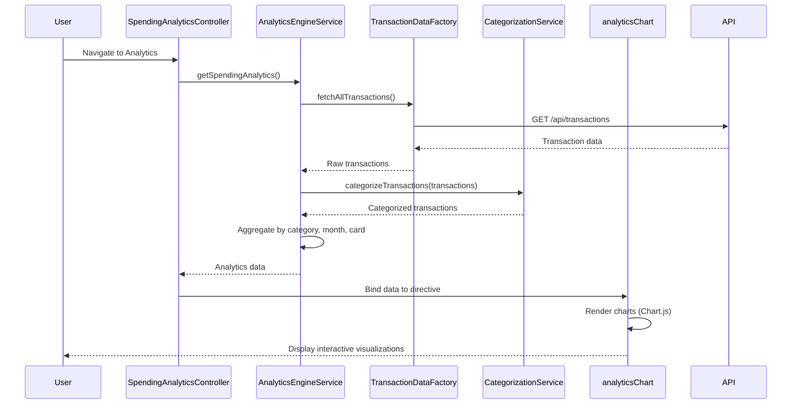

# Low-Level Design: Spending Analytics and Visualization
**Epic ID:** QE-8605  
**Branch:** PERFTEST20261109190052

---

## a. Architecture Mapping

- **User Interface** → AngularJS Module (`app.spendingAnalytics`) + Controller (`SpendingAnalyticsController`)
- **Analytics Engine** → Service (`AnalyticsEngineService`) for spend pattern computation
- **Transaction Data Service** → Factory (`TransactionDataFactory`) for transaction retrieval
- **Categorization Service** → Service (`CategorizationService`) for category assignment
- **Visualization Renderer** → Directive (`analyticsChart`) for rendering interactive charts

**Recommended Folder Structure:**
```
app/
├── modules/spendingAnalytics/
│   ├── controllers/spendingAnalytics.controller.js
│   ├── services/analyticsEngine.service.js
│   ├── services/categorization.service.js
│   ├── factories/transactionData.factory.js
│   ├── directives/analyticsChart.directive.js
│   └── views/spending-analytics.html
```

---

## b. Component Specifications

| Component Name | Artifact Type | Responsibility | Key Dependencies |
|----------------|---------------|----------------|------------------|
| SpendingAnalyticsController | Controller | Manages analytics view, handles user interactions, binds analytics data to view | AnalyticsEngineService, $scope |
| AnalyticsEngineService | Service | Aggregates transactions by category and month, computes card-wise and category-wise spending patterns | TransactionDataFactory, CategorizationService |
| CategorizationService | Service | Assigns transactions to one of nine predefined categories using rule-based logic | None |
| TransactionDataFactory | Factory | Fetches transaction records from REST API | $http, $q |
| analyticsChart | Directive | Renders interactive category-wise and monthly trend charts using Chart.js | AnalyticsEngineService |

---

## c. Data Model

**Transaction Model:**
```javascript
{
  transactionId: String,
  cardId: String,
  amount: Number,
  category: String, // One of 9 categories
  date: Date,
  merchantName: String
}
```

**CategoryAnalytics Model:**
```javascript
{
  category: String,
  totalSpend: Number,
  transactionCount: Number,
  percentage: Number
}
```

**MonthlyTrend Model:**
```javascript
{
  month: String, // YYYY-MM
  categoryBreakdown: Array<CategoryAnalytics>,
  totalSpend: Number
}
```

**CardWiseSpend Model:**
```javascript
{
  cardId: String,
  cardNumber: String, // Masked
  categorySpend: Array<{category: String, amount: Number}>,
  totalSpend: Number
}
```

---

## d. Data Flow

User navigates to spending analytics → SpendingAnalyticsController initializes and calls AnalyticsEngineService.getSpendingAnalytics() → AnalyticsEngineService requests transactions via TransactionDataFactory (REST API) → CategorizationService assigns categories to transactions → AnalyticsEngineService aggregates by category, month, and card → Service returns analytics data → Controller binds to scope → analyticsChart directive receives data and renders interactive visualizations (pie chart for category-wise, line chart for monthly trends) → User interacts with charts to drill down or filter.

---

## e. Primary Sequence Diagram



---

## f. Implementation Notes

- Use AngularJS Dependency Injection for all services, factories, and directives to ensure modularity and testability.
- Implement CategorizationService with rule-based logic (merchant name patterns) for assigning one of nine categories.
- Use Chart.js within analyticsChart directive for responsive, interactive charts with click events for drill-down.
- AnalyticsEngineService should use ES6 reduce() and groupBy patterns for efficient aggregation of large transaction datasets.
- TransactionDataFactory should implement caching to minimize redundant API calls during analytics interactions.

---

## g. Error Handling

HTTP interceptor captures API failures; AnalyticsEngineService wraps promises with error handling; toast notification service alerts user of data load errors.

---

## h. Security Notes

Requires token-based authentication via existing SSO; all API calls include authorization headers; standard input validation applied.

---

**End of LLD for QE-8605**