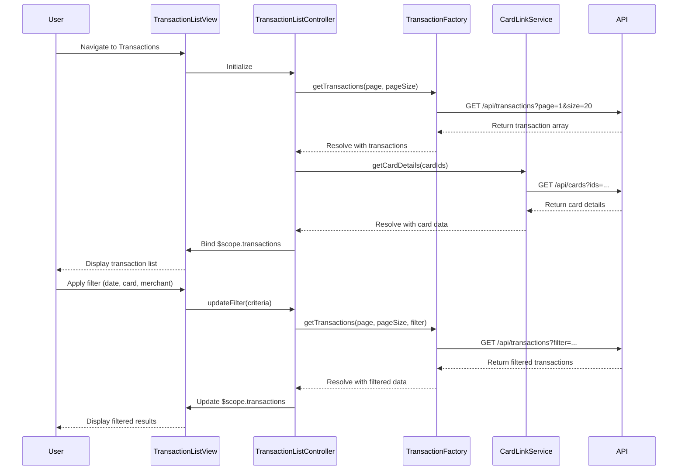

# Low-Level Design: Transaction Management and Monitoring
**Epic ID:** QE-8606

## a. Architecture Mapping

- **Transaction List Module** → AngularJS Module (`transactionModule`)
- **Transaction List Controller** → Controller (`TransactionListController`) - manages view state, filtering, pagination
- **Transaction Service** → Factory (`TransactionFactory`) - handles API calls for transaction data
- **Card Link Service** → Service (`CardLinkService`) - links transactions to credit cards
- **Auth Interceptor** → Factory (`AuthInterceptor`) - injects auth tokens into API requests
- **Transaction Filter Directive** → Directive (`transactionFilter`) - provides search/filter UI component

**Folder Structure:**
```
/app
  /modules
    /transaction
      transaction.module.js
      transaction.routes.js
      /controllers
        TransactionListController.js
      /services
        TransactionFactory.js
        CardLinkService.js
      /directives
        transactionFilter.directive.js
      /views
        transaction-list.html
  /shared
    /interceptors
      AuthInterceptor.js
```

## b. Component Specifications

| Name | Artifact Type | Responsibility | Key Dependencies |
|------|---------------|----------------|------------------|
| transactionModule | Module | Registers all transaction-related components | ngRoute, ui.bootstrap |
| TransactionListController | Controller | Manages transaction list view, pagination, filter state | TransactionFactory, CardLinkService, $scope |
| TransactionFactory | Factory | Fetches transaction data from REST API, handles search/filter requests | $http, $q, API_CONFIG |
| CardLinkService | Service | Retrieves card details and links to transactions | $http, API_CONFIG |
| transactionFilter | Directive | Renders search/filter UI (date, card, amount, merchant) | None |
| AuthInterceptor | Factory | Injects JWT token into all outgoing API requests | $window, $q |

## c. Data Model

**Transaction Object:**
```javascript
{
  transactionId: String,
  cardId: String,
  cardName: String,
  date: Date,
  merchant: String,
  category: String,
  amount: Number,
  currency: String,
  status: String // 'posted', 'pending'
}
```

**Filter Criteria Object:**
```javascript
{
  startDate: Date,
  endDate: Date,
  cardIds: Array<String>,
  minAmount: Number,
  maxAmount: Number,
  merchant: String,
  category: String
}
```

**Pagination Object:**
```javascript
{
  page: Number,
  pageSize: Number,
  totalRecords: Number
}
```

## d. Data Flow

User navigates to transaction list view → TransactionListController initializes and calls TransactionFactory.getTransactions() → Factory makes GET request to `/api/transactions` with auth token via AuthInterceptor → API returns paginated transaction array → Controller enriches data by calling CardLinkService.getCardDetails() for each unique cardId → Combined data is bound to $scope.transactions → View renders transaction list with ng-repeat → User applies filter via transactionFilter directive → Controller updates filter criteria and re-fetches data → Updated list is displayed with minimal latency using indexed API queries.

## e. Primary Sequence Diagram



## f. Implementation Notes

- Use AngularJS 1.x Factory pattern for stateless API services; Service pattern for stateful card linking logic
- Implement pagination using ui-bootstrap pagination directive; lazy-load transactions on scroll for large datasets
- Leverage AngularJS DI to inject TransactionFactory and CardLinkService into controller; use $q for promise chaining
- REST API integration via $http service; base URL configured in API_CONFIG constant
- Use ng-repeat with track by transactionId for optimal rendering performance; apply one-time binding (::) for static fields

## g. Error Handling

HTTP interceptor captures API errors (4xx, 5xx), displays user-friendly notifications via toastr, and logs errors to console; controller-level try/catch for data transformation errors.

## h. Security Notes

Requires token-based auth via existing SSO; AuthInterceptor injects JWT into Authorization header for all API calls.