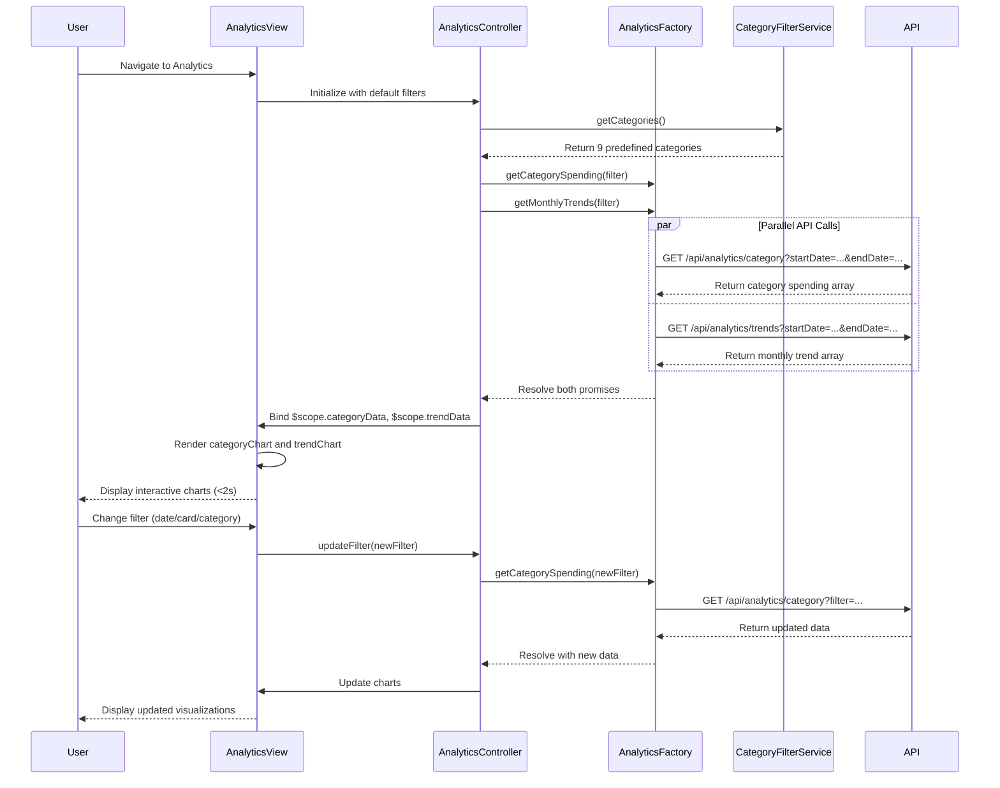

# Low-Level Design: Spending Analytics and Insights
**Epic ID:** QE-8607

## a. Architecture Mapping

- **Analytics Module** → AngularJS Module (`analyticsModule`)
- **Analytics Controller** → Controller (`AnalyticsController`) - manages chart state, filter parameters
- **Analytics Service** → Factory (`AnalyticsFactory`) - fetches aggregated analytics data from API
- **Chart Directive** → Directive (`categoryChart`, `trendChart`) - renders interactive charts using Chart.js
- **Category Filter Service** → Service (`CategoryFilterService`) - manages 9 predefined categories and filter state

**Folder Structure:**
```
/app
  /modules
    /analytics
      analytics.module.js
      analytics.routes.js
      /controllers
        AnalyticsController.js
      /services
        AnalyticsFactory.js
        CategoryFilterService.js
      /directives
        categoryChart.directive.js
        trendChart.directive.js
      /views
        analytics-dashboard.html
```

## b. Component Specifications

| Name | Artifact Type | Responsibility | Key Dependencies |
|------|---------------|----------------|------------------|
| analyticsModule | Module | Registers analytics components and chart dependencies | ngRoute, chart.js |
| AnalyticsController | Controller | Manages analytics view state, date range, card/category filters | AnalyticsFactory, CategoryFilterService, $scope |
| AnalyticsFactory | Factory | Fetches category-wise and trend analytics from REST API | $http, $q, API_CONFIG |
| CategoryFilterService | Service | Provides list of 9 categories, manages active filter selections | None |
| categoryChart | Directive | Renders category-wise spending pie/bar chart | Chart.js |
| trendChart | Directive | Renders monthly spend trend line chart | Chart.js |

## c. Data Model

**Category Spending Object:**
```javascript
{
  category: String, // 'Food & Dining', 'Fuel', 'Shopping', etc.
  amount: Number,
  percentage: Number,
  transactionCount: Number
}
```

**Monthly Trend Object:**
```javascript
{
  month: String, // 'YYYY-MM'
  totalSpend: Number,
  categoryBreakdown: Array<{category: String, amount: Number}>
}
```

**Analytics Filter Object:**
```javascript
{
  startDate: Date,
  endDate: Date,
  cardIds: Array<String>,
  categories: Array<String>
}
```

## d. Data Flow

User navigates to analytics dashboard → AnalyticsController initializes with default date range (last 6 months) → Controller calls AnalyticsFactory.getCategorySpending() and AnalyticsFactory.getMonthlyTrends() → Factory makes parallel GET requests to `/api/analytics/category` and `/api/analytics/trends` → API aggregates transaction data by category and month, returns chart-ready JSON → Factory resolves promises and returns data to controller → Controller binds data to $scope.categoryData and $scope.trendData → categoryChart and trendChart directives render interactive visualizations within 2 seconds → User changes filter (date, card, category) → Controller updates filter and re-fetches analytics → Charts update with new data.

## e. Primary Sequence Diagram



## f. Implementation Notes

- Use Chart.js library wrapped in AngularJS directives for responsive, interactive charts; leverage angular-chart.js for easier integration
- AnalyticsFactory uses $q.all() to fetch category and trend data in parallel, reducing load time
- CategoryFilterService maintains constant array of 9 categories; controller uses ng-options for category dropdown
- REST API returns pre-aggregated data to meet 2-second render target; avoid client-side aggregation of raw transactions
- Implement chart update logic in directive's $scope.$watch to re-render on data change without full page reload

## g. Error Handling

HTTP interceptor handles API failures; display fallback message in chart area if data unavailable; log errors for debugging.

## h. Security Notes

Standard input validation and secure API calls assumed; auth token injected via existing AuthInterceptor.