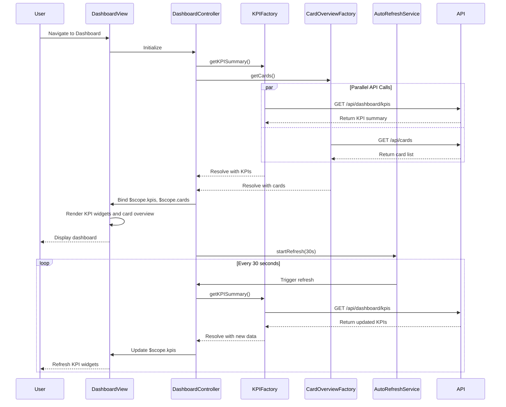

# Low-Level Design: Dashboard KPIs and Credit Card Overview
**Epic ID:** QE-8608

## a. Architecture Mapping

- **Dashboard Module** → AngularJS Module (`dashboardModule`)
- **Dashboard Controller** → Controller (`DashboardController`) - orchestrates KPI data retrieval and view binding
- **KPI Service** → Factory (`KPIFactory`) - fetches aggregated KPI data from API
- **Card Overview Service** → Factory (`CardOverviewFactory`) - retrieves multi-card details
- **KPI Widget Directive** → Directive (`kpiWidget`) - renders individual KPI card (spend, limit, available, outstanding)
- **Auto-Refresh Service** → Service (`AutoRefreshService`) - manages real-time data refresh intervals

**Folder Structure:**
```
/app
  /modules
    /dashboard
      dashboard.module.js
      dashboard.routes.js
      /controllers
        DashboardController.js
      /services
        KPIFactory.js
        CardOverviewFactory.js
        AutoRefreshService.js
      /directives
        kpiWidget.directive.js
      /views
        dashboard.html
```

## b. Component Specifications

| Name | Artifact Type | Responsibility | Key Dependencies |
|------|---------------|----------------|------------------|
| dashboardModule | Module | Registers dashboard components and dependencies | ngRoute, ui.bootstrap |
| DashboardController | Controller | Orchestrates KPI and card data loading, manages refresh logic | KPIFactory, CardOverviewFactory, AutoRefreshService, $scope |
| KPIFactory | Factory | Fetches consolidated KPI data (monthly spend, limits, outstanding) from API | $http, $q, API_CONFIG |
| CardOverviewFactory | Factory | Retrieves list of user's credit cards with balances | $http, API_CONFIG |
| kpiWidget | Directive | Renders responsive KPI card with icon, label, value, and trend | None |
| AutoRefreshService | Service | Manages interval-based data refresh (default 30s), provides start/stop methods | $interval |

## c. Data Model

**KPI Summary Object:**
```javascript
{
  monthlySpend: Number,
  totalCreditLimit: Number,
  availableCredit: Number,
  outstandingAmount: Number,
  currency: String
}
```

**Credit Card Object:**
```javascript
{
  cardId: String,
  cardName: String,
  cardNumber: String, // masked, e.g., '**** 1234'
  creditLimit: Number,
  availableCredit: Number,
  outstandingAmount: Number,
  status: String // 'active', 'blocked'
}
```

## d. Data Flow

User logs in and navigates to dashboard → DashboardController initializes and calls KPIFactory.getKPISummary() and CardOverviewFactory.getCards() → Both factories make GET requests to `/api/dashboard/kpis` and `/api/cards` with auth token → API aggregates data from Credit Card Data Service and Transaction Service, returns consolidated KPIs and card list → Controller binds data to $scope.kpis and $scope.cards → View renders KPI widgets using kpiWidget directive and card overview list → AutoRefreshService starts 30-second interval, triggering periodic re-fetch of KPI data → On each interval, controller updates $scope.kpis, causing automatic UI refresh via AngularJS data binding.

## e. Primary Sequence Diagram



## f. Implementation Notes

- Use Bootstrap grid system (col-md-3, col-sm-6, col-xs-12) for responsive KPI widget layout across desktop, tablet, mobile
- KPIFactory and CardOverviewFactory use $q.all() for parallel data fetching to minimize initial load time
- AutoRefreshService wraps $interval; controller calls startRefresh() on init and stopRefresh() on $destroy to prevent memory leaks
- kpiWidget directive uses isolated scope with bindToController for reusability; accepts kpiData object as input
- Implement loading spinner using ng-show bound to $scope.loading flag; set to true during API calls, false on resolution

## g. Error Handling

HTTP interceptor captures API errors and displays toast notification; controller sets fallback values (e.g., '--') for KPIs if API fails.

## h. Security Notes

Requires token-based auth via existing SSO; all API calls secured with JWT in Authorization header via AuthInterceptor.