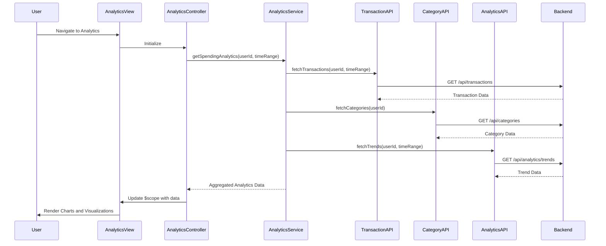

# Low-Level Design: QE-8609 - Spending Analytics and Insights

## a. Architecture Mapping

- **Analytics UI Layer** → AngularJS Module (`app.analytics`) with Controller (`AnalyticsController`), Directives for chart rendering (`spendingChart`, `categoryBreakdown`)
- **Analytics Service** → AngularJS Service (`AnalyticsService`) for orchestrating API calls and data aggregation
- **Transaction Service Integration** → AngularJS Factory (`TransactionAPI`) for REST API communication
- **Category Classification Service Integration** → AngularJS Factory (`CategoryAPI`) for category data retrieval
- **Analytics Engine Integration** → AngularJS Factory (`AnalyticsAPI`) for trend computation and insights

**Recommended Folder Structure:**
```
/app
  /modules
    /analytics
      analytics.module.js
      analytics.controller.js
      analytics.service.js
      analytics.directives.js
  /shared
    /services
      transaction-api.factory.js
      category-api.factory.js
      analytics-api.factory.js
  /assets
    /views
      analytics.html
```

## b. Component Specifications

| Name | Artifact Type | Responsibility | Key Dependencies |
|------|---------------|----------------|------------------|
| app.analytics | AngularJS Module | Root module for analytics feature | ngRoute, chart.js |
| AnalyticsController | Controller | Manages analytics view state, user interactions, and data binding | AnalyticsService, $scope |
| AnalyticsService | Service | Orchestrates data retrieval from multiple APIs and aggregates spending data | TransactionAPI, CategoryAPI, AnalyticsAPI, $q |
| TransactionAPI | Factory | Provides REST API interface for transaction data retrieval | $http, API_CONFIG |
| CategoryAPI | Factory | Provides REST API interface for category classification data | $http, API_CONFIG |
| AnalyticsAPI | Factory | Provides REST API interface for analytics engine (trends, insights) | $http, API_CONFIG |
| spendingChart | Directive | Renders interactive monthly spend trend chart using Chart.js | chart.js |
| categoryBreakdown | Directive | Renders category-wise spending breakdown pie/bar chart | chart.js |

## c. Data Model

**SpendingAnalytics Object:**
```javascript
{
  userId: String,
  monthlyTrends: Array<{month: String, totalSpend: Number}>,
  categoryBreakdown: Array<{category: String, amount: Number, percentage: Number}>,
  timeRange: {startDate: Date, endDate: Date},
  totalSpend: Number
}
```

**Transaction Object:**
```javascript
{
  transactionId: String,
  cardId: String,
  amount: Number,
  category: String,
  date: Date,
  description: String
}
```

**Category Object:**
```javascript
{
  categoryId: String,
  categoryName: String,
  totalAmount: Number,
  transactionCount: Number
}
```

## d. Data Flow

User navigates to analytics view, triggering AnalyticsController initialization. Controller invokes AnalyticsService.getSpendingAnalytics(), which makes parallel REST API calls via TransactionAPI (raw transactions), CategoryAPI (categorized data), and AnalyticsAPI (trends/insights). Service aggregates responses using $q.all(), transforms data into chart-ready format, and returns to controller. Controller updates $scope with analytics data, triggering Angular's digest cycle. Directives (spendingChart, categoryBreakdown) watch scope changes and render interactive Chart.js visualizations. User interactions (date range selection, category drill-down) trigger controller methods that repeat the data flow with updated parameters.

## e. Primary Sequence Diagram



## f. Implementation Notes

- Use AngularJS 1.x dependency injection for all services, factories, and controllers; register components via module.controller/service/factory methods
- Leverage $q.all() for parallel API calls to meet <1 second rendering NFR; implement client-side caching with $cacheFactory for 12-month historical data
- Integrate Chart.js via custom AngularJS directives with isolated scope; use directive link function to initialize charts and watch for data changes
- Apply ES6 arrow functions, const/let, template literals, and destructuring in all JavaScript code for modern syntax
- Implement API_CONFIG constant for base URLs and endpoints; use $http interceptors for authentication token injection and error handling

## g. Error Handling

HTTP interceptor-based error handling with $http response interceptor; catch API failures, display user-friendly notifications via toastr/growl, and log errors to console.

## h. Security Notes

Requires token-based auth via existing SSO; API calls include Authorization header with JWT token; standard input validation and secure API calls assumed.