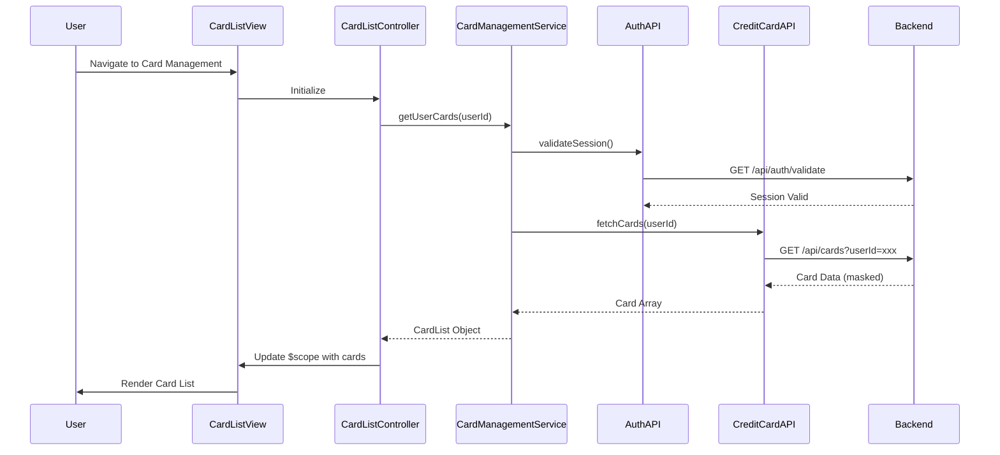

# Low-Level Design: QE-8610 - Multiple Credit Card Management

## a. Architecture Mapping

- **Card Management UI** → AngularJS Module (`app.cardManagement`) with Controller (`CardListController`), Directive (`cardListItem`)
- **Card Management Service** → AngularJS Service (`CardManagementService`) for orchestrating card data retrieval and formatting
- **Credit Card Data Service Integration** → AngularJS Factory (`CreditCardAPI`) for REST API communication
- **User Authentication Service Integration** → AngularJS Factory (`AuthAPI`) for authentication and authorization checks

**Recommended Folder Structure:**
```
/app
  /modules
    /card-management
      card-management.module.js
      card-list.controller.js
      card-management.service.js
      card-list-item.directive.js
  /shared
    /services
      credit-card-api.factory.js
      auth-api.factory.js
  /assets
    /views
      card-list.html
```

## b. Component Specifications

| Name | Artifact Type | Responsibility | Key Dependencies |
|------|---------------|----------------|------------------|
| app.cardManagement | AngularJS Module | Root module for card management feature | ngRoute, app.shared |
| CardListController | Controller | Manages card list view state, user interactions, and card display logic | CardManagementService, $scope |
| CardManagementService | Service | Orchestrates card data retrieval, formatting, and business logic for card operations | CreditCardAPI, AuthAPI, $q |
| CreditCardAPI | Factory | Provides REST API interface for credit card data retrieval | $http, API_CONFIG |
| AuthAPI | Factory | Provides REST API interface for user authentication and authorization | $http, API_CONFIG |
| cardListItem | Directive | Renders individual card item with masked card number and card details | None |

## c. Data Model

**CreditCard Object:**
```javascript
{
  cardId: String,
  userId: String,
  cardNumber: String, // masked (e.g., "**** **** **** 1234")
  cardType: String, // Visa, MasterCard, etc.
  cardHolderName: String,
  expiryDate: String,
  creditLimit: Number,
  availableCredit: Number,
  outstandingAmount: Number,
  lastTransactionDate: Date
}
```

**CardList Object:**
```javascript
{
  userId: String,
  cards: Array<CreditCard>,
  totalCards: Number,
  totalCreditLimit: Number,
  totalAvailableCredit: Number
}
```

## d. Data Flow

User authenticates and navigates to card management view, triggering CardListController initialization. Controller invokes CardManagementService.getUserCards(), which first calls AuthAPI to validate user session/token. Upon successful authentication, service calls CreditCardAPI.fetchCards(userId) to retrieve all cards via REST API GET /api/cards. Backend returns card data with masked card numbers. CreditCardAPI returns data to CardManagementService, which formats and aggregates card information (total cards, total credit limit, etc.). Service returns CardList object to controller, which updates $scope. Angular digest cycle triggers view update, rendering card list using cardListItem directive for each card. User interactions (view card details, filter cards) trigger controller methods that update scope and re-render view.

## e. Primary Sequence Diagram



## f. Implementation Notes

- Use AngularJS dependency injection for all components; register via module.controller/service/factory
- Implement client-side caching with $cacheFactory for card data to meet <300ms latency NFR; cache TTL set to 5 minutes
- Use ng-repeat with track by cardId in view for efficient rendering of up to 50 cards; apply one-time binding (::) for static card properties
- Apply ES6 const/let, arrow functions, and template literals throughout; use Array.map/filter for card data transformations
- Implement cardListItem directive with isolated scope and template for reusable card display component

## g. Error Handling

HTTP interceptor-based error handling; catch authentication failures and redirect to login; display API errors via toastr notifications.

## h. Security Notes

Requires token-based auth via existing SSO; card numbers are masked at backend before transmission; standard input validation and secure API calls assumed.