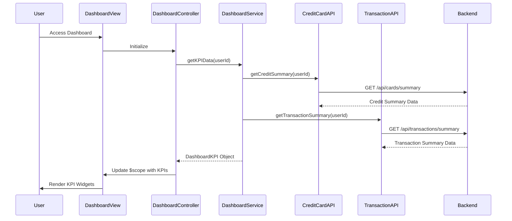

# Low-Level Design: QE-8611 - Credit Card Dashboard and KPIs

## a. Architecture Mapping

- **Dashboard UI Layer** → AngularJS Module (`app.dashboard`) with Controller (`DashboardController`), Directives for KPI widgets (`kpiWidget`)
- **Dashboard Service** → AngularJS Service (`DashboardService`) for orchestrating KPI data aggregation
- **Credit Card Data Service Integration** → AngularJS Factory (`CreditCardAPI`) for card details and credit limit data
- **Transaction Service Integration** → AngularJS Factory (`TransactionAPI`) for monthly spend and outstanding amounts

**Recommended Folder Structure:**
```
/app
  /modules
    /dashboard
      dashboard.module.js
      dashboard.controller.js
      dashboard.service.js
      kpi-widget.directive.js
  /shared
    /services
      credit-card-api.factory.js
      transaction-api.factory.js
  /assets
    /views
      dashboard.html
```

## b. Component Specifications

| Name | Artifact Type | Responsibility | Key Dependencies |
|------|---------------|----------------|------------------|
| app.dashboard | AngularJS Module | Root module for dashboard feature | ngRoute, app.shared |
| DashboardController | Controller | Manages dashboard view state, KPI data binding, and refresh logic | DashboardService, $scope, $interval |
| DashboardService | Service | Orchestrates parallel API calls to aggregate KPI data (monthly spend, credit limit, available credit, outstanding) | CreditCardAPI, TransactionAPI, $q |
| CreditCardAPI | Factory | Provides REST API interface for credit card data (limits, balances) | $http, API_CONFIG |
| TransactionAPI | Factory | Provides REST API interface for transaction data (monthly spend, outstanding amounts) | $http, API_CONFIG |
| kpiWidget | Directive | Renders individual KPI widget with label, value, and optional trend indicator | None |

## c. Data Model

**DashboardKPI Object:**
```javascript
{
  userId: String,
  monthlySpend: Number,
  totalCreditLimit: Number,
  availableCredit: Number,
  outstandingAmount: Number,
  creditUtilization: Number, // percentage
  lastUpdated: Date
}
```

**CreditCardSummary Object:**
```javascript
{
  totalCards: Number,
  totalCreditLimit: Number,
  totalAvailableCredit: Number
}
```

**TransactionSummary Object:**
```javascript
{
  monthlySpend: Number,
  outstandingAmount: Number,
  transactionCount: Number
}
```

## d. Data Flow

User accesses dashboard view, triggering DashboardController initialization. Controller invokes DashboardService.getKPIData(userId), which makes parallel REST API calls using $q.all() via CreditCardAPI.getCreditSummary() (for total credit limit, available credit) and TransactionAPI.getTransactionSummary() (for monthly spend, outstanding amounts). Both factories make GET requests to backend APIs. DashboardService aggregates responses, calculates derived metrics (credit utilization percentage), and returns DashboardKPI object to controller. Controller updates $scope with KPI data, triggering Angular digest cycle and view rendering via kpiWidget directives. For real-time refresh, controller uses $interval to poll DashboardService.getKPIData() every 30 seconds, updating scope and re-rendering KPIs.

## e. Primary Sequence Diagram



## f. Implementation Notes

- Use AngularJS dependency injection for all components; register via module.controller/service/factory
- Leverage $q.all() for parallel API calls to meet <2 second page load NFR; implement response caching with $cacheFactory (TTL: 30 seconds)
- Use $interval service for real-time KPI refresh every 30 seconds; cancel interval on $scope.$destroy to prevent memory leaks
- Apply ES6 const/let, arrow functions, destructuring, and template literals throughout JavaScript code
- Implement kpiWidget directive with isolated scope ({label: '@', value: '=', trend: '='}) for reusable KPI display; use Bootstrap grid for responsive layout

## g. Error Handling

HTTP interceptor-based error handling; catch API failures, display user notifications via toastr, retry failed requests once, and log errors to console.

## h. Security Notes

Requires token-based auth via existing SSO; API calls include Authorization header with JWT token; standard input validation and secure API calls assumed.