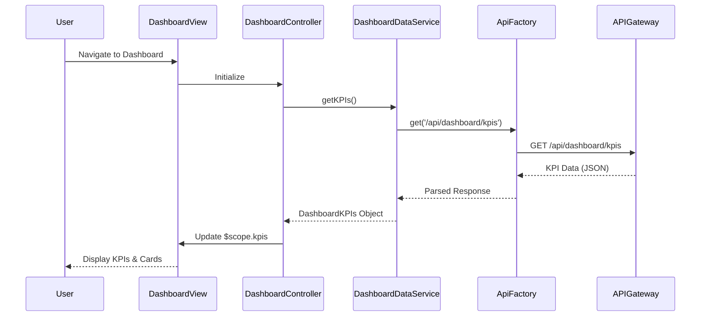

# Low-Level Design: QE-8612 - Dashboard KPIs and Credit Card Overview

## a. Architecture Mapping

- **Dashboard Module** → AngularJS Module (`app.dashboard`)
- **Dashboard UI Layer** → AngularJS Controller (`DashboardController`)
- **Data Aggregation Service** → AngularJS Service (`DashboardDataService`)
- **API Gateway Integration** → AngularJS Factory (`ApiFactory`)
- **User Authentication** → AngularJS Service (`AuthService`)

**Folder Structure:**
```
/app
  /modules
    /dashboard
      dashboard.module.js
      dashboard.controller.js
      dashboard.html
  /services
    dashboard-data.service.js
    auth.service.js
  /factories
    api.factory.js
  /models
    credit-card.model.js
```

## b. Component Specifications

| Name | Artifact Type | Responsibility | Key Dependencies |
|------|---------------|----------------|------------------|
| DashboardModule | Module | Root module for dashboard feature | ngRoute, ui.bootstrap |
| DashboardController | Controller | Manages dashboard view state and KPI display | DashboardDataService, $scope |
| DashboardDataService | Service | Fetches and aggregates credit card KPIs | ApiFactory, $http, $q |
| ApiFactory | Factory | Handles REST API calls with error handling | $http, AuthService |
| AuthService | Service | Manages user authentication and session | $http, $window |
| CreditCardModel | Model | Defines credit card data structure | None |

## c. Data Model

**CreditCard Object:**
```javascript
{
  cardId: String,
  cardNumber: String,
  cardType: String,
  creditLimit: Number,
  availableCredit: Number,
  outstandingAmount: Number,
  monthlySpend: Number,
  lastUpdated: Date
}
```

**DashboardKPIs Object:**
```javascript
{
  totalCreditLimit: Number,
  totalAvailableCredit: Number,
  totalOutstanding: Number,
  currentMonthSpend: Number,
  cards: Array<CreditCard>
}
```

## d. Data Flow

User loads dashboard → DashboardController initializes and calls DashboardDataService.getKPIs() → Service invokes ApiFactory.get('/api/dashboard/kpis') with auth token → API Gateway returns aggregated KPI data → Service transforms response into DashboardKPIs model → Controller updates $scope.kpis → View renders KPI cards and credit card list using Bootstrap grid → User sees monthly spend, total credit limit, available credit, and outstanding amounts.

## e. Primary Sequence Diagram



## f. Implementation Notes

- Use AngularJS 1.x Dependency Injection for all services and controllers with explicit array notation to avoid minification issues.
- Implement promise-based API calls using $q for chaining and error propagation; cache KPI data for 30 seconds using $cacheFactory.
- Apply Bootstrap responsive grid (col-xs, col-sm, col-md) for KPI cards to ensure mobile-first design.
- Use ES6 arrow functions and const/let in services; transpile with Babel if targeting older browsers.
- Integrate AuthService interceptor to attach JWT token to all outgoing API requests automatically.

## g. Error Handling

HTTP interceptor captures API errors; user-friendly notifications displayed via Bootstrap alerts with retry option for failed KPI loads.

## h. Security Notes

Requires token-based auth via existing SSO; all API calls include Authorization header with JWT token validated server-side.