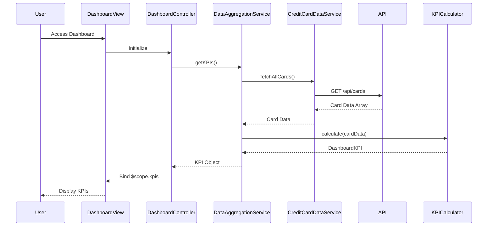

# Low-Level Design: Dashboard KPIs and Credit Card Overview
**Epic ID:** QE-8612  
**Feature:** Consolidated dashboard for credit card portfolio KPIs

---

## a. Architecture Mapping

| HLD Component | AngularJS Artifact | Mapping |
|---------------|-------------------|----------|
| Responsive Dashboard Interface | Module: `app.dashboard` | Main dashboard module |
| User Authentication Service | Service: `AuthService` | Handles user authentication and session |
| Data Aggregation Service | Service: `DataAggregationService` | Aggregates multi-card data |
| Credit Card Data Service | Service: `CreditCardDataService` | Fetches card details via REST API |
| KPI Calculation Engine | Factory: `KPICalculator` | Computes financial metrics |
| Dashboard View | Controller: `DashboardController` + View: `dashboard.html` | Renders KPI display |

**Recommended Folder Structure:**
```
app/
├── modules/
│   └── dashboard/
│       ├── dashboard.module.js
│       ├── dashboard.controller.js
│       ├── dashboard.html
│       └── dashboard.css
├── services/
│   ├── auth.service.js
│   ├── credit-card-data.service.js
│   └── data-aggregation.service.js
├── factories/
│   └── kpi-calculator.factory.js
└── app.js
```

---

## b. Component Specifications

| Component Name | Artifact Type | Responsibility | Key Dependencies |
|----------------|---------------|----------------|------------------|
| `app.dashboard` | Module | Dashboard feature module | `ngRoute`, `app.services` |
| `DashboardController` | Controller | Manages dashboard state and KPI display logic | `DataAggregationService`, `KPICalculator`, `$scope` |
| `AuthService` | Service | Validates user credentials and manages session | `$http`, `$window` (localStorage) |
| `CreditCardDataService` | Service | Retrieves card details and balances from REST API | `$http`, `API_ENDPOINTS` |
| `DataAggregationService` | Service | Orchestrates data fetching and aggregation | `CreditCardDataService`, `KPICalculator` |
| `KPICalculator` | Factory | Calculates monthly spend, credit limit, available credit, outstanding | None |
| `dashboard.html` | View | Responsive UI template with Bootstrap grid | Bootstrap 3.x, AngularJS directives |

---

## c. Data Model

```javascript
// CreditCard Model
const CreditCard = {
  cardId: String,
  cardNumber: String,        // Masked format: "****1234"
  cardType: String,          // "Visa", "Mastercard", etc.
  creditLimit: Number,
  availableCredit: Number,
  outstandingAmount: Number,
  monthlySpend: Number,
  expiryDate: String         // "MM/YYYY"
};

// DashboardKPI Model
const DashboardKPI = {
  totalCreditLimit: Number,
  totalAvailableCredit: Number,
  totalOutstanding: Number,
  totalMonthlySpend: Number,
  cardCount: Number,
  lastUpdated: Date
};
```

---

## d. Data Flow

User accesses dashboard → `AuthService` validates session → `DashboardController` initializes and calls `DataAggregationService.getKPIs()` → Service invokes `CreditCardDataService.fetchAllCards()` which makes GET request to `/api/cards` → Card data returned → `KPICalculator` computes aggregated metrics (sum of limits, available credit, outstanding, monthly spend) → `DataAggregationService` returns `DashboardKPI` object to controller → Controller binds data to `$scope.kpis` → View renders KPIs in responsive Bootstrap grid with real-time refresh via `$interval`.

---

## e. Primary Sequence Diagram



---

## f. Implementation Notes

- Use AngularJS 1.x Dependency Injection for all services and controllers
- Implement `$http` interceptor for authentication token injection and error handling
- Use `$interval` (5-second polling) for near real-time KPI refresh
- Apply Bootstrap responsive grid (col-md-3, col-sm-6, col-xs-12) for KPI cards
- Cache card data in service using simple object cache with TTL to meet 2-second load requirement

---

## g. Error Handling

HTTP interceptor captures API errors, displays user-friendly notifications via Bootstrap alerts, and logs to console.

---

## h. Security Notes

Requires token-based auth via existing SSO; card numbers masked at API layer before transmission.

---

**End of Document**