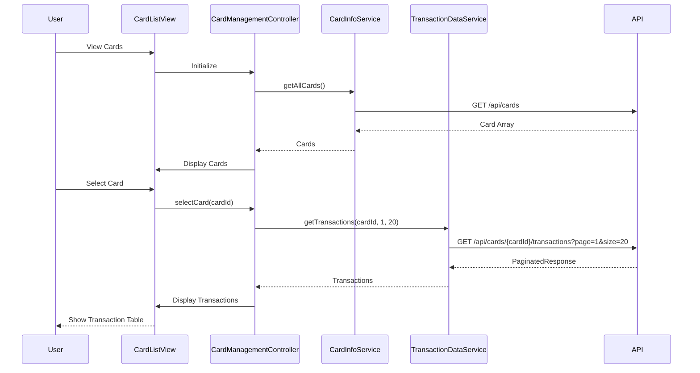

# Low-Level Design: Credit Card Management and Transactions
**Epic ID:** QE-8613  
**Feature:** Multi-card management with transaction history and drill-down

---

## a. Architecture Mapping

| HLD Component | AngularJS Artifact | Mapping |
|---------------|-------------------|----------|
| User Interface | Module: `app.cardManagement` | Card management feature module |
| Card Management Module | Controller: `CardManagementController` | Orchestrates card and transaction views |
| Transaction Data Service | Service: `TransactionDataService` | Fetches paginated transactions via REST |
| Credit Card Information Service | Service: `CardInfoService` | Retrieves card metadata |
| User Profile Service | Service: `UserProfileService` | Validates card ownership |
| Transaction History Store | REST API Endpoint | Backend data source |

**Recommended Folder Structure:**
```
app/
├── modules/
│   └── card-management/
│       ├── card-management.module.js
│       ├── card-management.controller.js
│       ├── card-list.html
│       ├── card-detail.html
│       └── transaction-list.component.js
├── services/
│   ├── transaction-data.service.js
│   ├── card-info.service.js
│   └── user-profile.service.js
└── app.js
```

---

## b. Component Specifications

| Component Name | Artifact Type | Responsibility | Key Dependencies |
|----------------|---------------|----------------|------------------|
| `app.cardManagement` | Module | Card management feature module | `ngRoute`, `ui.bootstrap` (pagination) |
| `CardManagementController` | Controller | Manages card list, selection, and transaction display | `CardInfoService`, `TransactionDataService`, `$scope`, `$routeParams` |
| `TransactionDataService` | Service | Fetches paginated transaction history from API | `$http`, `API_ENDPOINTS` |
| `CardInfoService` | Service | Retrieves card details and metadata | `$http`, `API_ENDPOINTS` |
| `UserProfileService` | Service | Validates user ownership of cards | `$http`, `AuthService` |
| `TransactionListComponent` | Component | Reusable component for displaying transactions with filters | `TransactionDataService` |
| `card-list.html` | View | Displays all user cards in grid layout | Bootstrap, AngularJS directives |
| `card-detail.html` | View | Shows individual card details with transaction history | Bootstrap table, pagination directive |

---

## c. Data Model

```javascript
// CreditCard Model
const CreditCard = {
  cardId: String,
  cardNumber: String,        // Masked: "****1234"
  cardType: String,
  cardHolderName: String,
  creditLimit: Number,
  availableCredit: Number,
  outstandingAmount: Number,
  expiryDate: String,
  status: String             // "Active", "Blocked", etc.
};

// Transaction Model
const Transaction = {
  transactionId: String,
  cardId: String,
  date: Date,
  merchant: String,
  category: String,          // "Food & Dining", "Fuel", etc.
  amount: Number,
  type: String,              // "Debit", "Credit"
  status: String             // "Posted", "Pending"
};

// PaginatedTransactionResponse
const PaginatedResponse = {
  transactions: Array<Transaction>,
  totalCount: Number,
  pageNumber: Number,
  pageSize: Number
};
```

---

## d. Data Flow

User navigates to card management → `CardManagementController` calls `UserProfileService.validateOwnership()` → Service confirms user access → Controller invokes `CardInfoService.getAllCards()` which makes GET to `/api/cards` → Card list displayed → User selects specific card → Controller calls `TransactionDataService.getTransactions(cardId, page, pageSize)` → Service makes GET to `/api/cards/{cardId}/transactions?page=1&size=20` → Paginated transactions returned → `TransactionListComponent` renders table with sorting/filtering → User interacts with pagination controls → New page fetched and displayed.

---

## e. Primary Sequence Diagram



---

## f. Implementation Notes

- Use `ui-router` for nested views (card list → card detail with transactions)
- Implement `ui.bootstrap.pagination` directive for transaction pagination
- Apply client-side filtering using AngularJS `filter` for transaction search by merchant/category
- Use `$q` promises for chaining service calls (card validation → card fetch → transaction fetch)
- Cache card list in service to avoid redundant API calls during navigation

---

## g. Error Handling

HTTP interceptor with try/catch in controllers; display Bootstrap modal for critical errors and inline alerts for validation failures.

---

## h. Security Notes

Requires token-based auth via existing SSO; validate card ownership server-side before returning transactions.

---

**End of Document**