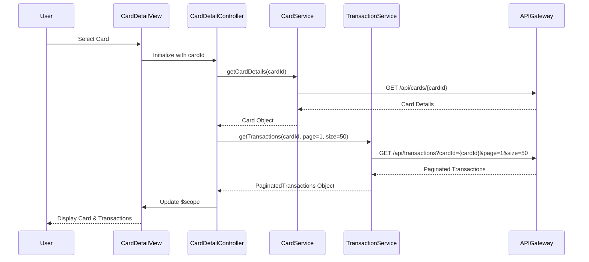

# Low-Level Design: QE-8613 - Credit Card Management and Transactions

## a. Architecture Mapping

- **Card Management Module** → AngularJS Module (`app.cardManagement`)
- **Card Management UI** → AngularJS Controller (`CardManagementController`)
- **Transaction Data Service** → AngularJS Service (`TransactionService`)
- **Card Management Service** → AngularJS Service (`CardService`)
- **User Profile Service** → AngularJS Service (`UserProfileService`)
- **Pagination Component** → AngularJS Directive (`paginationDirective`)

**Folder Structure:**
```
/app
  /modules
    /card-management
      card-management.module.js
      card-management.controller.js
      card-detail.controller.js
      card-management.html
      card-detail.html
  /services
    card.service.js
    transaction.service.js
    user-profile.service.js
  /directives
    pagination.directive.js
  /models
    transaction.model.js
```

## b. Component Specifications

| Name | Artifact Type | Responsibility | Key Dependencies |
|------|---------------|----------------|------------------|
| CardManagementModule | Module | Root module for card and transaction management | ngRoute, ui.bootstrap |
| CardManagementController | Controller | Manages card list view and filtering | CardService, $scope |
| CardDetailController | Controller | Manages individual card detail and transaction view | TransactionService, CardService, $routeParams |
| CardService | Service | Fetches card details and validates ownership | ApiFactory, UserProfileService |
| TransactionService | Service | Retrieves paginated transaction history | ApiFactory, $http |
| UserProfileService | Service | Validates user-card ownership | ApiFactory, $http |
| PaginationDirective | Directive | Reusable pagination control for transactions | None |

## c. Data Model

**Transaction Object:**
```javascript
{
  transactionId: String,
  cardId: String,
  amount: Number,
  merchantName: String,
  category: String,
  transactionDate: Date,
  description: String,
  status: String
}
```

**Card Object:**
```javascript
{
  cardId: String,
  cardNumber: String,
  cardType: String,
  creditLimit: Number,
  availableCredit: Number,
  outstandingAmount: Number,
  status: String
}
```

**PaginatedTransactions Object:**
```javascript
{
  transactions: Array<Transaction>,
  currentPage: Number,
  totalPages: Number,
  pageSize: Number,
  totalCount: Number
}
```

## d. Data Flow

User selects a credit card from dashboard → CardDetailController loads with cardId from $routeParams → Controller calls CardService.getCardDetails(cardId) to fetch card metadata → UserProfileService validates ownership → CardService returns card details → Controller calls TransactionService.getTransactions(cardId, page, pageSize) → Service invokes API with pagination params → API returns paginated transaction list → Controller updates $scope.transactions and $scope.card → View renders card details and transaction table with pagination controls → User navigates pages or filters by card.

## e. Primary Sequence Diagram



## f. Implementation Notes

- Use AngularJS $routeParams to extract cardId from URL for deep linking to card details.
- Implement pagination directive with isolated scope for reusability across transaction and other list views.
- Apply ES6 template literals for constructing API URLs with query parameters; use $httpParamSerializer for complex filters.
- Cache card details using $cacheFactory with 5-minute TTL to reduce redundant API calls during navigation.
- Use ng-repeat with track by transactionId for efficient DOM rendering of large transaction lists.

## g. Error Handling

HTTP interceptor with try/catch blocks in services; display user-friendly error messages via toastr notifications for failed card or transaction loads.

## h. Security Notes

Requires token-based auth via existing SSO; UserProfileService validates card ownership server-side before returning data.