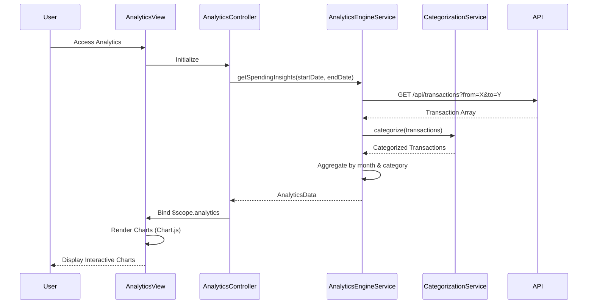

# Low-Level Design: Spending Analytics and Insights
**Epic ID:** QE-8614  
**Feature:** Interactive spending analytics with category-wise visualization

---

## a. Architecture Mapping

| HLD Component | AngularJS Artifact | Mapping |
|---------------|-------------------|----------|
| User Dashboard | Module: `app.analytics` | Analytics feature module |
| Analytics Engine | Service: `AnalyticsEngineService` | Processes and aggregates transaction data |
| Transaction Categorization Service | Service: `CategorizationService` | Classifies transactions into 9 categories |
| Historical Transaction Data Store | REST API Endpoint | Backend transaction repository |
| Visualization Library | Directive: `chartDirective` (using Chart.js) | Renders interactive charts |

**Recommended Folder Structure:**
```
app/
├── modules/
│   └── analytics/
│       ├── analytics.module.js
│       ├── analytics.controller.js
│       ├── analytics.html
│       └── analytics.css
├── services/
│   ├── analytics-engine.service.js
│   └── categorization.service.js
├── directives/
│   └── chart.directive.js
└── app.js
```

---

## b. Component Specifications

| Component Name | Artifact Type | Responsibility | Key Dependencies |
|----------------|---------------|----------------|------------------|
| `app.analytics` | Module | Analytics feature module | `ngRoute`, `chart.js` |
| `AnalyticsController` | Controller | Manages analytics view state and user interactions | `AnalyticsEngineService`, `$scope`, `$filter` |
| `AnalyticsEngineService` | Service | Aggregates transactions by month, card, and category | `$http`, `CategorizationService`, `API_ENDPOINTS` |
| `CategorizationService` | Service | Maps transactions to 9 predefined categories | None (rule-based logic) |
| `chartDirective` | Directive | Wraps Chart.js for rendering line/bar/pie charts | `Chart.js` library |
| `analytics.html` | View | Displays trend charts and category breakdowns | Bootstrap grid, chart directives |

---

## c. Data Model

```javascript
// Transaction Model (input)
const Transaction = {
  transactionId: String,
  cardId: String,
  date: Date,
  merchant: String,
  amount: Number,
  category: String           // Auto-assigned or pre-categorized
};

// MonthlySpendTrend Model
const MonthlySpendTrend = {
  month: String,             // "2024-01"
  totalSpend: Number,
  transactionCount: Number
};

// CategorySpend Model
const CategorySpend = {
  category: String,          // "Food & Dining", "Fuel", etc.
  totalAmount: Number,
  percentage: Number,
  transactionCount: Number
};

// AnalyticsData Model (output)
const AnalyticsData = {
  monthlyTrends: Array<MonthlySpendTrend>,
  categoryBreakdown: Array<CategorySpend>,
  cardWiseSpend: Object      // { cardId: totalSpend }
};
```

---

## d. Data Flow

User accesses analytics dashboard → `AnalyticsController` calls `AnalyticsEngineService.getSpendingInsights(startDate, endDate)` → Service makes GET to `/api/transactions?from=2023-01-01&to=2024-01-01` → Transactions retrieved → `CategorizationService` classifies each transaction into one of 9 categories → `AnalyticsEngineService` aggregates by month (for trends) and by category (for breakdown) → Service returns `AnalyticsData` object → Controller binds to `$scope.analytics` → `chartDirective` renders monthly trend line chart and category pie chart → User interacts with charts for drill-down (e.g., click category to see transactions).

---

## e. Primary Sequence Diagram



---

## f. Implementation Notes

- Use Chart.js 2.x wrapped in AngularJS directive for responsive charts (line for trends, pie/doughnut for categories)
- Implement client-side aggregation using ES6 `reduce()` and `Map` for performance with up to 10K transactions
- Use AngularJS `$filter('date')` for formatting month labels
- Apply debouncing on date range filters to avoid excessive API calls
- Store categorization rules in `CategorizationService` as constant mapping (merchant patterns → category)

---

## g. Error Handling

HTTP interceptor with fallback to cached data if API fails; display warning banner if data is stale.

---

## h. Security Notes

Standard input validation and secure API calls assumed; ensure date range parameters are sanitized.

---

**End of Document**