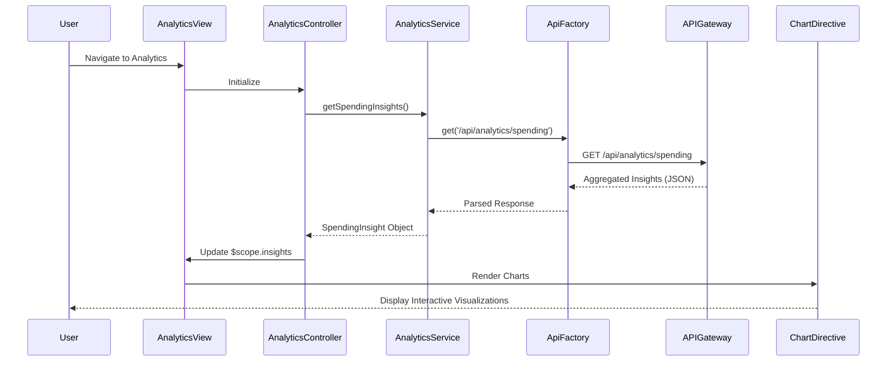

# Low-Level Design: QE-8614 - Spending Analytics and Insights

## a. Architecture Mapping

- **Analytics Module** → AngularJS Module (`app.analytics`)
- **Analytics UI** → AngularJS Controller (`AnalyticsController`)
- **Analytics Engine** → AngularJS Service (`AnalyticsService`)
- **Transaction Categorization Service** → AngularJS Service (`CategoryService`)
- **Visualization Service** → AngularJS Directive (`chartDirective`)
- **Chart Rendering Library** → Third-party (Chart.js via angular-chart.js)

**Folder Structure:**
```
/app
  /modules
    /analytics
      analytics.module.js
      analytics.controller.js
      analytics.html
  /services
    analytics.service.js
    category.service.js
  /directives
    chart.directive.js
  /models
    spending-insight.model.js
```

## b. Component Specifications

| Name | Artifact Type | Responsibility | Key Dependencies |
|------|---------------|----------------|------------------|
| AnalyticsModule | Module | Root module for analytics and insights | ngRoute, chart.js, angular-chart.js |
| AnalyticsController | Controller | Manages analytics view and chart interactions | AnalyticsService, $scope |
| AnalyticsService | Service | Fetches and processes spending insights | ApiFactory, CategoryService, $http |
| CategoryService | Service | Provides category metadata and validation | None |
| ChartDirective | Directive | Wraps Chart.js for rendering interactive charts | chart.js |

## c. Data Model

**SpendingInsight Object:**
```javascript
{
  monthlyTrends: Array<{month: String, amount: Number}>,
  cardWiseSpend: Array<{cardId: String, cardName: String, amount: Number}>,
  categoryWiseSpend: Array<{category: String, amount: Number, percentage: Number}>
}
```

**Category Enum:**
```javascript
['Food & Dining', 'Fuel', 'Shopping', 'Travel', 'Entertainment', 'Utilities', 'Healthcare', 'Education', 'Miscellaneous']
```

## d. Data Flow

User navigates to analytics dashboard → AnalyticsController initializes and calls AnalyticsService.getSpendingInsights() → Service invokes ApiFactory.get('/api/analytics/spending') → API Gateway queries Historical Transaction Data Store and returns pre-aggregated insights → Service transforms response into SpendingInsight model with monthly trends, card-wise spend, and category-wise breakdowns → Controller updates $scope.insights → ChartDirective renders three interactive charts (line chart for monthly trends, bar chart for card-wise spend, pie chart for category-wise spend) using Chart.js → User interacts with charts to drill down into specific periods or categories.

## e. Primary Sequence Diagram



## f. Implementation Notes

- Integrate angular-chart.js wrapper for Chart.js to leverage AngularJS data binding with reactive chart updates.
- Use ES6 Array.map() and Array.reduce() in AnalyticsService for client-side data transformation if needed for chart formatting.
- Apply responsive chart options (maintainAspectRatio: false) to ensure smooth rendering across desktop, tablet, and mobile devices.
- Cache analytics data for 60 seconds using $cacheFactory to minimize redundant API calls during user interactions.
- Use AngularJS $filter for formatting currency and percentages in chart tooltips and labels.

## g. Error Handling

HTTP interceptor captures analytics API errors; fallback to empty state with user notification via Bootstrap alert and retry button.

## h. Security Notes

Standard input validation and secure API calls assumed; analytics endpoints require authenticated user session with valid JWT token.