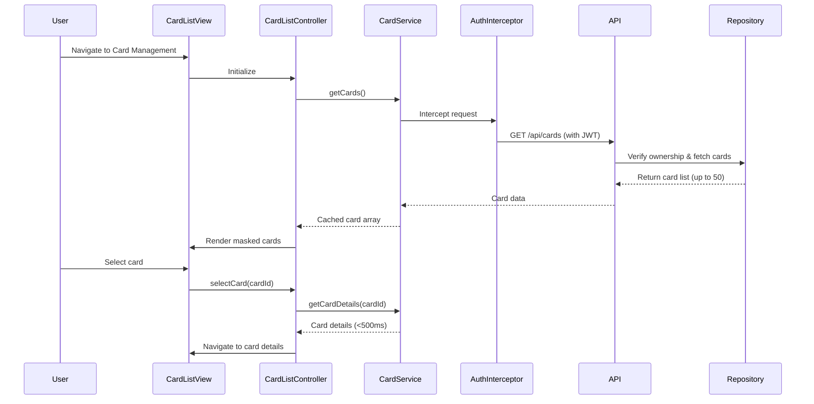

# Low-Level Design: QE-8615 - Credit Card Management and Viewing

## a. Architecture Mapping

- **Card Management Module** → AngularJS Module (`app.cardManagement`)
- **Card List Controller** → AngularJS Controller (`CardListController`) - manages card listing and selection
- **Card Details Controller** → AngularJS Controller (`CardDetailsController`) - handles individual card view
- **Card Service** → AngularJS Service (`CardService`) - REST API integration for card data
- **Auth Interceptor** → AngularJS Factory (`AuthInterceptor`) - injects auth tokens and verifies ownership
- **Card Masking Filter** → AngularJS Filter (`cardMask`) - masks sensitive card numbers

**Folder Structure:**
```
/app
  /modules
    /card-management
      card-list.controller.js
      card-details.controller.js
      card.service.js
      card-management.module.js
  /common
    /filters
      card-mask.filter.js
    /interceptors
      auth.interceptor.js
  /views
    /card-management
      card-list.html
      card-details.html
```

## b. Component Specifications

| Name | Artifact Type | Responsibility | Key Dependencies |
|------|---------------|----------------|------------------|
| CardManagementModule | Module | Root module for card management features | ngRoute, CardService |
| CardListController | Controller | Display list of up to 50 cards, handle card selection | CardService, $scope, $location |
| CardDetailsController | Controller | Display individual card details and card-wise spend | CardService, SpendAnalysisService, $routeParams |
| CardService | Service | REST API calls for card CRUD, caching for <500ms response | $http, $q, AuthInterceptor |
| SpendAnalysisService | Service | Fetch card-specific spending data | $http, TransactionService |
| AuthInterceptor | Factory | Inject JWT token, verify card ownership | $window, AuthService |
| cardMask Filter | Filter | Mask card numbers to **** **** **** 1234 format | None |

## c. Data Model

```javascript
// Card Model
{
  cardId: String,              // Unique card identifier
  userId: String,              // Owner user ID
  cardLabel: String,           // User-defined card label
  cardNumber: String,          // Full card number (masked in UI)
  maskedNumber: String,        // Pre-masked number for display
  issuer: String,              // Card issuer (Visa, MasterCard, etc.)
  cardType: String,            // Credit/Debit
  creditLimit: Number,         // Total credit limit
  availableCredit: Number,     // Available credit
  outstandingAmount: Number,   // Current outstanding
  expiryDate: String,          // MM/YY format
  status: String               // Active/Inactive
}

// CardSpend Model
{
  cardId: String,
  monthlySpend: Number,
  categoryBreakdown: Array     // Array of {category: String, amount: Number}
}
```

## d. Data Flow

User logs in and navigates to card management → CardListController requests user's cards via CardService → AuthInterceptor injects token and verifies ownership → CardService calls GET /api/cards REST endpoint → Credit Card Data Repository returns card list (cached for fast switching) → Controller applies cardMask filter and renders list in view → User selects a card → CardDetailsController loads via $routeParams → CardService retrieves cached card details (<500ms) → SpendAnalysisService fetches card-wise spend from Transaction API → View updates with masked card details and spending data.

## e. Primary Sequence Diagram



## f. Implementation Notes

- Use AngularJS $http service with response caching (`cache: true`) to achieve <500ms card switching response time.
- Implement cardMask filter using ES6 template literals: `card.cardNumber.slice(-4).padStart(16, '*').match(/.{1,4}/g).join(' ')`.
- Dependency Injection: Inject CardService and AuthInterceptor into all controllers; use strict DI annotation (`$inject` or array syntax).
- REST API integration: Base URL configured in module constant; all endpoints prefixed with `/api/cards`.
- Card list pagination: Use ng-repeat with limitTo filter if user has >20 cards for performance.

## g. Error Handling

HTTP interceptor captures 401/403 errors for unauthorized card access and redirects to login; service-level try/catch with $q.reject() propagates errors to controllers for user notification via Bootstrap alerts.

## h. Security Notes

Requires token-based auth via existing SSO; AuthInterceptor injects JWT in Authorization header; card numbers masked client-side and server returns pre-masked data; ownership verification enforced at API layer.