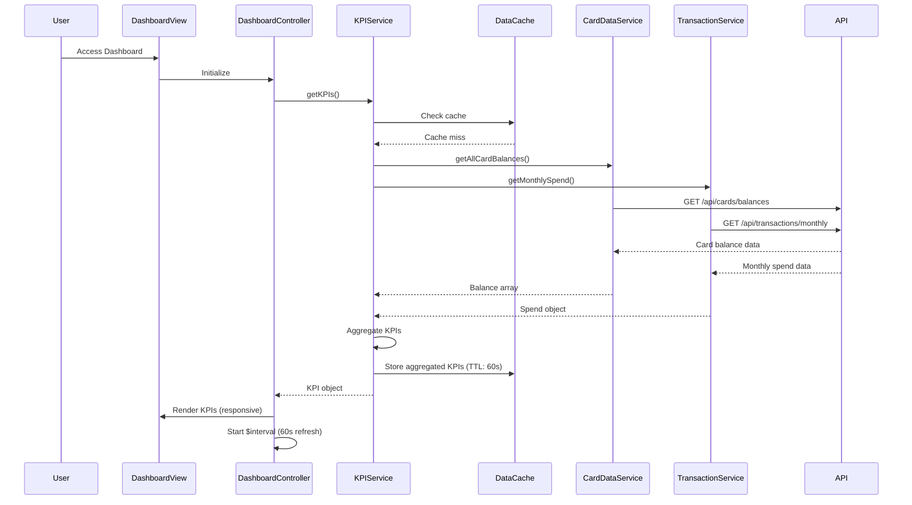

# Low-Level Design: QE-8616 - Credit Card Dashboard and KPI Management

## a. Architecture Mapping

- **Dashboard Module** → AngularJS Module (`app.dashboard`)
- **Dashboard Controller** → AngularJS Controller (`DashboardController`) - manages KPI display and refresh
- **KPI Service** → AngularJS Service (`KPIService`) - aggregates KPI data from multiple sources
- **Card Data Service** → AngularJS Service (`CardDataService`) - fetches card balances and limits
- **Transaction Service** → AngularJS Service (`TransactionService`) - retrieves monthly spend data
- **Cache Factory** → AngularJS Factory (`DataCacheFactory`) - implements cache layer for real-time refresh

**Folder Structure:**
```
/app
  /modules
    /dashboard
      dashboard.controller.js
      kpi.service.js
      dashboard.module.js
  /common
    /services
      card-data.service.js
      transaction.service.js
    /factories
      data-cache.factory.js
  /views
    /dashboard
      dashboard.html
  /styles
    dashboard.css (responsive Bootstrap grid)
```

## b. Component Specifications

| Name | Artifact Type | Responsibility | Key Dependencies |
|------|---------------|----------------|------------------|
| DashboardModule | Module | Root module for dashboard and KPI features | ngRoute, KPIService |
| DashboardController | Controller | Display KPIs, handle real-time refresh, responsive layout | KPIService, $scope, $interval |
| KPIService | Service | Aggregate KPIs from card and transaction data | CardDataService, TransactionService, DataCacheFactory |
| CardDataService | Service | REST API calls for card balances, limits, outstanding amounts | $http, $q |
| TransactionService | Service | REST API calls for monthly spend calculation | $http, $q |
| DataCacheFactory | Factory | Cache layer with TTL for real-time refresh and <2s load | $cacheFactory |

## c. Data Model

```javascript
// KPI Model
{
  totalCreditLimit: Number,      // Sum of all card limits
  availableCredit: Number,       // Sum of all available credit
  totalOutstanding: Number,      // Sum of all outstanding amounts
  monthlySpend: Number,          // Current month total spend
  utilizationRate: Number,       // (totalOutstanding / totalCreditLimit) * 100
  lastUpdated: Date              // Timestamp of last refresh
}

// CardBalance Model
{
  cardId: String,
  creditLimit: Number,
  availableCredit: Number,
  outstandingAmount: Number
}

// MonthlySpend Model
{
  currentMonth: String,          // YYYY-MM format
  totalSpend: Number,
  transactionCount: Number
}
```

## d. Data Flow

User accesses dashboard → DashboardController initializes and calls KPIService.getKPIs() → KPIService checks DataCacheFactory for cached data (TTL: 60s) → If cache miss, parallel requests to CardDataService.getAllCardBalances() and TransactionService.getMonthlySpend() → CardDataService calls GET /api/cards/balances → TransactionService calls GET /api/transactions/monthly → Both services return data → KPIService aggregates totals (sum limits, available credit, outstanding, monthly spend) → Calculated KPIs stored in cache → KPIService returns aggregated KPI object to controller → DashboardController binds to view with Bootstrap responsive grid → $interval triggers auto-refresh every 60s for real-time updates.

## e. Primary Sequence Diagram



## f. Implementation Notes

- Use Bootstrap grid system (col-xs, col-sm, col-md, col-lg) for responsive KPI cards across devices.
- Implement DataCacheFactory with $cacheFactory and custom TTL logic; cache key: 'dashboard-kpis'.
- Use $q.all() in KPIService to parallelize CardDataService and TransactionService calls for <2s load time.
- Real-time refresh: $interval service triggers KPIService.getKPIs() every 60 seconds; cancel interval on $scope.$destroy.
- KPI aggregation: Use ES6 Array.reduce() for summing card balances and calculating totals.

## g. Error Handling

HTTP interceptor-based error handling with fallback to cached data if API calls fail; user notified via Bootstrap alert component for network errors; $q.reject() propagates errors to controller.

## h. Security Notes

Standard input validation and secure API calls assumed; API endpoints require authentication token; no sensitive data exposed in client-side aggregation logic.