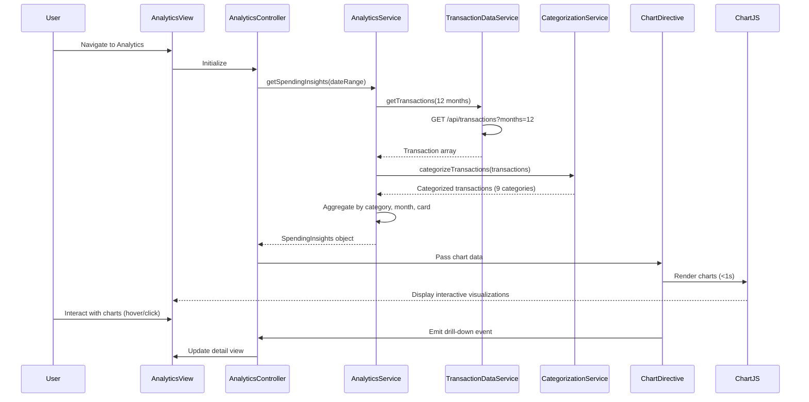

# Low-Level Design: QE-8617 - Transaction Analytics and Spending Insights

## a. Architecture Mapping

- **Analytics Module** → AngularJS Module (`app.analytics`)
- **Analytics Controller** → AngularJS Controller (`AnalyticsController`) - manages chart interactions and data display
- **Analytics Service** → AngularJS Service (`AnalyticsService`) - aggregates and processes transaction data
- **Transaction Data Service** → AngularJS Service (`TransactionDataService`) - fetches transaction history
- **Categorization Service** → AngularJS Service (`CategorizationService`) - classifies transactions into 9 categories
- **Chart Directive** → AngularJS Directive (`spendingChart`) - wraps charting library for interactive visualizations

**Folder Structure:**
```
/app
  /modules
    /analytics
      analytics.controller.js
      analytics.service.js
      analytics.module.js
  /common
    /services
      transaction-data.service.js
      categorization.service.js
    /directives
      spending-chart.directive.js
  /views
    /analytics
      analytics.html
  /styles
    analytics.css (responsive chart containers)
```

## b. Component Specifications

| Name | Artifact Type | Responsibility | Key Dependencies |
|------|---------------|----------------|------------------|
| AnalyticsModule | Module | Root module for transaction analytics features | ngRoute, AnalyticsService, Chart.js |
| AnalyticsController | Controller | Handle user interactions, filter selection, date range | AnalyticsService, $scope, $filter |
| AnalyticsService | Service | Aggregate data by category, time, card; format for charts | TransactionDataService, CategorizationService |
| TransactionDataService | Service | REST API calls for transaction history (12 months) | $http, $q |
| CategorizationService | Service | Classify transactions into 9 categories | None (rule-based or API-based) |
| spendingChart Directive | Directive | Render interactive charts (bar, pie, line) using Chart.js | Chart.js library |

## c. Data Model

```javascript
// Transaction Model
{
  transactionId: String,
  cardId: String,
  amount: Number,
  category: String,             // One of 9 categories
  merchantName: String,
  transactionDate: Date,        // ISO format
  description: String
}

// CategorySpend Model
{
  category: String,             // Food & Dining, Fuel, Shopping, Travel, Entertainment, Utilities, Healthcare, Education, Miscellaneous
  totalAmount: Number,
  transactionCount: Number,
  percentage: Number            // % of total spend
}

// MonthlyTrend Model
{
  month: String,                // YYYY-MM format
  totalSpend: Number,
  categoryBreakdown: Array      // Array of CategorySpend
}

// SpendingInsights Model
{
  categorySpends: Array,        // Array of CategorySpend (9 categories)
  monthlyTrends: Array,         // Array of MonthlyTrend (12 months)
  cardWiseSpend: Array,         // Array of {cardId, totalSpend, categories}
  topCategory: String,          // Highest spend category
  totalSpend: Number
}
```

## d. Data Flow

User navigates to analytics view → AnalyticsController calls AnalyticsService.getSpendingInsights(dateRange, cardId) → AnalyticsService requests raw transactions via TransactionDataService.getTransactions(12 months) → API returns transaction history → CategorizationService classifies each transaction into one of 9 categories (Food & Dining, Fuel, Shopping, Travel, Entertainment, Utilities, Healthcare, Education, Miscellaneous) → AnalyticsService aggregates by category, month, and card using ES6 Array.reduce() → Formatted data passed to spendingChart directive → Chart.js renders interactive visualizations (category pie chart, monthly trend line chart, card-wise bar chart) within 1 second → User interacts with charts (hover, click) to drill down into spending patterns.

## e. Primary Sequence Diagram



## f. Implementation Notes

- Use Chart.js library via spendingChart directive; directive isolate scope with data binding: `scope: {chartData: '=', chartType: '@'}`.
- Categorization: If API-based, CategorizationService calls GET /api/categorize; if rule-based, implement ES6 Map with merchant patterns.
- Data aggregation: Use ES6 Array.reduce() and Map for efficient category/month/card grouping; optimize for <1s render time.
- Responsive charts: Chart.js responsive option enabled; container uses Bootstrap col classes for mobile/tablet/desktop.
- Historical data: TransactionDataService caches 12-month data; refresh on date range change or manual user trigger.

## g. Error Handling

HTTP interceptor captures API errors; AnalyticsService returns empty dataset on failure with user notification via Bootstrap alert; Chart.js gracefully handles empty data with "No data available" message.

## h. Security Notes

Standard input validation and secure API calls assumed; transaction data filtered by authenticated user's cards only; no PII exposed in client-side aggregation.