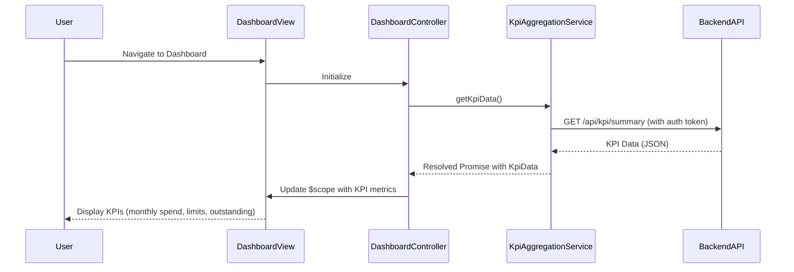

# Low-Level Design: QE-8618 - Dashboard and KPI Management

## a. Architecture Mapping

- **Dashboard UI Component** → AngularJS Module: `dashboardModule` + Controller: `DashboardController` + View: `dashboard.html`
- **KPI Aggregation Service** → AngularJS Service: `KpiAggregationService` (handles REST API calls to backend)
- **User Authentication Service** → AngularJS Factory: `AuthFactory` (manages authentication state and tokens)
- **Credit Card Data Service** → Backend REST API (consumed by `KpiAggregationService`)

**Recommended Folder Structure:**
```
/app
  /modules
    /dashboard
      dashboard.module.js
      dashboard.controller.js
      dashboard.html
  /services
    kpi-aggregation.service.js
  /factories
    auth.factory.js
  /models
    kpi-data.model.js
```

## b. Component Specifications

| Name | Artifact Type | Responsibility | Key Dependencies |
|------|---------------|----------------|------------------|
| dashboardModule | AngularJS Module | Entry point for dashboard feature, registers all dashboard components | angular, ui.router |
| DashboardController | Controller | Manages dashboard view state, fetches KPI data, handles user interactions | KpiAggregationService, AuthFactory, $scope |
| KpiAggregationService | Service | Fetches KPI data from backend REST API, caches responses for performance | $http, $q, AuthFactory |
| AuthFactory | Factory | Provides authentication tokens and validates user session | $window, $http |
| dashboard.html | View Template | Displays KPI metrics (monthly spend, credit limit, available credit, outstanding) with responsive layout | Bootstrap CSS, AngularJS directives |

## c. Data Model

**KpiData Model:**
```javascript
{
  userId: String,
  monthlySpend: Number,
  totalCreditLimit: Number,
  availableCredit: Number,
  outstandingAmount: Number,
  lastUpdated: Date
}
```

## d. Data Flow

User authenticates via AuthFactory → DashboardController initializes and calls KpiAggregationService.getKpiData() → Service sends GET request to `/api/kpi/summary` with auth token → Backend aggregates card balances and transaction data → Response cached in service → KpiData model populated and bound to $scope → View updates with KPI metrics displayed in responsive Bootstrap cards.

## e. Primary Sequence Diagram



## f. Implementation Notes

- Use AngularJS Dependency Injection for all services and factories to enable testability
- Implement $http interceptor in KpiAggregationService to attach auth tokens automatically
- Cache KPI data using $cacheFactory with 5-minute TTL to meet 2-second load requirement
- Use Bootstrap grid system (col-md-3) for responsive KPI card layout across devices
- Leverage ES6 arrow functions and const/let in service implementations

## g. Error Handling

HTTP interceptor captures API errors; user-facing notifications displayed via Bootstrap alerts with retry option.

## h. Security Notes

Requires token-based auth via existing SSO; all API calls include Authorization header with JWT token.