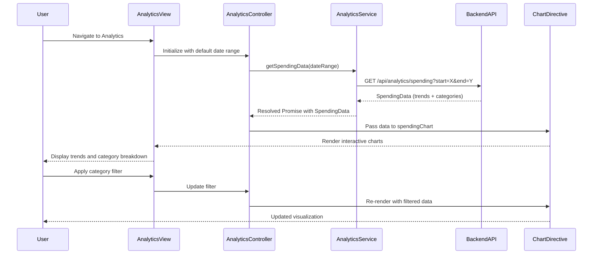

# Low-Level Design: QE-8619 - Analytics and Spending Insights

## a. Architecture Mapping

- **User Analytics Interface** → AngularJS Module: `analyticsModule` + Controller: `AnalyticsController` + View: `analytics.html`
- **Visualization Component** → AngularJS Directive: `spendingChart` (wraps Chart.js library)
- **Analytics Engine** → AngularJS Service: `AnalyticsService` (handles REST API calls and data transformation)
- **Transaction Categorization Service** → Backend REST API (consumed by `AnalyticsService`)

**Recommended Folder Structure:**
```
/app
  /modules
    /analytics
      analytics.module.js
      analytics.controller.js
      analytics.html
  /directives
    spending-chart.directive.js
  /services
    analytics.service.js
  /models
    spending-data.model.js
```

## b. Component Specifications

| Name | Artifact Type | Responsibility | Key Dependencies |
|------|---------------|----------------|------------------|
| analyticsModule | AngularJS Module | Entry point for analytics feature, registers analytics components | angular, ui.router, chart.js |
| AnalyticsController | Controller | Manages analytics view state, fetches spending data, handles filter interactions | AnalyticsService, $scope, $filter |
| AnalyticsService | Service | Fetches categorized transaction data from backend, computes trends and aggregations | $http, $q, AuthFactory |
| spendingChart | Directive | Renders interactive charts (line for trends, pie for categories) using Chart.js | Chart.js library |
| analytics.html | View Template | Displays monthly trend and category-wise spending charts with filter controls | Bootstrap CSS, spendingChart directive |

## c. Data Model

**SpendingData Model:**
```javascript
{
  userId: String,
  monthlyTrends: Array<{month: String, amount: Number}>,
  categoryBreakdown: Array<{category: String, amount: Number, percentage: Number}>,
  categories: ['Food & Dining', 'Fuel', 'Shopping', 'Travel', 'Entertainment', 'Utilities', 'Healthcare', 'Education', 'Miscellaneous'],
  dateRange: {start: Date, end: Date}
}
```

## d. Data Flow

User navigates to analytics view → AnalyticsController calls AnalyticsService.getSpendingData(dateRange) → Service sends GET request to `/api/analytics/spending` with date filters → Backend retrieves categorized transactions from database (12+ months) and computes aggregations → Response returned as SpendingData → Controller processes data and passes to spendingChart directive → Chart.js renders interactive visualizations (line chart for trends, pie chart for categories) → User interacts with filters to drill down by category or time period.

## e. Primary Sequence Diagram



## f. Implementation Notes

- Integrate Chart.js via AngularJS directive with two-way data binding for interactive updates
- Pre-compute monthly and category aggregations on backend; service caches results for 2-second render target
- Use AngularJS $filter service for client-side date range and category filtering
- Implement responsive chart sizing using Chart.js responsive: true option with Bootstrap containers
- Leverage ES6 Array methods (map, reduce, filter) for data transformation in service layer

## g. Error Handling

HTTP interceptor-based error handling with user notification via Bootstrap modal for data fetch failures.

## h. Security Notes

Standard input validation and secure API calls assumed; auth token included in all analytics API requests.