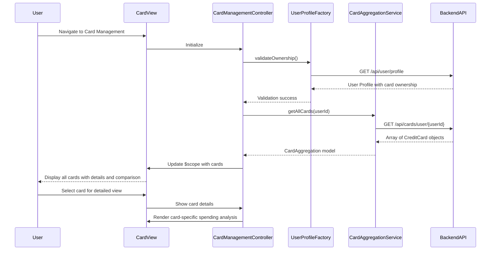

# Low-Level Design: QE-8620 - Multiple Credit Card Management

## a. Architecture Mapping

- **User Interface** → AngularJS Module: `cardManagementModule` + Controller: `CardManagementController` + View: `card-management.html`
- **Card Management Module** → AngularJS Controller: `CardManagementController` (orchestrates card operations)
- **Card Aggregation Service** → AngularJS Service: `CardAggregationService` (handles multi-card data retrieval)
- **User Profile Service** → AngularJS Factory: `UserProfileFactory` (validates card ownership)

**Recommended Folder Structure:**
```
/app
  /modules
    /card-management
      card-management.module.js
      card-management.controller.js
      card-management.html
  /services
    card-aggregation.service.js
  /factories
    user-profile.factory.js
  /models
    credit-card.model.js
```

## b. Component Specifications

| Name | Artifact Type | Responsibility | Key Dependencies |
|------|---------------|----------------|------------------|
| cardManagementModule | AngularJS Module | Entry point for card management feature, registers all card-related components | angular, ui.router |
| CardManagementController | Controller | Manages card list view, handles card selection, triggers card-wise analysis | CardAggregationService, UserProfileFactory, $scope |
| CardAggregationService | Service | Fetches all user cards from backend, provides card comparison logic | $http, $q, AuthFactory |
| UserProfileFactory | Factory | Validates user card ownership and retrieves user profile data | $http, AuthFactory |
| card-management.html | View Template | Displays card list with individual card details, balances, and comparison view | Bootstrap CSS, AngularJS ng-repeat |

## c. Data Model

**CreditCard Model:**
```javascript
{
  cardId: String,
  userId: String,
  cardName: String,
  cardNumber: String (masked),
  creditLimit: Number,
  currentBalance: Number,
  availableCredit: Number,
  monthlySpend: Number,
  cardType: String,
  issuer: String
}
```

**CardAggregation Model:**
```javascript
{
  userId: String,
  cards: Array<CreditCard>,
  totalCards: Number,
  aggregatedLimit: Number,
  aggregatedBalance: Number
}
```

## d. Data Flow

User accesses card management interface → CardManagementController calls UserProfileFactory.validateOwnership() → On success, controller calls CardAggregationService.getAllCards() → Service sends GET request to `/api/cards/user/{userId}` → Backend retrieves all user cards with data isolation → Response mapped to CreditCard models → CardAggregation model populated with array of cards → Controller binds to $scope → View renders card list using ng-repeat with individual card details and comparison metrics.

## e. Primary Sequence Diagram



## f. Implementation Notes

- Use AngularJS ng-repeat with track by cardId for efficient card list rendering (supports 10+ cards)
- Implement async data loading with $q.all() to fetch multiple card details in parallel for 3-second target
- Cache card data using service-level variable with manual refresh option for user-triggered updates
- Use Bootstrap card components with responsive grid (col-md-4) for multi-card display
- Implement client-side card comparison using ES6 Array.sort() and custom comparator functions

## g. Error Handling

Try/catch blocks in service methods with $q.reject() for promise chain; user notified via Bootstrap toast notifications.

## h. Security Notes

Requires token-based auth via existing SSO; backend enforces data isolation per user; card numbers masked on client.