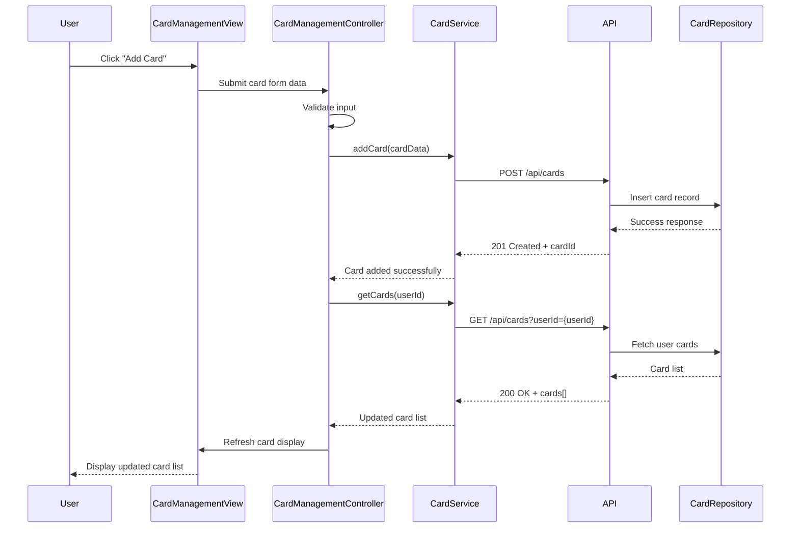

# Low-Level Design: Credit Card and Transaction Management
**Epic ID:** QE-8621  
**Application Stack:** AngularJS 1.x, JavaScript ES6, HTML5, CSS3, Bootstrap, REST APIs, MVC Architecture

---

## a. Architecture Mapping

- **Card Management UI** → AngularJS Module (`creditCard.management`) + Controller (`CardManagementController`) + View Template (`card-management.html`)
- **Transaction Management UI** → AngularJS Controller (`TransactionManagementController`) + View Template (`transaction-list.html`)
- **Card Data Service** → AngularJS Service (`CardService`) for CRUD operations via REST API
- **Transaction Data Service** → AngularJS Service (`TransactionService`) for fetching and filtering transactions via REST API
- **User Profile Integration** → AngularJS Factory (`UserProfileFactory`) for user context and authorization
- **Transaction Categorization** → AngularJS Service (`CategorizationService`) for assigning categories to transactions

**Recommended Folder Structure:**
```
app/
├── modules/
│   └── creditCard/
│       ├── management/
│       │   ├── controllers/
│       │   │   ├── CardManagementController.js
│       │   │   └── TransactionManagementController.js
│       │   ├── services/
│       │   │   ├── CardService.js
│       │   │   ├── TransactionService.js
│       │   │   └── CategorizationService.js
│       │   ├── factories/
│       │   │   └── UserProfileFactory.js
│       │   └── views/
│       │       ├── card-management.html
│       │       └── transaction-list.html
│       └── management.module.js
└── assets/
    ├── css/
    └── js/
```

---

## b. Component Specifications

| Component Name | Artifact Type | Responsibility | Key Dependencies |
|----------------|---------------|----------------|------------------|
| `creditCard.management` | Module | Root module for card and transaction management features | `ngRoute`, `ngResource` |
| `CardManagementController` | Controller | Manages card addition, viewing, and updates; binds card data to view | `CardService`, `UserProfileFactory`, `$scope` |
| `TransactionManagementController` | Controller | Handles transaction listing, pagination, search, and filtering | `TransactionService`, `CategorizationService`, `$scope` |
| `CardService` | Service | Provides REST API methods for card CRUD operations (GET, POST, PUT, DELETE) | `$http`, `API_BASE_URL` |
| `TransactionService` | Service | Fetches transaction data with pagination, search, and filter support | `$http`, `API_BASE_URL` |
| `CategorizationService` | Service | Assigns predefined categories to transactions based on merchant/type | None |
| `UserProfileFactory` | Factory | Retrieves and caches user profile and authorization context | `$http`, `$q` |

---

## c. Data Model

**Card Model:**
```javascript
{
  cardId: String,
  userId: String,
  cardNumber: String (masked),
  cardHolderName: String,
  bankName: String,
  cardType: String, // e.g., 'Visa', 'MasterCard'
  creditLimit: Number,
  availableCredit: Number,
  outstandingAmount: Number,
  expiryDate: String, // 'MM/YY'
  addedDate: Date
}
```

**Transaction Model:**
```javascript
{
  transactionId: String,
  cardId: String,
  userId: String,
  merchantName: String,
  category: String, // e.g., 'Food & Dining', 'Fuel'
  amount: Number,
  transactionDate: Date,
  description: String,
  transactionType: String // 'debit' or 'credit'
}
```

---

## d. Data Flow

User navigates to the card management view, triggering `CardManagementController` to invoke `CardService.getCards()`, which sends a GET request to `/api/cards?userId={userId}`. The API returns a list of cards, which the controller binds to `$scope.cards` for rendering in `card-management.html`. When the user adds a new card, the controller collects form data, validates it, and calls `CardService.addCard(cardData)`, which POSTs to `/api/cards`. On success, the card list refreshes. For transactions, `TransactionManagementController` calls `TransactionService.getTransactions(cardId, page, filters)`, which fetches paginated data from `/api/transactions?cardId={cardId}&page={page}`, applies client-side filtering if needed, and updates the view with categorized transactions via `CategorizationService`.

---

## e. Primary Sequence Diagram



---

## f. Implementation Notes

- Use AngularJS Dependency Injection for all services, factories, and controllers to ensure testability and modularity.
- Implement pagination in `TransactionService` using query parameters (`?page=1&limit=20`) to handle large transaction datasets efficiently.
- Apply ES6 arrow functions and `const`/`let` for cleaner, block-scoped code; use Promises or `$q` for async operations.
- Integrate Bootstrap grid system and responsive utilities for mobile-first card and transaction list layouts.
- Use `$http` interceptors for global error handling, authentication token injection, and API base URL configuration.

---

## g. Error Handling

HTTP interceptor captures API errors (4xx/5xx), logs them, and displays user-friendly notifications via a global alert service; client-side validation prevents invalid form submissions.

---

## h. Security Notes

Requires token-based authentication via existing SSO; card numbers are masked on the client side; all API calls enforce user-specific authorization checks.