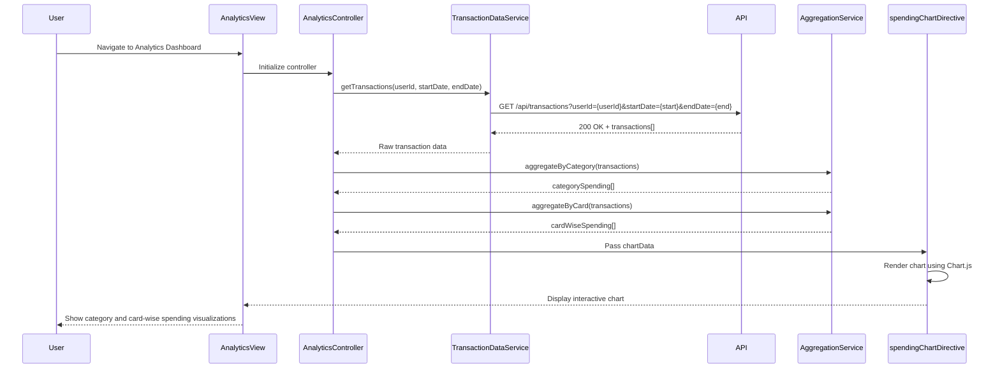

# Low-Level Design: Credit Card Spending Analytics and Visualization
**Epic ID:** QE-8622  
**Application Stack:** AngularJS 1.x, JavaScript ES6, HTML5, CSS3, Bootstrap, REST APIs, MVC Architecture

---

## a. Architecture Mapping

- **Analytics Dashboard UI** → AngularJS Module (`creditCard.analytics`) + Controller (`AnalyticsController`) + View Template (`analytics-dashboard.html`)
- **Visualization Rendering** → AngularJS Directive (`spendingChart`) wrapping charting library (e.g., Chart.js or D3.js)
- **Data Aggregation Logic** → AngularJS Service (`AggregationService`) for processing and summarizing transaction data
- **Transaction Data Retrieval** → AngularJS Service (`TransactionDataService`) for fetching raw transaction data via REST API
- **Category Classification** → AngularJS Service (`CategoryService`) for mapping transactions to nine predefined categories

**Recommended Folder Structure:**
```
app/
├── modules/
│   └── creditCard/
│       ├── analytics/
│       │   ├── controllers/
│       │   │   └── AnalyticsController.js
│       │   ├── services/
│       │   │   ├── AggregationService.js
│       │   │   ├── TransactionDataService.js
│       │   │   └── CategoryService.js
│       │   ├── directives/
│       │   │   └── spendingChart.directive.js
│       │   └── views/
│       │       └── analytics-dashboard.html
│       └── analytics.module.js
└── assets/
    ├── css/
    └── js/
        └── vendor/ (Chart.js or D3.js)
```

---

## b. Component Specifications

| Component Name | Artifact Type | Responsibility | Key Dependencies |
|----------------|---------------|----------------|------------------|
| `creditCard.analytics` | Module | Root module for analytics and visualization features | `ngRoute`, `ngResource` |
| `AnalyticsController` | Controller | Orchestrates data fetching, aggregation, and chart rendering; manages user interactions | `AggregationService`, `TransactionDataService`, `CategoryService`, `$scope` |
| `AggregationService` | Service | Aggregates transaction data by category, card, and month for visualization | None |
| `TransactionDataService` | Service | Fetches transaction data for specified date ranges via REST API | `$http`, `API_BASE_URL` |
| `CategoryService` | Service | Provides category definitions and maps transactions to categories | None |
| `spendingChart` | Directive | Encapsulates chart rendering logic using Chart.js/D3.js; supports interactive updates | Chart.js or D3.js library |

---

## c. Data Model

**Aggregated Spending Model:**
```javascript
{
  userId: String,
  month: String, // 'YYYY-MM'
  categorySpending: [
    {
      category: String, // e.g., 'Food & Dining'
      totalAmount: Number
    }
  ],
  cardWiseSpending: [
    {
      cardId: String,
      cardName: String,
      totalAmount: Number
    }
  ],
  monthlyTrend: [
    {
      month: String, // 'YYYY-MM'
      totalSpend: Number
    }
  ]
}
```

**Category Definition Model:**
```javascript
{
  categories: [
    'Food & Dining',
    'Fuel',
    'Shopping',
    'Travel',
    'Entertainment',
    'Utilities',
    'Healthcare',
    'Education',
    'Miscellaneous'
  ]
}
```

---

## d. Data Flow

User accesses the analytics dashboard, triggering `AnalyticsController` to call `TransactionDataService.getTransactions(userId, startDate, endDate)`, which sends a GET request to `/api/transactions?userId={userId}&startDate={start}&endDate={end}`. The API returns raw transaction data, which the controller passes to `AggregationService.aggregateByCategory(transactions)` and `AggregationService.aggregateByCard(transactions)` for client-side processing. The aggregated data is then bound to `$scope.chartData` and passed to the `spendingChart` directive, which renders interactive visualizations using Chart.js. User interactions (e.g., selecting a different month or card) trigger controller methods that re-aggregate data and update the chart directive, ensuring smooth transitions and real-time visual feedback.

---

## e. Primary Sequence Diagram



---

## f. Implementation Notes

- Use AngularJS two-way data binding to sync user filter selections (date range, card) with chart updates without full page reloads.
- Implement `AggregationService` using ES6 array methods (`reduce`, `map`, `filter`) for efficient client-side data processing.
- Integrate Chart.js via the `spendingChart` directive; use directive's `link` function to initialize charts and `$watch` to handle data updates.
- Apply Bootstrap responsive grid for dashboard layout; ensure charts resize gracefully on mobile/tablet using Chart.js responsive options.
- Cache aggregated data in `$scope` or a service to avoid redundant API calls when switching between views (category vs. card-wise).

---

## g. Error Handling

HTTP interceptor handles API failures; display fallback message in analytics view if data fetch fails; log errors for debugging.

---

## h. Security Notes

Standard input validation and secure API calls assumed; user authentication enforced at API layer.