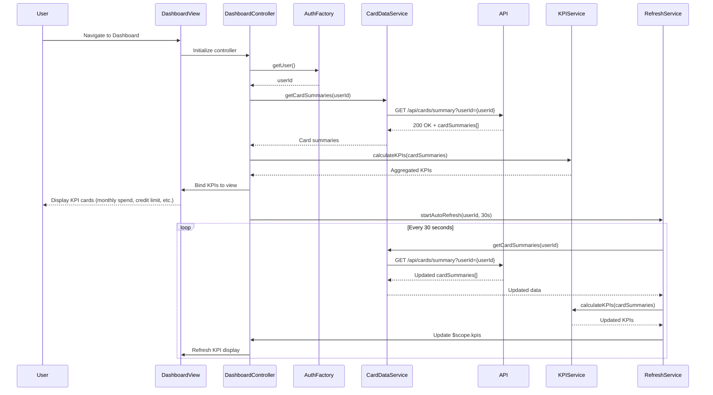

# Low-Level Design: Credit Card Dashboard and KPI Monitoring
**Epic ID:** QE-8623  
**Application Stack:** AngularJS 1.x, JavaScript ES6, HTML5, CSS3, Bootstrap, REST APIs, MVC Architecture

---

## a. Architecture Mapping

- **Dashboard UI** → AngularJS Module (`creditCard.dashboard`) + Controller (`DashboardController`) + View Template (`dashboard.html`)
- **KPI Aggregation Logic** → AngularJS Service (`KPIService`) for calculating and aggregating KPIs across multiple cards
- **Credit Card Data Retrieval** → AngularJS Service (`CardDataService`) for fetching card details and balances via REST API
- **Real-time Data Refresh** → AngularJS Service (`RefreshService`) using `$interval` for periodic data updates
- **User Authentication** → AngularJS Factory (`AuthFactory`) for session management and token handling

**Recommended Folder Structure:**
```
app/
├── modules/
│   └── creditCard/
│       ├── dashboard/
│       │   ├── controllers/
│       │   │   └── DashboardController.js
│       │   ├── services/
│       │   │   ├── KPIService.js
│       │   │   ├── CardDataService.js
│       │   │   └── RefreshService.js
│       │   ├── factories/
│       │   │   └── AuthFactory.js
│       │   └── views/
│       │       └── dashboard.html
│       └── dashboard.module.js
└── assets/
    ├── css/
    │   └── dashboard.css
    └── js/
```

---

## b. Component Specifications

| Component Name | Artifact Type | Responsibility | Key Dependencies |
|----------------|---------------|----------------|------------------|
| `creditCard.dashboard` | Module | Root module for dashboard and KPI monitoring features | `ngRoute`, `ngResource` |
| `DashboardController` | Controller | Manages dashboard state, fetches KPI data, and binds to view | `KPIService`, `CardDataService`, `RefreshService`, `AuthFactory`, `$scope` |
| `KPIService` | Service | Calculates aggregated KPIs (monthly spend, total limit, available credit, outstanding) from card data | None |
| `CardDataService` | Service | Fetches credit card details and transaction summaries via REST API | `$http`, `API_BASE_URL` |
| `RefreshService` | Service | Implements periodic data refresh using `$interval` for real-time KPI updates | `$interval`, `CardDataService` |
| `AuthFactory` | Factory | Manages user authentication state and provides session tokens for API calls | `$http`, `$window` |

---

## c. Data Model

**KPI Model:**
```javascript
{
  userId: String,
  monthlySpend: Number,
  totalCreditLimit: Number,
  availableCredit: Number,
  outstandingAmount: Number,
  lastUpdated: Date
}
```

**Card Summary Model:**
```javascript
{
  cardId: String,
  cardNumber: String (masked),
  bankName: String,
  creditLimit: Number,
  availableCredit: Number,
  outstandingAmount: Number,
  currentMonthSpend: Number
}
```

---

## d. Data Flow

User logs in and navigates to the dashboard, triggering `DashboardController` initialization. The controller invokes `AuthFactory.getUser()` to retrieve the authenticated user's ID, then calls `CardDataService.getCardSummaries(userId)`, which sends a GET request to `/api/cards/summary?userId={userId}`. The API returns an array of card summaries, which the controller passes to `KPIService.calculateKPIs(cardSummaries)` for aggregation. The service computes total credit limit (sum of all card limits), available credit (sum of available credit per card), outstanding amount (sum of outstanding per card), and monthly spend (sum of current month spend per card). The aggregated KPIs are bound to `$scope.kpis` and rendered in `dashboard.html` using Bootstrap cards. `RefreshService` is initialized with a 30-second interval to periodically re-fetch card data and update KPIs, ensuring real-time visibility.

---

## e. Primary Sequence Diagram



---

## f. Implementation Notes

- Use AngularJS `$interval` in `RefreshService` for periodic data refresh; ensure interval is canceled on controller `$destroy` to prevent memory leaks.
- Implement responsive Bootstrap grid layout (col-xs, col-sm, col-md) for KPI cards to ensure mobile, tablet, and desktop compatibility.
- Apply ES6 template literals and arrow functions in services for cleaner code; use `const` for immutable config values (e.g., API endpoints).
- Leverage AngularJS `$http` service with interceptors for automatic token injection and global error handling.
- Cache card summaries in `CardDataService` using a simple in-memory object to reduce redundant API calls during rapid navigation.

---

## g. Error Handling

HTTP interceptor captures API errors and displays user-friendly notifications; retry logic in `RefreshService` for transient failures.

---

## h. Security Notes

Requires token-based auth via existing SSO; all API calls include authentication headers; sensitive card data masked on client side.