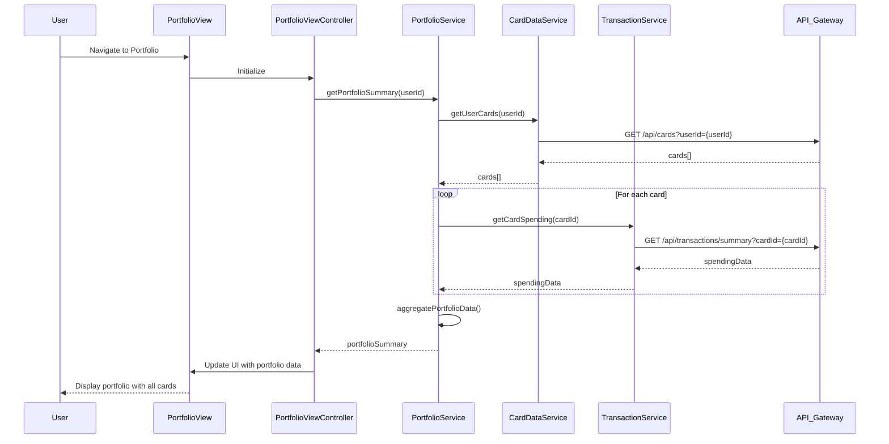

# Low-Level Design: QE-8672 - Credit Card Portfolio Management

## a. Architecture Mapping

- **AngularJS Module**: `creditCard.portfolio` - Main module for portfolio management feature
- **Controller**: `PortfolioViewController` - Manages portfolio display and user interactions
- **Service**: `PortfolioService` - Handles API calls to Portfolio Management Service via REST
- **Service**: `CardDataService` - Manages credit card data retrieval and caching
- **Service**: `TransactionService` - Fetches card-wise spending data
- **Directive**: `cardComparisonWidget` - Renders side-by-side card comparison UI
- **Directive**: `cardDetailsCard` - Displays individual card information

**Folder Structure:**
```
app/
├── modules/
│   └── portfolio/
│       ├── controllers/
│       │   └── portfolio-view.controller.js
│       ├── services/
│       │   ├── portfolio.service.js
│       │   ├── card-data.service.js
│       │   └── transaction.service.js
│       ├── directives/
│       │   ├── card-comparison-widget.directive.js
│       │   └── card-details-card.directive.js
│       ├── views/
│       │   └── portfolio-view.html
│       └── portfolio.module.js
```

## b. Component Specifications

| Component Name | Artifact Type | Responsibility | Key Dependencies |
|----------------|---------------|----------------|------------------|
| creditCard.portfolio | Module | Root module for portfolio management | ngRoute, ngResource |
| PortfolioViewController | Controller | Orchestrates portfolio view, handles user interactions, manages state | PortfolioService, CardDataService, TransactionService, $scope |
| PortfolioService | Factory | Aggregates portfolio data, coordinates between card and transaction services | $http, $q, API_CONFIG |
| CardDataService | Factory | Fetches and caches credit card details from repository | $http, $cacheFactory, API_CONFIG |
| TransactionService | Factory | Retrieves card-wise spending data | $http, $q, API_CONFIG |
| cardComparisonWidget | Directive | Renders interactive card comparison interface | PortfolioService |
| cardDetailsCard | Directive | Displays individual card details with spending summary | CardDataService, TransactionService |

## c. Data Model

**CreditCard Model:**
```javascript
{
  cardId: String,
  cardNumber: String (masked),
  cardHolderName: String,
  cardType: String,
  creditLimit: Number,
  availableCredit: Number,
  outstandingAmount: Number,
  expiryDate: String (MM/YY),
  status: String
}
```

**CardSpending Model:**
```javascript
{
  cardId: String,
  monthlySpend: Number,
  categoryBreakdown: Array<{category: String, amount: Number}>,
  transactionCount: Number,
  lastTransactionDate: String (ISO 8601)
}
```

**PortfolioSummary Model:**
```javascript
{
  userId: String,
  cards: Array<CreditCard>,
  cardSpending: Map<String, CardSpending>,
  totalCreditLimit: Number,
  totalAvailableCredit: Number,
  totalOutstanding: Number
}
```

## d. Data Flow

User navigates to the portfolio view, triggering PortfolioViewController initialization. The controller invokes PortfolioService.getPortfolioSummary(), which concurrently calls CardDataService.getUserCards() (fetching from Credit Card Data Repository via REST API) and TransactionService.getCardSpending() for each card. CardDataService caches card details to optimize repeated requests. PortfolioService aggregates the responses into a PortfolioSummary object and returns it to the controller. The controller binds the data to $scope, updating the view. User interactions (e.g., selecting a card for comparison) trigger controller methods that update the model, and Angular's two-way binding refreshes the UI via cardComparisonWidget and cardDetailsCard directives.

## e. Primary Sequence Diagram



## f. Implementation Notes

- Use AngularJS 1.x dependency injection for all services and controllers; register components via module.controller() and module.factory()
- Implement CardDataService with $cacheFactory for client-side caching to reduce redundant API calls for card details
- Use $q.all() in PortfolioService to parallelize multiple TransactionService calls for improved performance
- Apply ES6 arrow functions, template literals, and const/let for cleaner, modern JavaScript code
- Integrate Bootstrap grid system (col-md-*, col-sm-*) for responsive card layout across devices

## g. Error Handling

HTTP interceptor captures API errors (4xx/5xx), displays user-friendly notifications via a toast service, and logs errors to console for debugging.

## h. Security Notes

Requires token-based auth via existing SSO; API calls include Authorization header with JWT token.