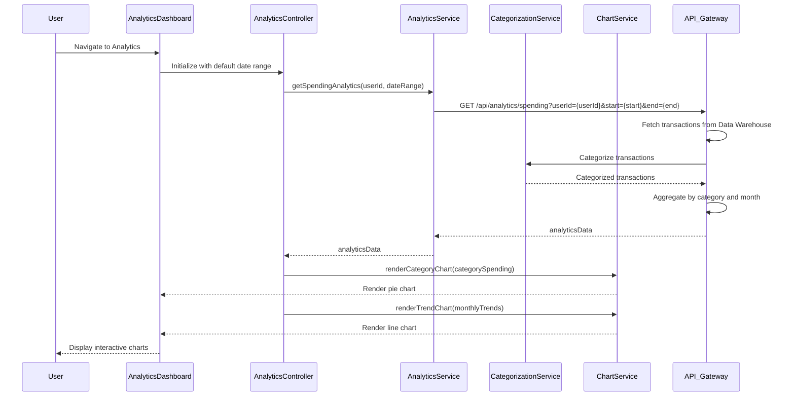

# Low-Level Design: QE-8673 - Spending Analytics and Insights

## a. Architecture Mapping

- **AngularJS Module**: `creditCard.analytics` - Main module for spending analytics feature
- **Controller**: `AnalyticsController` - Manages analytics dashboard and user interactions
- **Service**: `AnalyticsService` - Handles API calls to Analytics Service via REST
- **Service**: `CategorizationService` - Manages transaction categorization logic
- **Service**: `ChartService` - Wraps visualization library for chart rendering
- **Directive**: `categorySpendingChart` - Renders category-wise spending visualization
- **Directive**: `trendAnalysisChart` - Displays monthly spend trends
- **Filter**: `currencyFormat` - Formats monetary values consistently

**Folder Structure:**
```
app/
├── modules/
│   └── analytics/
│       ├── controllers/
│       │   └── analytics.controller.js
│       ├── services/
│       │   ├── analytics.service.js
│       │   ├── categorization.service.js
│       │   └── chart.service.js
│       ├── directives/
│       │   ├── category-spending-chart.directive.js
│       │   └── trend-analysis-chart.directive.js
│       ├── filters/
│       │   └── currency-format.filter.js
│       ├── views/
│       │   └── analytics-dashboard.html
│       └── analytics.module.js
```

## b. Component Specifications

| Component Name | Artifact Type | Responsibility | Key Dependencies |
|----------------|---------------|----------------|------------------|
| creditCard.analytics | Module | Root module for spending analytics | ngRoute, ngResource, chart.js |
| AnalyticsController | Controller | Manages analytics dashboard state, handles date range selection and chart interactions | AnalyticsService, ChartService, $scope, $filter |
| AnalyticsService | Factory | Fetches transaction data, aggregates spending by category and time period | $http, $q, CategorizationService, API_CONFIG |
| CategorizationService | Factory | Classifies transactions into predefined categories | $http, API_CONFIG |
| ChartService | Factory | Generates interactive charts using visualization library (Chart.js) | Chart.js library |
| categorySpendingChart | Directive | Renders pie/donut chart for category-wise spending breakdown | ChartService, AnalyticsService |
| trendAnalysisChart | Directive | Renders line chart for monthly spend trends over time | ChartService, AnalyticsService |
| currencyFormat | Filter | Formats numbers as currency with proper locale and symbol | $filter |

## c. Data Model

**Transaction Model:**
```javascript
{
  transactionId: String,
  cardId: String,
  amount: Number,
  category: String,
  merchantName: String,
  transactionDate: String (ISO 8601),
  description: String
}
```

**CategorySpending Model:**
```javascript
{
  category: String,
  totalAmount: Number,
  transactionCount: Number,
  percentage: Number
}
```

**MonthlyTrend Model:**
```javascript
{
  month: String (YYYY-MM),
  totalSpend: Number,
  categoryBreakdown: Array<{category: String, amount: Number}>
}
```

**AnalyticsData Model:**
```javascript
{
  userId: String,
  dateRange: {startDate: String, endDate: String},
  categorySpending: Array<CategorySpending>,
  monthlyTrends: Array<MonthlyTrend>,
  totalSpend: Number
}
```

## d. Data Flow

User accesses the analytics dashboard, triggering AnalyticsController initialization with default date range (last 12 months). The controller calls AnalyticsService.getSpendingAnalytics(userId, dateRange), which sends a GET request to the Analytics Service REST API. The API retrieves historical transactions from the Transaction Data Service, passes them through the Categorization Engine for classification, and aggregates spending by category and month. The aggregated AnalyticsData is returned to AnalyticsService, which passes it to the controller. The controller binds data to $scope and invokes ChartService to render categorySpendingChart (pie chart) and trendAnalysisChart (line chart) directives. User interactions (e.g., selecting a different date range or clicking a chart segment) trigger controller methods that fetch updated data and refresh the charts.

## e. Primary Sequence Diagram



## f. Implementation Notes

- Use AngularJS 1.x with Chart.js library for interactive visualizations; integrate via ChartService wrapper for testability
- Implement lazy loading for large transaction datasets using pagination or virtual scrolling in transaction detail views
- Use $http interceptor to add loading indicators during API calls for better UX
- Apply ES6 const/let, arrow functions, and destructuring for cleaner service implementations
- Leverage Bootstrap responsive utilities and CSS3 flexbox for chart container responsiveness

## g. Error Handling

HTTP interceptor catches API failures, displays error toast with retry option, and falls back to cached data if available.

## h. Security Notes

Standard input validation and secure API calls assumed; date range inputs sanitized to prevent injection attacks.