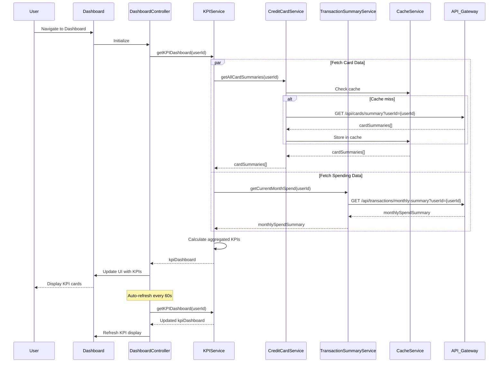

# Low-Level Design: QE-8674 - Dashboard and KPI Management

## a. Architecture Mapping

- **AngularJS Module**: `creditCard.dashboard` - Main module for KPI dashboard feature
- **Controller**: `DashboardController` - Manages dashboard state and KPI display
- **Service**: `KPIService` - Handles API calls to KPI Aggregation Service via REST
- **Service**: `CreditCardService` - Fetches credit card balance and limit data
- **Service**: `TransactionSummaryService` - Retrieves monthly spending summaries
- **Service**: `CacheService` - Manages client-side caching for performance optimization
- **Directive**: `kpiCard` - Displays individual KPI metric with icon and value
- **Directive**: `dashboardRefresh` - Provides manual refresh functionality

**Folder Structure:**
```
app/
├── modules/
│   └── dashboard/
│       ├── controllers/
│       │   └── dashboard.controller.js
│       ├── services/
│       │   ├── kpi.service.js
│       │   ├── credit-card.service.js
│       │   ├── transaction-summary.service.js
│       │   └── cache.service.js
│       ├── directives/
│       │   ├── kpi-card.directive.js
│       │   └── dashboard-refresh.directive.js
│       ├── views/
│       │   └── dashboard.html
│       └── dashboard.module.js
```

## b. Component Specifications

| Component Name | Artifact Type | Responsibility | Key Dependencies |
|----------------|---------------|----------------|------------------|
| creditCard.dashboard | Module | Root module for dashboard and KPI management | ngRoute, ngResource |
| DashboardController | Controller | Orchestrates KPI data fetching, manages dashboard state and refresh logic | KPIService, CacheService, $scope, $interval |
| KPIService | Factory | Aggregates KPI data from multiple sources, calculates derived metrics | CreditCardService, TransactionSummaryService, $q, API_CONFIG |
| CreditCardService | Factory | Fetches credit card balance, limit, and outstanding amount data | $http, CacheService, API_CONFIG |
| TransactionSummaryService | Factory | Retrieves monthly spending summaries for all cards | $http, CacheService, API_CONFIG |
| CacheService | Service | Manages $cacheFactory instances for performance optimization | $cacheFactory |
| kpiCard | Directive | Renders individual KPI metric with responsive layout and animation | $filter |
| dashboardRefresh | Directive | Provides pull-to-refresh or button-based manual refresh | KPIService, $scope |

## c. Data Model

**KPIDashboard Model:**
```javascript
{
  userId: String,
  monthlySpend: Number,
  totalCreditLimit: Number,
  availableCredit: Number,
  totalOutstanding: Number,
  creditUtilization: Number (percentage),
  lastUpdated: String (ISO 8601)
}
```

**CreditCardSummary Model:**
```javascript
{
  cardId: String,
  currentBalance: Number,
  creditLimit: Number,
  availableCredit: Number,
  outstandingAmount: Number
}
```

**MonthlySpendSummary Model:**
```javascript
{
  userId: String,
  month: String (YYYY-MM),
  totalSpend: Number,
  cardBreakdown: Array<{cardId: String, spend: Number}>
}
```

## d. Data Flow

User navigates to the dashboard, triggering DashboardController initialization. The controller invokes KPIService.getKPIDashboard(userId), which concurrently calls CreditCardService.getAllCardSummaries(userId) and TransactionSummaryService.getCurrentMonthSpend(userId). CreditCardService fetches card balance and limit data from the Credit Card Data Source REST API, caching results via CacheService. TransactionSummaryService retrieves monthly spending data from the Transaction Data Service API. KPIService aggregates the responses, calculates total credit limit (sum of all card limits), available credit (sum of available credit per card), total outstanding (sum of outstanding amounts), and credit utilization percentage. The KPIDashboard object is returned to the controller, which binds it to $scope. The kpiCard directives render each KPI metric with responsive Bootstrap layout. An $interval service polls KPIService every 60 seconds for real-time updates, refreshing the dashboard automatically.

## e. Primary Sequence Diagram



## f. Implementation Notes

- Use AngularJS 1.x dependency injection; register all services as factories for singleton behavior
- Implement CacheService with $cacheFactory and configurable TTL (default 5 minutes) to reduce API load
- Use $interval for periodic polling (60-second default) with automatic cleanup on $scope.$destroy
- Apply ES6 const/let, arrow functions, and Promise-based $q for asynchronous operations
- Leverage Bootstrap grid (col-xs-12, col-sm-6, col-md-3) for responsive KPI card layout across devices

## g. Error Handling

HTTP interceptor captures API errors, displays user-friendly error messages via toast notifications, and retries failed requests once before falling back to cached data.

## h. Security Notes

Requires token-based auth via existing SSO; all API requests include Authorization header with JWT token.