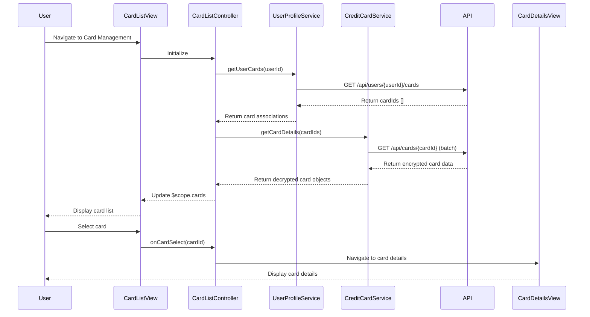

# Low-Level Design: QE-8675 - Credit Card Management and Monitoring

## a. Architecture Mapping

**Component to Artifact Mapping:**
- User Interface - Card List → AngularJS Module: `creditCard.management` with Controller: `CardListController` and View: `card-list.html`
- Card Management Controller → AngularJS Controller: `CardManagementController` handling card selection, navigation, and state management
- User Profile Service → AngularJS Service: `UserProfileService` (Factory pattern) for retrieving user-card associations
- Credit Card Repository → AngularJS Service: `CreditCardService` (Factory pattern) for API calls to fetch card data
- Card Details View → AngularJS View: `card-details.html` with Controller: `CardDetailsController`
- Encryption Service → AngularJS Service: `EncryptionService` (Factory pattern) for client-side data security

**Recommended Folder Structure:**
```
app/
├── modules/
│   └── credit-card/
│       ├── management/
│       │   ├── controllers/
│       │   │   ├── card-list.controller.js
│       │   │   ├── card-management.controller.js
│       │   │   └── card-details.controller.js
│       │   ├── services/
│       │   │   ├── user-profile.service.js
│       │   │   ├── credit-card.service.js
│       │   │   └── encryption.service.js
│       │   ├── views/
│       │   │   ├── card-list.html
│       │   │   └── card-details.html
│       │   └── management.module.js
```

## b. Component Specifications

| Component Name | Artifact Type | Responsibility | Key Dependencies |
|----------------|---------------|----------------|------------------|
| CardListController | Controller | Displays list of all user credit cards, handles card selection events | UserProfileService, CreditCardService, $scope |
| CardManagementController | Controller | Manages card navigation state and coordinates between list and detail views | $state, CreditCardService, $rootScope |
| CardDetailsController | Controller | Displays detailed information for selected card including limits, balances, and spend analysis | CreditCardService, $stateParams, $scope |
| UserProfileService | Factory | Retrieves user-card associations and ownership information via REST API | $http, $q, EncryptionService |
| CreditCardService | Factory | Fetches card details, limits, balances, and transaction history from backend API | $http, $q, $cacheFactory, EncryptionService |
| EncryptionService | Factory | Handles client-side encryption/decryption for secure data transmission | CryptoJS or native Web Crypto API |
| creditCard.management | Module | Main module encapsulating card management functionality | ui.router, ngAnimate |

## c. Data Model

**CreditCard Object:**
```javascript
{
  cardId: String,
  userId: String,
  cardNumber: String (masked),
  cardHolderName: String,
  cardType: String, // 'Visa', 'MasterCard', 'Amex'
  creditLimit: Number,
  availableCredit: Number,
  outstandingBalance: Number,
  currentSpend: Number,
  expiryDate: String, // 'MM/YY'
  status: String, // 'Active', 'Blocked', 'Expired'
  lastUpdated: Date
}
```

**UserCardAssociation Object:**
```javascript
{
  userId: String,
  cardIds: Array<String>,
  primaryCardId: String
}
```

## d. Data Flow

User navigates to the card management page → `CardListController` initializes and calls `UserProfileService.getUserCards()` → Service makes REST API call to fetch user-card associations → `CreditCardService.getCardDetails()` is invoked for each cardId → Backend API returns card data (encrypted) → `EncryptionService` decrypts data → Controller updates `$scope.cards` array → View renders card list using `ng-repeat` → User selects a card → `CardManagementController` updates state and navigates to card details view using `$state.go()` → `CardDetailsController` loads detailed card information → UI displays card-specific spend analysis and limits.

## e. Primary Sequence Diagram



## f. Implementation Notes

- Use AngularJS `ui-router` for state management with nested views for card list and card details states
- Implement dependency injection for all services using factory pattern; use `$http` with interceptors for API calls
- Cache card data using `$cacheFactory` with 5-minute TTL to meet 1-second retrieval NFR for repeated access
- Use ES6 classes for controllers and services, transpiled via Babel; leverage arrow functions and template literals
- Implement batch API calls for fetching multiple card details to optimize network requests and improve load time

## g. Error Handling

HTTP interceptor-based error handling with user-friendly notifications via toast service; retry logic for transient failures.

## h. Security Notes

Requires token-based authentication via existing SSO; all card data transmitted over HTTPS with client-side encryption for sensitive fields.