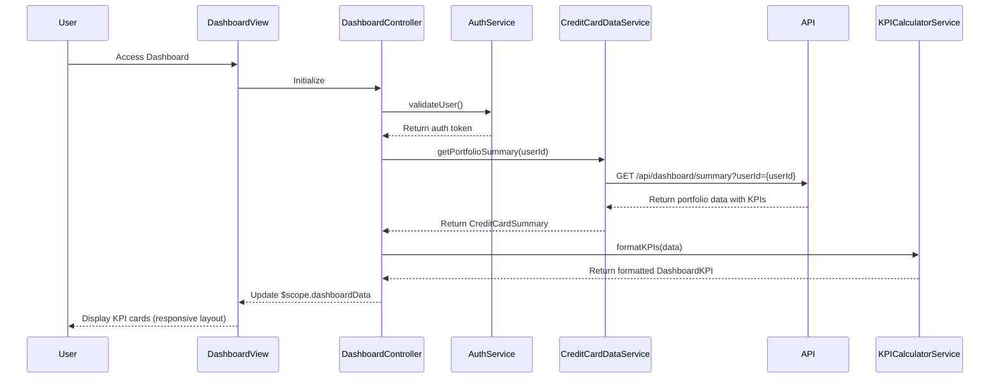

# Low-Level Design: QE-8676 - Credit Card Dashboard and KPI Management

## a. Architecture Mapping

**Component to Artifact Mapping:**
- User Interface - Dashboard → AngularJS Module: `creditCard.dashboard` with Controller: `DashboardController` and View: `dashboard.html`
- Authentication Service → AngularJS Service: `AuthService` (Factory pattern) for user authentication and authorization
- Dashboard Controller → AngularJS Controller: `DashboardController` orchestrating KPI display and data refresh
- Credit Card Data Service → AngularJS Service: `CreditCardDataService` (Factory pattern) for fetching card and transaction data
- KPI Calculator → AngularJS Service: `KPICalculatorService` (Factory pattern) for computing dashboard metrics
- Data Repository → Backend REST API accessed via `$http` service

**Recommended Folder Structure:**
```
app/
├── modules/
│   └── credit-card/
│       ├── dashboard/
│       │   ├── controllers/
│       │   │   └── dashboard.controller.js
│       │   ├── services/
│       │   │   ├── auth.service.js
│       │   │   ├── credit-card-data.service.js
│       │   │   └── kpi-calculator.service.js
│       │   ├── views/
│       │   │   └── dashboard.html
│       │   ├── directives/
│       │   │   └── kpi-card.directive.js
│       │   └── dashboard.module.js
```

## b. Component Specifications

| Component Name | Artifact Type | Responsibility | Key Dependencies |
|----------------|---------------|----------------|------------------|
| DashboardController | Controller | Orchestrates dashboard initialization, data loading, and KPI display | AuthService, CreditCardDataService, KPICalculatorService, $scope |
| AuthService | Factory | Validates user authentication and retrieves user session/token | $http, $q, $window (localStorage) |
| CreditCardDataService | Factory | Fetches credit card portfolio data including balances, limits, and transactions | $http, $q, $cacheFactory |
| KPICalculatorService | Factory | Computes KPIs: monthly spend, total credit limit, available credit, outstanding amount | None (pure calculation logic) |
| kpiCardDirective | Directive | Reusable component for rendering individual KPI cards with responsive layout | None |
| creditCard.dashboard | Module | Main module encapsulating dashboard functionality | ui.router, ngAnimate, angular-bootstrap |

## c. Data Model

**DashboardKPI Object:**
```javascript
{
  monthlySpend: Number,
  totalCreditLimit: Number,
  availableCredit: Number,
  outstandingAmount: Number,
  lastUpdated: Date
}
```

**CreditCardSummary Object:**
```javascript
{
  userId: String,
  cards: Array<{
    cardId: String,
    cardNumber: String (masked),
    creditLimit: Number,
    availableCredit: Number,
    currentBalance: Number
  }>,
  aggregatedKPIs: DashboardKPI
}
```

## d. Data Flow

User accesses dashboard page → `DashboardController` initializes and calls `AuthService.validateUser()` → Upon successful authentication, controller invokes `CreditCardDataService.getPortfolioSummary()` → Service makes REST API call to `/api/dashboard/summary` → Backend returns aggregated card data with pre-computed KPIs (cached server-side) → `KPICalculatorService` validates and formats KPI data → Controller updates `$scope.dashboardData` → View renders KPI cards using `kpi-card` directive with responsive Bootstrap grid → UI displays monthly spend, credit limit, available credit, and outstanding amount with visual indicators.

## e. Primary Sequence Diagram



## f. Implementation Notes

- Use AngularJS custom directive `kpi-card` with isolated scope for reusable KPI display components; leverage Bootstrap grid for responsive layout
- Implement lazy loading for dashboard module using `ocLazyLoad` to optimize initial page load time and meet 2-second NFR
- Cache dashboard summary data using `$cacheFactory` with 2-minute TTL; implement pull-to-refresh for manual data reload
- Use ES6 promises with `$q` service for async operations; chain API calls to minimize sequential delays
- Apply WCAG 2.1 accessibility: ARIA labels for KPI cards, keyboard navigation support, high-contrast color scheme

## g. Error Handling

HTTP interceptor captures API errors; display user-friendly messages via toast notifications; fallback to cached data if available.

## h. Security Notes

Requires token-based auth via existing SSO; dashboard API validates user ownership of card data before returning KPIs.