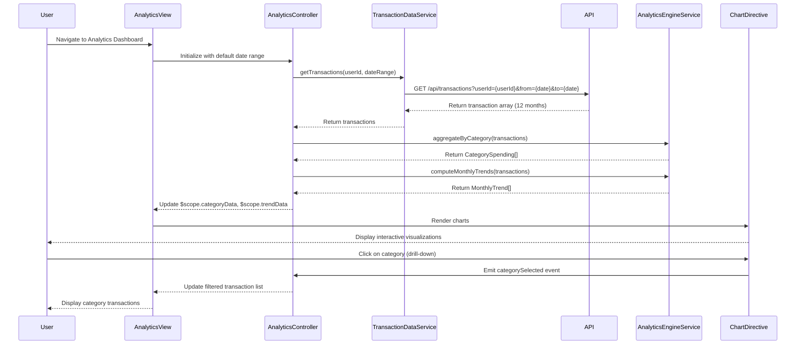

# Low-Level Design: QE-8677 - Spending Analytics and Transaction Insights

## a. Architecture Mapping

**Component to Artifact Mapping:**
- User Interface - Analytics Dashboard → AngularJS Module: `creditCard.analytics` with Controller: `AnalyticsController` and View: `analytics-dashboard.html`
- Analytics Controller → AngularJS Controller: `AnalyticsController` managing visualization state and user interactions
- Transaction Data Service → AngularJS Service: `TransactionDataService` (Factory pattern) for fetching transaction records
- Data Analytics Engine → AngularJS Service: `AnalyticsEngineService` (Factory pattern) for aggregation and trend computation
- Categorization Module → AngularJS Service: `CategorizationService` (Factory pattern) for transaction categorization logic
- Charting Library → Third-party directive integration: Chart.js via `angular-chart.js` or D3.js via custom directives
- Transaction Repository → Backend REST API accessed via `$http` service

**Recommended Folder Structure:**
```
app/
├── modules/
│   └── credit-card/
│       ├── analytics/
│       │   ├── controllers/
│       │   │   └── analytics.controller.js
│       │   ├── services/
│       │   │   ├── transaction-data.service.js
│       │   │   ├── analytics-engine.service.js
│       │   │   └── categorization.service.js
│       │   ├── views/
│       │   │   └── analytics-dashboard.html
│       │   ├── directives/
│       │   │   ├── category-chart.directive.js
│       │   │   └── trend-chart.directive.js
│       │   └── analytics.module.js
```

## b. Component Specifications

| Component Name | Artifact Type | Responsibility | Key Dependencies |
|----------------|---------------|----------------|------------------|
| AnalyticsController | Controller | Manages analytics dashboard state, date range selection, and chart interactions | TransactionDataService, AnalyticsEngineService, $scope, $filter |
| TransactionDataService | Factory | Fetches transaction records for specified date range and card(s) from backend API | $http, $q, $cacheFactory |
| AnalyticsEngineService | Factory | Aggregates transactions by category and month; computes spending trends and insights | CategorizationService |
| CategorizationService | Factory | Maps transactions to predefined categories using rule-based logic | None (stateless) |
| categoryChartDirective | Directive | Renders interactive pie/donut chart for category-wise spending with drill-down | Chart.js, $timeout |
| trendChartDirective | Directive | Renders line/bar chart for monthly spend trends with interactive tooltips | Chart.js, $timeout |
| creditCard.analytics | Module | Main module encapsulating analytics functionality | ui.router, angular-chart.js, ngAnimate |

## c. Data Model

**Transaction Object:**
```javascript
{
  transactionId: String,
  cardId: String,
  amount: Number,
  currency: String,
  merchant: String,
  category: String, // One of 9 predefined categories
  transactionDate: Date,
  description: String
}
```

**CategorySpending Object:**
```javascript
{
  category: String, // 'Food & Dining', 'Fuel', 'Shopping', etc.
  totalAmount: Number,
  transactionCount: Number,
  percentage: Number // % of total spend
}
```

**MonthlyTrend Object:**
```javascript
{
  month: String, // 'YYYY-MM'
  totalSpend: Number,
  categoryBreakdown: Array<CategorySpending>
}
```

## d. Data Flow

User navigates to analytics dashboard → `AnalyticsController` initializes with default date range (last 12 months) → Controller calls `TransactionDataService.getTransactions(userId, dateRange)` → Service fetches transaction data from `/api/transactions` REST endpoint → Backend returns pre-categorized transaction records (cached server-side) → `AnalyticsEngineService.aggregateByCategory(transactions)` computes category-wise spending → `AnalyticsEngineService.computeMonthlyTrends(transactions)` generates monthly spend data → Controller updates `$scope.categoryData` and `$scope.trendData` → View renders `category-chart` and `trend-chart` directives using Chart.js → User interacts with chart (drill-down on category) → Directive emits event → Controller filters transactions and updates detail view.

## e. Primary Sequence Diagram



## f. Implementation Notes

- Use `angular-chart.js` wrapper for Chart.js integration; configure responsive charts with drill-down via click event handlers
- Implement client-side caching of transaction data using `$cacheFactory` with 10-minute TTL; pre-compute aggregations to meet 3-second rendering NFR
- Use ES6 `Map` and `reduce` functions in `AnalyticsEngineService` for efficient category aggregation and trend calculation
- Leverage AngularJS `$filter` service for date range filtering and currency formatting in views
- Implement lazy loading for Chart.js library using `ocLazyLoad` to optimize initial bundle size

## g. Error Handling

HTTP interceptor-based error handling with retry logic for failed API calls; display error toast and fallback to cached data if available.

## h. Security Notes

Standard input validation and secure API calls assumed; transaction data access restricted to authenticated user's own records.