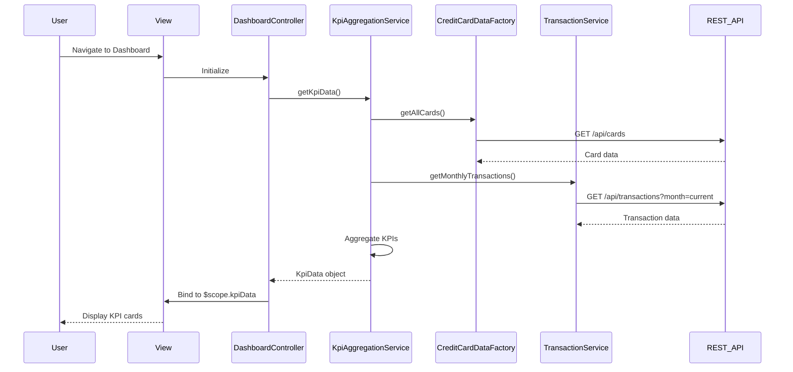

# Low-Level Design: QE-8678 - Dashboard and KPI Management

## a. Architecture Mapping

- **User Interface**: AngularJS View (HTML template with Bootstrap) + CSS3 styling
- **Dashboard Controller**: AngularJS Controller (`DashboardController`) managing KPI display logic and data binding
- **KPI Aggregation Engine**: AngularJS Service (`KpiAggregationService`) for calculating and aggregating KPI metrics
- **Credit Card Data Service**: AngularJS Factory (`CreditCardDataFactory`) for REST API calls to retrieve card balances and limits
- **Transaction Service**: AngularJS Service (`TransactionService`) for REST API calls to fetch monthly spend data

**Recommended Folder Structure:**
```
app/
├── modules/dashboard/
│   ├── controllers/DashboardController.js
│   ├── services/KpiAggregationService.js
│   ├── views/dashboard.html
│   └── dashboard.module.js
├── shared/
│   ├── factories/CreditCardDataFactory.js
│   ├── services/TransactionService.js
│   └── shared.module.js
└── assets/css/dashboard.css
```

## b. Component Specifications

| Component Name | Artifact Type | Responsibility | Key Dependencies |
|----------------|---------------|----------------|------------------|
| DashboardController | Controller | Orchestrates KPI data retrieval, aggregation, and binding to view | KpiAggregationService, $scope |
| KpiAggregationService | Service | Aggregates data from multiple sources to compute Monthly Spend, Total Credit Limit, Available Credit, Outstanding Amount | CreditCardDataFactory, TransactionService, $q |
| CreditCardDataFactory | Factory | Fetches credit card balances and limits via REST API | $http, API_CONFIG |
| TransactionService | Service | Retrieves monthly transaction data for spend calculations via REST API | $http, API_CONFIG |
| dashboard.html | View | Displays KPI cards in responsive Bootstrap grid layout | DashboardController, Bootstrap CSS |

## c. Data Model

**KpiData (JavaScript Object):**
```javascript
{
  monthlySpend: Number,        // Total spend for current month
  totalCreditLimit: Number,    // Sum of credit limits across all cards
  availableCredit: Number,     // Total available credit
  outstandingAmount: Number,   // Total outstanding balance
  lastUpdated: Date            // Timestamp of last data refresh
}
```

**CreditCard (JavaScript Object):**
```javascript
{
  cardId: String,
  cardNumber: String,
  creditLimit: Number,
  currentBalance: Number,
  availableCredit: Number
}
```

## d. Data Flow

User navigates to the dashboard view, triggering `DashboardController` initialization. The controller invokes `KpiAggregationService.getKpiData()`, which concurrently calls `CreditCardDataFactory.getAllCards()` and `TransactionService.getMonthlyTransactions()` using `$q.all()` for parallel API requests. The service aggregates responses to compute KPI values (summing credit limits, balances, and transaction amounts), then returns the `KpiData` object. The controller binds this data to `$scope.kpiData`, and the view renders KPI cards using Bootstrap responsive grid with Angular data binding, updating the UI instantly.

## e. Primary Sequence Diagram



## f. Implementation Notes

- Use AngularJS module pattern with dependency injection for all controllers, services, and factories.
- Implement `$q.all()` for parallel API calls to minimize page load time and optimize KPI rendering.
- Apply Bootstrap grid system (col-md-3, col-sm-6, col-xs-12) for responsive KPI card layout across devices.
- Use ES6 arrow functions and const/let for cleaner service logic and improved readability.
- Implement auto-refresh using `$interval` service (e.g., every 5 minutes) to update KPI data without full page reload.

## g. Error Handling

HTTP interceptor captures API failures; user-friendly error messages displayed via Bootstrap alerts with retry option.

## h. Security Notes

Standard input validation and secure API calls assumed; token-based authentication via existing SSO for API access.