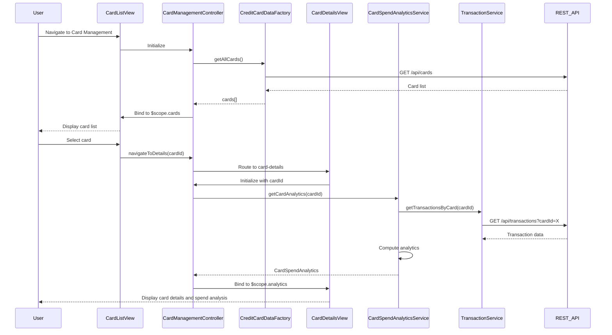

# Low-Level Design: QE-8679 - Credit Card Management and Tracking

## a. Architecture Mapping

- **User Interface**: AngularJS View (HTML template with Bootstrap) for card list and details display
- **Card Management Controller**: AngularJS Controller (`CardManagementController`) managing card selection, filtering, and detail views
- **Credit Card Data Service**: AngularJS Factory (`CreditCardDataFactory`) for REST API calls to retrieve card information
- **Transaction Service**: AngularJS Service (`TransactionService`) for fetching card-specific transaction history
- **Card Spend Analytics Module**: AngularJS Service (`CardSpendAnalyticsService`) for calculating per-card spending metrics

**Recommended Folder Structure:**
```
app/
├── modules/card-management/
│   ├── controllers/CardManagementController.js
│   ├── services/CardSpendAnalyticsService.js
│   ├── views/card-list.html
│   ├── views/card-details.html
│   └── card-management.module.js
├── shared/
│   ├── factories/CreditCardDataFactory.js
│   ├── services/TransactionService.js
│   └── shared.module.js
└── assets/css/card-management.css
```

## b. Component Specifications

| Component Name | Artifact Type | Responsibility | Key Dependencies |
|----------------|---------------|----------------|------------------|
| CardManagementController | Controller | Manages card list display, card selection, filtering, and navigation to card details | CreditCardDataFactory, CardSpendAnalyticsService, $scope, $routeParams |
| CardSpendAnalyticsService | Service | Computes card-specific spending metrics and patterns from transaction data | TransactionService, $q |
| CreditCardDataFactory | Factory | Retrieves all cards and individual card details via REST API | $http, API_CONFIG |
| TransactionService | Service | Fetches transaction history filtered by card ID via REST API | $http, API_CONFIG |
| card-list.html | View | Displays all credit cards in a responsive grid with filtering options | CardManagementController, Bootstrap CSS |
| card-details.html | View | Shows detailed card information and card-wise spend analysis | CardManagementController, Bootstrap CSS |

## c. Data Model

**CreditCard (JavaScript Object):**
```javascript
{
  cardId: String,
  cardNumber: String,
  cardHolderName: String,
  cardType: String,            // e.g., Visa, MasterCard
  creditLimit: Number,
  currentBalance: Number,
  availableCredit: Number,
  expiryDate: String,
  isActive: Boolean
}
```

**CardSpendAnalytics (JavaScript Object):**
```javascript
{
  cardId: String,
  totalSpend: Number,
  transactionCount: Number,
  categoryBreakdown: Object,   // { category: amount }
  averageTransactionAmount: Number,
  lastTransactionDate: Date
}
```

## d. Data Flow

User accesses the card management view, triggering `CardManagementController` to call `CreditCardDataFactory.getAllCards()`, which fetches the card list via REST API. The controller binds the card array to `$scope.cards`, and the view renders cards in a Bootstrap grid. When the user selects a card, the controller captures the `cardId`, navigates to the card details view, and invokes `CardSpendAnalyticsService.getCardAnalytics(cardId)`. This service calls `TransactionService.getTransactionsByCard(cardId)` to retrieve card-specific transactions, processes the data to compute spending metrics, and returns the `CardSpendAnalytics` object. The controller binds this to `$scope.analytics`, and the view displays detailed card information and spend analysis charts.

## e. Primary Sequence Diagram



## f. Implementation Notes

- Use AngularJS routing (`$routeProvider` or `ui-router`) to navigate between card list and card details views with cardId as route parameter.
- Implement card filtering using AngularJS filters (e.g., by card type, active status) bound to UI controls.
- Cache card list data in service using a simple in-memory cache to reduce redundant API calls during session.
- Use ES6 template literals for dynamic API endpoint construction (e.g., `/api/transactions?cardId=${cardId}`).
- Apply Bootstrap card components for consistent card display with responsive breakpoints.

## g. Error Handling

HTTP interceptor with try/catch in service methods; display user-friendly error notifications using Bootstrap modals or toasts.

## h. Security Notes

Requires token-based auth via existing SSO; card data securely transmitted over HTTPS with sensitive card numbers masked in UI.