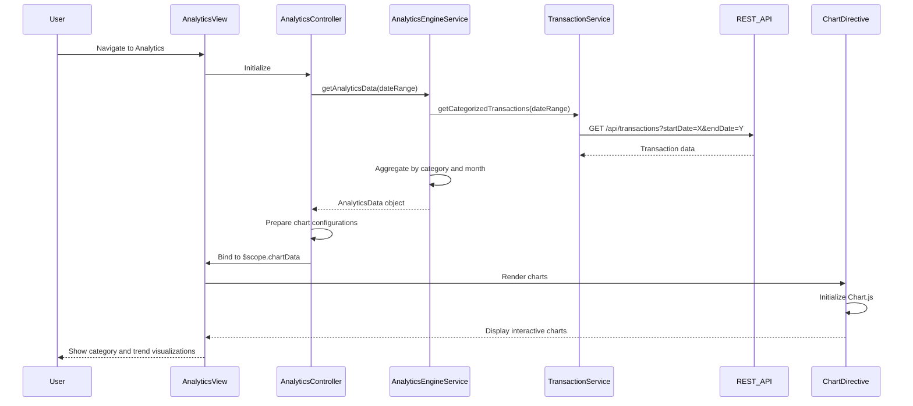

# Low-Level Design: QE-8680 - Analytics and Spending Insights

## a. Architecture Mapping

- **User Interface**: AngularJS View (HTML template with Bootstrap) for displaying interactive charts and spending insights
- **Analytics Controller**: AngularJS Controller (`AnalyticsController`) managing chart data preparation and user interactions
- **Analytics Engine**: AngularJS Service (`AnalyticsEngineService`) for processing and aggregating transaction data by category and time period
- **Transaction Service**: AngularJS Service (`TransactionService`) for fetching categorized transaction data via REST API
- **Data Visualization Library**: Integration with Chart.js or similar library via AngularJS directive (`chartDirective`)

**Recommended Folder Structure:**
```
app/
├── modules/analytics/
│   ├── controllers/AnalyticsController.js
│   ├── services/AnalyticsEngineService.js
│   ├── directives/chartDirective.js
│   ├── views/analytics.html
│   └── analytics.module.js
├── shared/
│   ├── services/TransactionService.js
│   └── shared.module.js
└── assets/
    ├── css/analytics.css
    └── lib/chart.min.js
```

## b. Component Specifications

| Component Name | Artifact Type | Responsibility | Key Dependencies |
|----------------|---------------|----------------|------------------|
| AnalyticsController | Controller | Orchestrates data retrieval, prepares chart configurations, and manages user filter selections | AnalyticsEngineService, $scope, $filter |
| AnalyticsEngineService | Service | Aggregates transaction data by category and month, computes spending trends and breakdowns | TransactionService, $q |
| TransactionService | Service | Retrieves categorized transaction data for specified time periods via REST API | $http, API_CONFIG |
| chartDirective | Directive | Wraps Chart.js library to render interactive charts (pie, bar, line) with AngularJS data binding | Chart.js library |
| analytics.html | View | Displays category-wise spending charts, monthly trend graphs, and filter controls | AnalyticsController, Bootstrap CSS, chartDirective |

## c. Data Model

**CategorySpending (JavaScript Object):**
```javascript
{
  category: String,            // e.g., 'Food & Dining', 'Fuel', 'Shopping'
  totalAmount: Number,
  transactionCount: Number,
  percentage: Number           // Percentage of total spending
}
```

**MonthlyTrend (JavaScript Object):**
```javascript
{
  month: String,               // e.g., '2024-01'
  totalSpend: Number,
  categoryBreakdown: Array     // Array of CategorySpending objects
}
```

**AnalyticsData (JavaScript Object):**
```javascript
{
  categorySpending: Array,     // Array of CategorySpending for current period
  monthlyTrends: Array,        // Array of MonthlyTrend for historical data
  totalSpend: Number,
  dateRange: Object            // { startDate: Date, endDate: Date }
}
```

## d. Data Flow

User navigates to the analytics view, triggering `AnalyticsController` initialization. The controller calls `AnalyticsEngineService.getAnalyticsData(dateRange)`, which invokes `TransactionService.getCategorizedTransactions(dateRange)` to fetch transaction data via REST API. The service processes the response, grouping transactions by category (Food & Dining, Fuel, Shopping, Travel, Entertainment, Utilities, Healthcare, Education, Miscellaneous) and by month, computing totals and percentages. The aggregated `AnalyticsData` object is returned to the controller, which prepares chart configurations (datasets, labels, colors) and binds them to `$scope.chartData`. The view renders interactive charts using the `chartDirective`, which initializes Chart.js instances with the provided data, enabling users to explore spending patterns visually.

## e. Primary Sequence Diagram



## f. Implementation Notes

- Use AngularJS custom directive to encapsulate Chart.js integration with isolated scope for reusable chart components.
- Implement date range picker using Bootstrap Datepicker or similar, bound to controller scope for dynamic data filtering.
- Apply ES6 array methods (map, reduce, filter) in AnalyticsEngineService for efficient data aggregation and transformation.
- Use AngularJS `$filter` service for formatting currency values and dates in chart labels and tooltips.
- Optimize chart rendering by limiting data points and using Chart.js responsive options for mobile compatibility.

## g. Error Handling

HTTP interceptor captures API errors; fallback to cached data if available, with user notification via Bootstrap alert.

## h. Security Notes

Standard input validation and secure API calls assumed; date range inputs sanitized to prevent injection attacks.