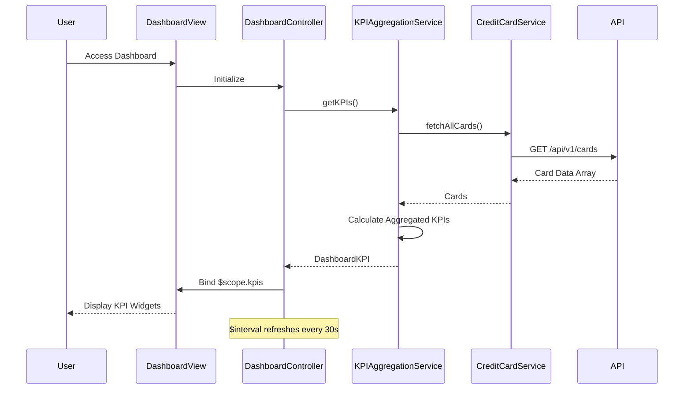

# Low-Level Design: Credit Card Dashboard and KPI Management
**Epic ID:** QE-8705  
**Feature:** Centralized dashboard with real-time KPI display

---

## a. Architecture Mapping

| HLD Component | AngularJS Artifact | Mapping |
|---------------|-------------------|----------|
| Dashboard UI Layer | Module: `app.dashboard` + Controller: `DashboardController` | Main dashboard module and controller |
| User Authentication Service | Service: `AuthService` | Manages authentication and session |
| KPI Aggregation Service | Service: `KPIAggregationService` | Aggregates and calculates KPIs |
| Credit Card Data Source | Service: `CreditCardService` | Fetches card data via REST API |
| Dashboard View | View: `dashboard.html` | Responsive template with KPI widgets |

**Recommended Folder Structure:**
```
app/
├── modules/
│   └── dashboard/
│       ├── dashboard.module.js
│       ├── dashboard.controller.js
│       ├── dashboard.html
│       └── kpi-widget.component.js
├── services/
│   ├── auth.service.js
│   ├── kpi-aggregation.service.js
│   └── credit-card.service.js
└── app.js
```

---

## b. Component Specifications

| Component Name | Artifact Type | Responsibility | Key Dependencies |
|----------------|---------------|----------------|------------------|
| `app.dashboard` | Module | Dashboard feature module | `ngRoute`, `ngAnimate` |
| `DashboardController` | Controller | Manages dashboard state and KPI refresh | `KPIAggregationService`, `$scope`, `$interval` |
| `AuthService` | Service | Validates user and manages JWT token | `$http`, `$window` |
| `CreditCardService` | Service | Fetches card details and balances from API | `$http`, `API_ENDPOINTS` |
| `KPIAggregationService` | Service | Calculates monthly spend, limits, available credit, outstanding | `CreditCardService` |
| `kpiWidgetComponent` | Component | Reusable KPI display widget with icon and value | None |
| `dashboard.html` | View | Responsive dashboard layout with Bootstrap grid | Bootstrap 3.x, AngularJS directives |

---

## c. Data Model

```javascript
// CreditCard Model
const CreditCard = {
  cardId: String,
  cardNumber: String,        // Masked
  creditLimit: Number,
  availableCredit: Number,
  outstandingAmount: Number,
  currentMonthSpend: Number
};

// DashboardKPI Model
const DashboardKPI = {
  monthlySpend: Number,
  totalCreditLimit: Number,
  totalAvailableCredit: Number,
  totalOutstanding: Number,
  utilizationRate: Number,   // Percentage
  lastRefreshed: Date
};
```

---

## d. Data Flow

User logs in → `AuthService` validates credentials and stores JWT token → User navigates to dashboard → `DashboardController` initializes and calls `KPIAggregationService.getKPIs()` → Service invokes `CreditCardService.fetchAllCards()` which makes GET to `/api/v1/cards` → Card data returned → Service aggregates: sum of monthly spend, total credit limits, available credit, outstanding amounts → Calculates utilization rate → Returns `DashboardKPI` object → Controller binds to `$scope.kpis` → View renders KPI widgets using `kpiWidgetComponent` → `$interval` triggers refresh every 30 seconds for real-time updates.

---

## e. Primary Sequence Diagram



---

## f. Implementation Notes

- Use AngularJS 1.x with ES6 syntax (classes for services, arrow functions)
- Implement `$http` interceptor for JWT token injection and 401 handling
- Use `$interval` for periodic KPI refresh (30-second interval) with cleanup on `$destroy`
- Apply Bootstrap responsive utilities (col-lg-3, col-md-6, col-sm-12) for KPI cards
- Cache card data with 60-second TTL in `CreditCardService` to reduce API load

---

## g. Error Handling

HTTP interceptor captures errors; display Bootstrap alert for API failures; retry logic with exponential backoff.

---

## h. Security Notes

Requires token-based auth via existing SSO; JWT token stored in sessionStorage; HTTPS enforced for all API calls.

---

**End of Document**