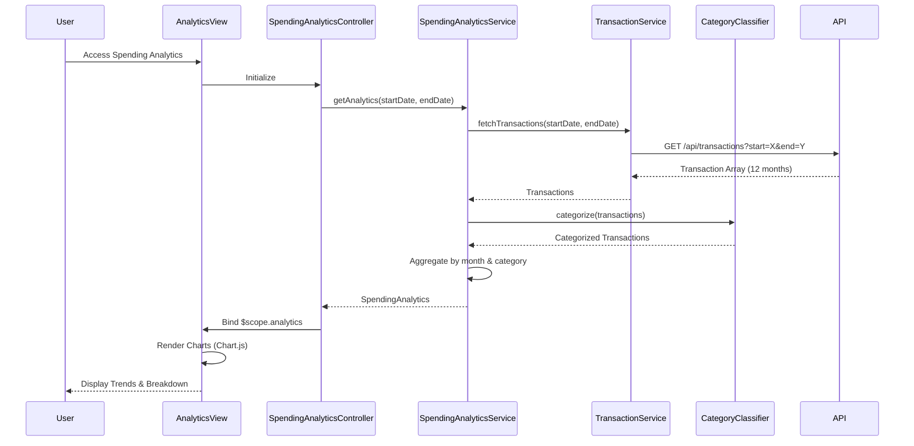

# Low-Level Design: Spending Analytics and Trend Visualization
**Epic ID:** QE-8706  
**Feature:** Interactive spending analytics with category-wise breakdown and trend visualization

---

## a. Architecture Mapping

| HLD Component | AngularJS Artifact | Mapping |
|---------------|-------------------|----------|
| User Interface | Module: `app.spendingAnalytics` | Spending analytics feature module |
| Analytics Engine | Service: `SpendingAnalyticsService` | Processes and aggregates transaction data |
| Transaction Data Service | Service: `TransactionService` | Fetches transaction data via REST API |
| Category Classification Service | Service: `CategoryClassifier` | Auto-categorizes transactions into 9 categories |
| Visualization Component | Directive: `trendChartDirective` + Component: `categoryBreakdownComponent` | Renders charts using Chart.js |

**Recommended Folder Structure:**
```
app/
├── modules/
│   └── spending-analytics/
│       ├── spending-analytics.module.js
│       ├── spending-analytics.controller.js
│       ├── spending-analytics.html
│       └── category-breakdown.component.js
├── services/
│   ├── spending-analytics.service.js
│   ├── transaction.service.js
│   └── category-classifier.service.js
├── directives/
│   └── trend-chart.directive.js
└── app.js
```

---

## b. Component Specifications

| Component Name | Artifact Type | Responsibility | Key Dependencies |
|----------------|---------------|----------------|------------------|
| `app.spendingAnalytics` | Module | Spending analytics feature module | `ngRoute`, `chart.js` |
| `SpendingAnalyticsController` | Controller | Manages analytics view and user interactions | `SpendingAnalyticsService`, `$scope`, `$filter` |
| `SpendingAnalyticsService` | Service | Aggregates transactions by month and category | `TransactionService`, `CategoryClassifier` |
| `TransactionService` | Service | Fetches transaction data from API | `$http`, `API_ENDPOINTS` |
| `CategoryClassifier` | Service | Classifies transactions into 9 categories using rule engine | None |
| `trendChartDirective` | Directive | Renders monthly spend trend line chart | `Chart.js` |
| `categoryBreakdownComponent` | Component | Displays category-wise spending with pie/doughnut chart | `Chart.js` |
| `spending-analytics.html` | View | Layout with trend and category visualizations | Bootstrap grid, chart directives |

---

## c. Data Model

```javascript
// Transaction Model
const Transaction = {
  transactionId: String,
  cardId: String,
  date: Date,
  merchant: String,
  amount: Number,
  category: String           // One of 9 categories
};

// MonthlyTrend Model
const MonthlyTrend = {
  month: String,             // "Jan 2024"
  totalSpend: Number
};

// CategorySpending Model
const CategorySpending = {
  category: String,          // "Food & Dining", "Fuel", "Shopping", etc.
  amount: Number,
  percentage: Number,
  color: String              // Chart color
};

// SpendingAnalytics Model
const SpendingAnalytics = {
  monthlyTrends: Array<MonthlyTrend>,
  categoryBreakdown: Array<CategorySpending>,
  totalSpend: Number,
  periodStart: Date,
  periodEnd: Date
};
```

---

## d. Data Flow

User accesses spending analytics → `SpendingAnalyticsController` calls `SpendingAnalyticsService.getAnalytics(startDate, endDate)` → Service invokes `TransactionService.fetchTransactions(startDate, endDate)` which makes GET to `/api/transactions?start=X&end=Y` → Transactions retrieved (12 months history) → `CategoryClassifier` categorizes each transaction into one of 9 predefined categories → Service aggregates by month (for trend) and by category (for breakdown) → Returns `SpendingAnalytics` object → Controller binds to `$scope.analytics` → `trendChartDirective` renders line chart for monthly trends → `categoryBreakdownComponent` renders pie chart for category distribution → User interacts with charts for drill-down insights.

---

## e. Primary Sequence Diagram



---

## f. Implementation Notes

- Use Chart.js 2.x for responsive charts (line for trends, doughnut for category breakdown)
- Implement `CategoryClassifier` with merchant keyword mapping to 9 categories (Food & Dining, Fuel, Shopping, Travel, Entertainment, Utilities, Healthcare, Education, Miscellaneous)
- Use ES6 `Array.reduce()` for efficient aggregation of transactions
- Apply AngularJS `$filter('currency')` for amount formatting
- Implement drill-down: clicking chart segment filters transactions by category/month

---

## g. Error Handling

HTTP interceptor with try/catch; display user notification for API errors; graceful degradation with empty state message.

---

## h. Security Notes

Standard input validation and secure API calls assumed; sanitize date range inputs to prevent injection.

---

**End of Document**