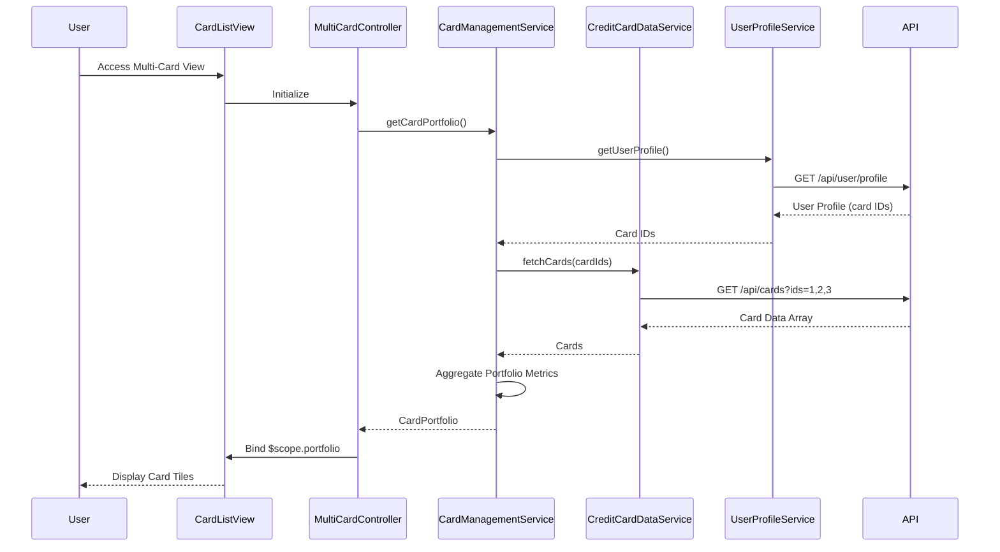

# Low-Level Design: Multi-Card Management and Monitoring
**Epic ID:** QE-8707  
**Feature:** Unified platform for managing and monitoring multiple credit cards

---

## a. Architecture Mapping

| HLD Component | AngularJS Artifact | Mapping |
|---------------|-------------------|----------|
| User Interface | Module: `app.multiCard` | Multi-card management feature module |
| Card Management Service | Service: `CardManagementService` | Orchestrates card operations |
| Credit Card Data Service | Service: `CreditCardDataService` | Fetches card information via REST API |
| User Profile Service | Service: `UserProfileService` | Associates cards with user accounts |
| Data Store | REST API Backend | Backend data repository |
| Card Comparison View | Controller: `CardComparisonController` + View: `card-comparison.html` | Enables side-by-side card comparison |

**Recommended Folder Structure:**
```
app/
├── modules/
│   └── multi-card/
│       ├── multi-card.module.js
│       ├── multi-card.controller.js
│       ├── card-list.html
│       ├── card-detail.html
│       ├── card-comparison.controller.js
│       └── card-comparison.html
├── services/
│   ├── card-management.service.js
│   ├── credit-card-data.service.js
│   └── user-profile.service.js
├── components/
│   └── card-tile.component.js
└── app.js
```

---

## b. Component Specifications

| Component Name | Artifact Type | Responsibility | Key Dependencies |
|----------------|---------------|----------------|------------------|
| `app.multiCard` | Module | Multi-card management feature module | `ngRoute`, `ui.bootstrap` |
| `MultiCardController` | Controller | Manages card list display and selection | `CardManagementService`, `$scope` |
| `CardComparisonController` | Controller | Handles card comparison logic | `CardManagementService`, `$routeParams` |
| `CardManagementService` | Service | Orchestrates card fetching and portfolio operations | `CreditCardDataService`, `UserProfileService` |
| `CreditCardDataService` | Service | Retrieves card details from API (supports up to 10 cards) | `$http`, `API_ENDPOINTS` |
| `UserProfileService` | Service | Fetches user profile and associated card IDs | `$http`, `AuthService` |
| `cardTileComponent` | Component | Reusable card display tile with key metrics | None |
| `card-list.html` | View | Grid layout displaying all user cards | Bootstrap grid, card tiles |
| `card-comparison.html` | View | Side-by-side comparison table for selected cards | Bootstrap table |

---

## c. Data Model

```javascript
// CreditCard Model
const CreditCard = {
  cardId: String,
  cardNumber: String,        // Masked: "****1234"
  cardType: String,          // "Visa", "Mastercard", "Amex"
  cardHolderName: String,
  creditLimit: Number,
  availableCredit: Number,
  outstandingAmount: Number,
  currentMonthSpend: Number,
  expiryDate: String,
  status: String,            // "Active", "Blocked"
  issuer: String
};

// CardPortfolio Model
const CardPortfolio = {
  userId: String,
  cards: Array<CreditCard>,
  totalCreditLimit: Number,
  totalAvailableCredit: Number,
  totalOutstanding: Number,
  cardCount: Number
};

// CardComparison Model
const CardComparison = {
  cards: Array<CreditCard>,
  comparisonMetrics: Array<String>  // ["creditLimit", "availableCredit", etc.]
};
```

---

## d. Data Flow

User accesses multi-card view → `MultiCardController` calls `CardManagementService.getCardPortfolio()` → Service invokes `UserProfileService.getUserProfile()` to get associated card IDs → Service calls `CreditCardDataService.fetchCards(cardIds)` which makes GET to `/api/cards?ids=1,2,3` → Card data retrieved (masked card numbers) → Service aggregates portfolio metrics → Returns `CardPortfolio` object → Controller binds to `$scope.portfolio` → View renders card tiles in grid → User selects multiple cards for comparison → Controller navigates to comparison view → `CardComparisonController` fetches selected cards → Displays side-by-side comparison table with key metrics.

---

## e. Primary Sequence Diagram



---

## f. Implementation Notes

- Use AngularJS 1.x with component-based architecture for reusable card tiles
- Implement `$q.all()` for parallel fetching of multiple card details to meet <500ms latency requirement
- Use Bootstrap grid (col-md-4) for responsive card tile layout
- Apply AngularJS `ng-repeat` with `track by cardId` for efficient rendering
- Cache card data in `CardManagementService` with 5-minute TTL to reduce API calls

---

## g. Error Handling

HTTP interceptor with fallback to partial data display if some cards fail to load; display warning for failed cards.

---

## h. Security Notes

Requires token-based auth via existing SSO; card numbers masked at API layer; validate user ownership server-side.

---

**End of Document**