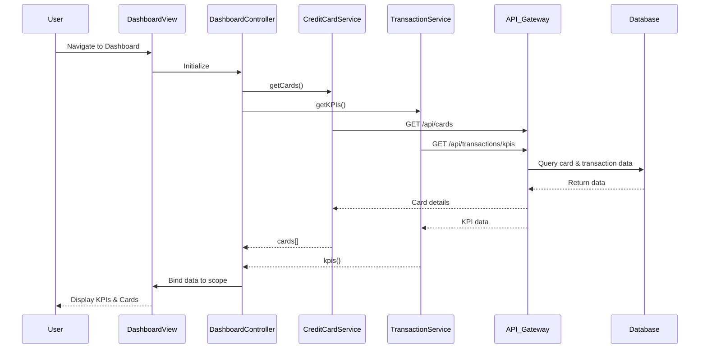

# Low-Level Design: Credit Card Dashboard and KPI Management
**Epic ID:** QE-8708  
**Technology Stack:** AngularJS 1.x, JavaScript ES6, HTML5, CSS3, Bootstrap, REST APIs, MVC Architecture

---

## a. Architecture Mapping

- **Dashboard UI Layer** → AngularJS Module (`app.dashboard`) + Controller (`DashboardController`) + View Template (`dashboard.html`)
- **KPI Display Components** → AngularJS Directives (`kpiCard`, `creditSummary`)
- **Credit Card Service Integration** → AngularJS Service (`CreditCardService`) wrapping REST API calls
- **Transaction Service Integration** → AngularJS Service (`TransactionService`) for spend/outstanding calculations
- **Authentication** → AngularJS Service (`AuthService`) with HTTP interceptor for token management
- **Data Refresh** → AngularJS Factory (`DashboardRefreshFactory`) implementing polling mechanism

**Recommended Folder Structure:**
```
/app
  /modules
    /dashboard
      dashboard.module.js
      dashboard.controller.js
      dashboard.html
  /services
    creditcard.service.js
    transaction.service.js
    auth.service.js
  /directives
    kpi-card.directive.js
  /factories
    dashboard-refresh.factory.js
```

---

## b. Component Specifications

| Component Name | Artifact Type | Responsibility | Key Dependencies |
|----------------|---------------|----------------|------------------|
| `app.dashboard` | Module | Root module for dashboard feature | `ngRoute`, `ui.bootstrap` |
| `DashboardController` | Controller | Orchestrates KPI data fetching and view binding | `CreditCardService`, `TransactionService`, `DashboardRefreshFactory` |
| `CreditCardService` | Service | Fetches credit card details and limits via REST API | `$http`, `AuthService` |
| `TransactionService` | Service | Retrieves monthly spend and outstanding amounts | `$http`, `AuthService` |
| `AuthService` | Service | Manages user authentication and session tokens | `$http`, `$window` |
| `DashboardRefreshFactory` | Factory | Implements polling for real-time data refresh | `$interval`, `$rootScope` |
| `kpiCard` | Directive | Reusable UI component for displaying individual KPI metrics | None |
| `dashboard.html` | View Template | Responsive layout using Bootstrap grid for KPI cards | Bootstrap CSS |

---

## c. Data Model

**DashboardViewModel (Controller scope object):**
```javascript
{
  cards: [
    {
      cardId: String,
      cardNumber: String (masked),
      issuer: String,
      creditLimit: Number,
      currentBalance: Number,
      status: String
    }
  ],
  kpis: {
    monthlySpend: Number,
    totalCreditLimit: Number,
    availableCredit: Number,
    outstandingAmount: Number
  },
  isLoading: Boolean,
  lastRefreshed: Date
}
```

---

## d. Data Flow

User navigates to dashboard → `DashboardController` initializes and invokes `CreditCardService.getCards()` and `TransactionService.getKPIs()` concurrently → Services make authenticated REST API calls via `$http` with interceptor injecting auth token → API responses are received and mapped to `DashboardViewModel` → Controller binds data to scope → View renders KPI cards using `kpiCard` directive and Bootstrap responsive grid → `DashboardRefreshFactory` polls services every 30 seconds, updating scope on new data → UI reactively updates via AngularJS two-way binding.

---

## e. Primary Sequence Diagram



---

## f. Implementation Notes

- Use AngularJS Dependency Injection to inject services into controller; follow `$inject` annotation for minification safety
- Implement `$http` interceptor in `AuthService` to attach bearer token to all outgoing requests and handle 401 responses
- Use `$q.all()` to parallelize `CreditCardService` and `TransactionService` calls for faster dashboard load
- Leverage Bootstrap responsive grid (`col-xs-12 col-md-6 col-lg-3`) for KPI card layout across devices
- Implement `DashboardRefreshFactory` using `$interval` with 30-second polling; cancel interval on scope `$destroy` to prevent memory leaks

---

## g. Error Handling

HTTP interceptor captures API errors; user-friendly notifications displayed via Bootstrap alert directive; retry logic in `DashboardRefreshFactory` on transient failures.

---

## h. Security Notes

Requires token-based auth via existing SSO; all API calls include Authorization header managed by `AuthService` interceptor.