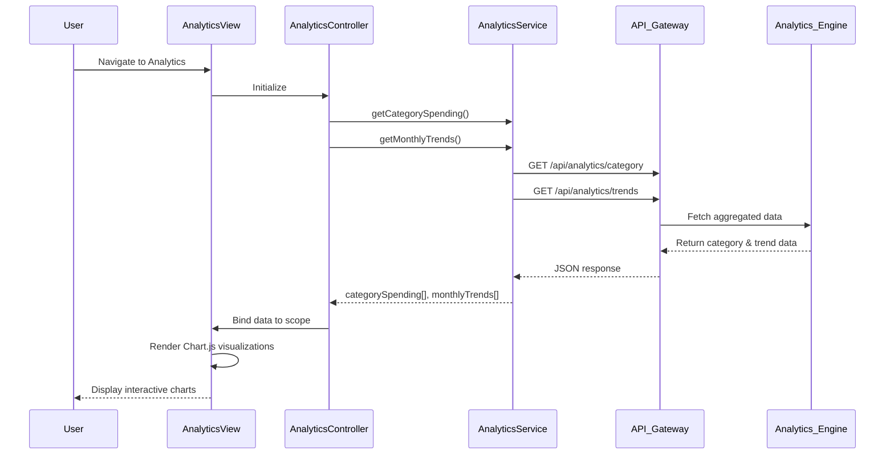

# Low-Level Design: Spending Analytics and Insights
**Epic ID:** QE-8709  
**Technology Stack:** AngularJS 1.x, JavaScript ES6, HTML5, CSS3, Bootstrap, REST APIs, Chart.js

---

## a. Architecture Mapping

- **Analytics UI Component** → AngularJS Module (`app.analytics`) + Controller (`AnalyticsController`) + View Template (`analytics.html`)
- **Category-wise Visualization** → AngularJS Directive (`categoryChart`) wrapping Chart.js pie/bar chart
- **Monthly Trend Visualization** → AngularJS Directive (`trendChart`) wrapping Chart.js line chart
- **Transaction Service Integration** → AngularJS Service (`AnalyticsService`) for aggregated spending data
- **Data Filtering** → AngularJS Filter (`dateRangeFilter`) and Controller methods for drill-down

**Recommended Folder Structure:**
```
/app
  /modules
    /analytics
      analytics.module.js
      analytics.controller.js
      analytics.html
  /services
    analytics.service.js
  /directives
    category-chart.directive.js
    trend-chart.directive.js
  /filters
    date-range.filter.js
```

---

## b. Component Specifications

| Component Name | Artifact Type | Responsibility | Key Dependencies |
|----------------|---------------|----------------|------------------|
| `app.analytics` | Module | Root module for analytics feature | `ngRoute`, `chart.js` |
| `AnalyticsController` | Controller | Fetches analytics data and manages filter state | `AnalyticsService`, `$scope` |
| `AnalyticsService` | Service | Retrieves category-wise and monthly trend data via REST API | `$http`, `AuthService` |
| `categoryChart` | Directive | Renders interactive category-wise spending chart using Chart.js | `Chart.js` library |
| `trendChart` | Directive | Renders monthly spend trend line chart | `Chart.js` library |
| `dateRangeFilter` | Filter | Filters transaction data by date range for drill-down | None |
| `analytics.html` | View Template | Responsive layout with chart containers and filter controls | Bootstrap CSS |

---

## c. Data Model

**AnalyticsViewModel (Controller scope object):**
```javascript
{
  categorySpending: [
    {
      category: String, // e.g., "Food & Dining"
      amount: Number,
      percentage: Number
    }
  ],
  monthlyTrends: [
    {
      month: String, // e.g., "2024-01"
      totalSpend: Number
    }
  ],
  selectedDateRange: {
    startDate: Date,
    endDate: Date
  },
  isLoading: Boolean
}
```

---

## d. Data Flow

User navigates to analytics page → `AnalyticsController` initializes and calls `AnalyticsService.getCategorySpending()` and `AnalyticsService.getMonthlyTrends()` → Service makes REST API calls to Analytics Engine endpoint → API returns pre-aggregated category and trend data → Controller processes response and binds to scope → `categoryChart` and `trendChart` directives watch scope data and render Chart.js visualizations → User applies date filter → Controller updates `selectedDateRange` and re-fetches data → Charts reactively update with filtered results.

---

## e. Primary Sequence Diagram



---

## f. Implementation Notes

- Use Chart.js library integrated via AngularJS directive with isolated scope to encapsulate chart rendering logic
- Implement `$watch` in chart directives to detect data changes and call `chart.update()` for reactive visualization
- Use `$http` with query parameters for date range filtering; API returns filtered aggregates to minimize client-side computation
- Leverage Bootstrap responsive utilities (`hidden-xs`, `col-md-6`) to optimize chart layout on mobile devices
- Store 12 months of historical data in-memory after initial load; subsequent filters operate on cached dataset to improve performance

---

## g. Error Handling

Service-level try/catch with promise rejection; controller displays error message via Bootstrap alert; chart directives show "No data available" placeholder on empty datasets.

---

## h. Security Notes

Standard input validation and secure API calls assumed; date range inputs sanitized to prevent injection attacks.