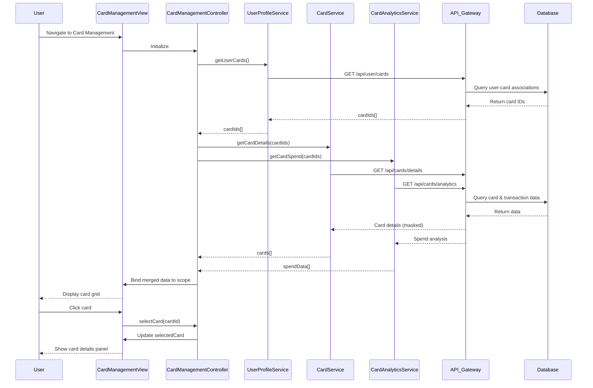

# Low-Level Design: Credit Card Management and Tracking
**Epic ID:** QE-8710  
**Technology Stack:** AngularJS 1.x, JavaScript ES6, HTML5, CSS3, Bootstrap, REST APIs, MVC Architecture

---

## a. Architecture Mapping

- **Card Management Module** → AngularJS Module (`app.cardManagement`) + Controller (`CardManagementController`) + View Template (`card-management.html`)
- **Card Display Grid** → AngularJS Directive (`cardGrid`) with Bootstrap responsive grid
- **Card Details View** → AngularJS Directive (`cardDetails`) for individual card information
- **Credit Card Service Integration** → AngularJS Service (`CardService`) for card CRUD operations
- **Transaction Service Integration** → AngularJS Service (`CardAnalyticsService`) for card-wise spend analysis
- **User Profile Integration** → AngularJS Service (`UserProfileService`) for card-user association

**Recommended Folder Structure:**
```
/app
  /modules
    /card-management
      card-management.module.js
      card-management.controller.js
      card-management.html
  /services
    card.service.js
    card-analytics.service.js
    user-profile.service.js
  /directives
    card-grid.directive.js
    card-details.directive.js
```

---

## b. Component Specifications

| Component Name | Artifact Type | Responsibility | Key Dependencies |
|----------------|---------------|----------------|------------------|
| `app.cardManagement` | Module | Root module for card management feature | `ngRoute`, `ui.bootstrap` |
| `CardManagementController` | Controller | Manages card list retrieval and selection state | `CardService`, `CardAnalyticsService`, `UserProfileService` |
| `CardService` | Service | Fetches card details, limits, and status via REST API | `$http`, `AuthService` |
| `CardAnalyticsService` | Service | Retrieves card-wise spending analysis | `$http`, `AuthService` |
| `UserProfileService` | Service | Associates cards with authenticated user account | `$http`, `AuthService` |
| `cardGrid` | Directive | Displays cards in responsive grid with status indicators | Bootstrap CSS |
| `cardDetails` | Directive | Shows detailed card information including masked card number | None |
| `card-management.html` | View Template | Responsive layout with card grid and details panel | Bootstrap CSS |

---

## c. Data Model

**CardManagementViewModel (Controller scope object):**
```javascript
{
  cards: [
    {
      cardId: String,
      cardNumber: String, // Masked (e.g., "**** **** **** 1234")
      issuer: String,
      creditLimit: Number,
      currentBalance: Number,
      availableCredit: Number,
      status: String, // "Active", "Blocked", "Expired"
      cardWiseSpend: {
        currentMonth: Number,
        lastMonth: Number,
        yearToDate: Number
      }
    }
  ],
  selectedCard: Object,
  isLoading: Boolean
}
```

---

## d. Data Flow

User navigates to card management page → `CardManagementController` initializes and calls `UserProfileService.getUserCards()` → Service fetches user-associated card IDs → Controller invokes `CardService.getCardDetails(cardIds)` → Service makes REST API call to retrieve card information with masked numbers → For each card, `CardAnalyticsService.getCardSpend(cardId)` is called to fetch spend analysis → API responses are aggregated and bound to `cards` array in scope → View renders cards using `cardGrid` directive in Bootstrap responsive grid → User clicks on a card → Controller updates `selectedCard` → `cardDetails` directive displays detailed information in side panel.

---

## e. Primary Sequence Diagram



---

## f. Implementation Notes

- Use AngularJS `ng-repeat` with `track by cardId` for efficient card grid rendering; limit to 10 cards per user as per NFR
- Implement card number masking in `CardService` using ES6 string template: `cardNumber.replace(/.(?=.{4})/g, '*')`
- Use `$q.all()` to parallelize `CardService` and `CardAnalyticsService` calls for 1-second retrieval target
- Leverage Bootstrap grid classes (`col-xs-12 col-sm-6 col-md-4`) for responsive card layout
- Implement card status color-coding in `cardGrid` directive: Active (green), Blocked (red), Expired (gray)

---

## g. Error Handling

HTTP interceptor-based error handling with user notification via Bootstrap toast; graceful degradation if analytics service fails (show card details without spend data).

---

## h. Security Notes

Card numbers masked server-side before API response; token-based authentication required for all card operations; input validation on card selection to prevent unauthorized access.