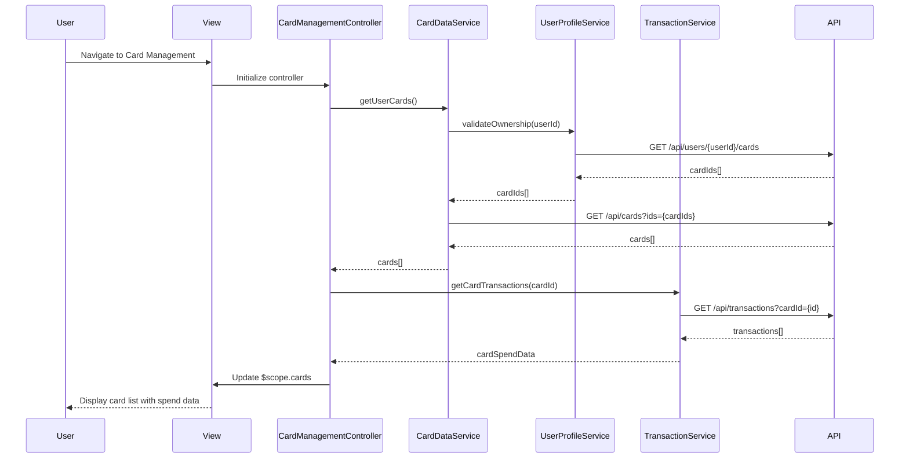

# Low-Level Design: QE-8763 - Multiple Credit Card Management and Tracking

## a. Architecture Mapping

**HLD Component → AngularJS Artifact:**
- User Interface → AngularJS Module: `creditCard.management`
- Card Management Module → Controller: `CardManagementController`
- Card Data Service → Service: `CardDataService`
- Transaction Service → Service: `TransactionService`
- User Profile Service → Service: `UserProfileService`
- Database → REST API endpoints

**Recommended Folder Structure:**
```
app/
├── modules/
│   └── card-management/
│       ├── controllers/
│       │   └── card-management.controller.js
│       ├── services/
│       │   ├── card-data.service.js
│       │   ├── transaction.service.js
│       │   └── user-profile.service.js
│       ├── views/
│       │   ├── card-list.html
│       │   ├── card-detail.html
│       │   └── card-comparison.html
│       └── card-management.module.js
```

## b. Component Specifications

| Component Name | Artifact Type | Responsibility | Key Dependencies |
|---|---|---|---|
| creditCard.management | Module | Root module for card management features | ngRoute, ngResource |
| CardManagementController | Controller | Orchestrates card display, comparison, and user interactions | CardDataService, TransactionService, $scope |
| CardDataService | Service | Fetches card details, metadata, and validates ownership | $http, UserProfileService, API_CONFIG |
| TransactionService | Service | Retrieves card-level transactions and computes spend analytics | $http, $q, API_CONFIG |
| UserProfileService | Service | Validates card ownership and manages user-card associations | $http, $localStorage, API_CONFIG |
| CardListView | HTML Template | Displays all user cards in grid/list layout | CardManagementController |
| CardDetailView | HTML Template | Shows individual card details and spend trends | CardManagementController |
| CardComparisonView | HTML Template | Enables side-by-side card performance comparison | CardManagementController |

## c. Data Model

**CreditCard Object:**
```javascript
{
  cardId: String,
  cardNumber: String (masked),
  cardHolderName: String,
  bankName: String,
  cardType: String,
  creditLimit: Number,
  availableCredit: Number,
  outstandingAmount: Number,
  monthlySpend: Number,
  expiryDate: String,
  isActive: Boolean
}
```

**CardTransaction Object:**
```javascript
{
  transactionId: String,
  cardId: String,
  amount: Number,
  category: String,
  merchantName: String,
  transactionDate: Date,
  description: String
}
```

**UserCardProfile Object:**
```javascript
{
  userId: String,
  cards: Array<String>,
  primaryCardId: String
}
```

## d. Data Flow

User navigates to the card management view, triggering CardManagementController initialization. The controller invokes CardDataService.getUserCards(), which calls UserProfileService to validate ownership and fetch card IDs, then retrieves full card details via REST API GET /api/cards. For each card, TransactionService.getCardTransactions(cardId) fetches monthly transactions via GET /api/transactions?cardId={id}&month={current}, computes card-wise spend, and returns aggregated data. The controller updates $scope.cards and $scope.cardSpendData, which Angular's data binding renders in the view (card list, detail, or comparison layout).

## e. Primary Sequence Diagram



## f. Implementation Notes

- Use AngularJS 1.x module pattern with dependency injection for all services and controllers.
- Implement ES6 classes for services; use arrow functions for callbacks and promise chains.
- Leverage $http service with interceptors for API calls; configure base URL via API_CONFIG constant.
- Apply Bootstrap grid system (col-md-4) for responsive card layout; use ng-repeat for card iteration.
- Cache card data in $localStorage for 5 minutes to meet 1-second retrieval NFR; invalidate on user action.

## g. Error Handling

HTTP interceptor captures API errors (4xx/5xx), displays user-friendly notifications via toastr, and logs errors to console.

## h. Security Notes

Requires token-based auth via existing SSO; card numbers are masked client-side; API enforces user-card ownership validation.