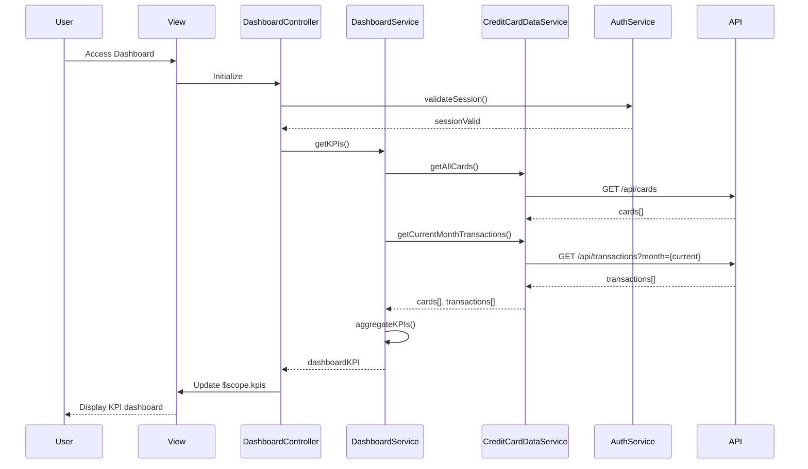

# Low-Level Design: QE-8764 - Credit Card Dashboard and KPI Management

## a. Architecture Mapping

**HLD Component → AngularJS Artifact:**
- Web Application UI → AngularJS Module: `creditCard.dashboard`
- Dashboard Service → Service: `DashboardService`
- Credit Card Data Service → Service: `CreditCardDataService`
- Authentication Service → Service: `AuthService`
- Data Store → REST API endpoints

**Recommended Folder Structure:**
```
app/
├── modules/
│   └── dashboard/
│       ├── controllers/
│       │   └── dashboard.controller.js
│       ├── services/
│       │   ├── dashboard.service.js
│       │   ├── credit-card-data.service.js
│       │   └── auth.service.js
│       ├── views/
│       │   └── dashboard.html
│       ├── directives/
│       │   └── kpi-card.directive.js
│       └── dashboard.module.js
```

## b. Component Specifications

| Component Name | Artifact Type | Responsibility | Key Dependencies |
|---|---|---|---|
| creditCard.dashboard | Module | Root module for dashboard and KPI features | ngRoute, ngResource |
| DashboardController | Controller | Manages dashboard state, KPI data binding, and refresh logic | DashboardService, $scope, $interval |
| DashboardService | Service | Orchestrates KPI computation and aggregation across all cards | CreditCardDataService, $q |
| CreditCardDataService | Service | Fetches card and transaction data from REST API | $http, $cacheFactory, API_CONFIG |
| AuthService | Service | Handles user authentication and token management | $http, $localStorage, AUTH_CONFIG |
| KpiCardDirective | Directive | Reusable component to display individual KPI metrics | None |
| DashboardView | HTML Template | Renders KPI cards in responsive grid layout | DashboardController |

## c. Data Model

**DashboardKPI Object:**
```javascript
{
  monthlySpend: Number,
  totalCreditLimit: Number,
  availableCredit: Number,
  outstandingAmount: Number,
  creditUtilization: Number,
  lastUpdated: Date
}
```

**CreditCardSummary Object:**
```javascript
{
  cardId: String,
  cardNumber: String (masked),
  creditLimit: Number,
  availableCredit: Number,
  outstandingAmount: Number,
  currentMonthSpend: Number
}
```

## d. Data Flow

User accesses the dashboard, triggering DashboardController initialization. The controller invokes DashboardService.getKPIs(), which calls CreditCardDataService.getAllCards() to fetch all user cards via REST API GET /api/cards. The service then calls CreditCardDataService.getCurrentMonthTransactions() to retrieve transaction data via GET /api/transactions?month={current}. DashboardService aggregates data (sum credit limits, calculate available credit, compute monthly spend) and returns a DashboardKPI object. The controller binds this to $scope.kpis, and Angular renders the KPI cards in the view using the kpi-card directive. An $interval refreshes KPIs every 30 seconds.

## e. Primary Sequence Diagram



## f. Implementation Notes

- Use AngularJS 1.x module with dependency injection for services and controllers; define module dependencies in dashboard.module.js.
- Implement ES6 classes for DashboardService and CreditCardDataService; use Promise.all() for parallel API calls.
- Configure $http interceptor to attach auth tokens; use $cacheFactory for 5-minute card data cache to meet 2-second load NFR.
- Apply Bootstrap grid (col-xs-12 col-sm-6 col-md-3) for responsive KPI card layout; use ng-repeat with kpi-card directive.
- Implement $interval-based auto-refresh (30s) for real-time KPI updates; cancel interval on $scope.$destroy.

## g. Error Handling

HTTP interceptor-based error handling with try/catch in service methods; display user notifications via Angular toastr on API failures.

## h. Security Notes

Requires token-based auth via existing SSO; auth token stored in $localStorage and attached to all API requests via interceptor.