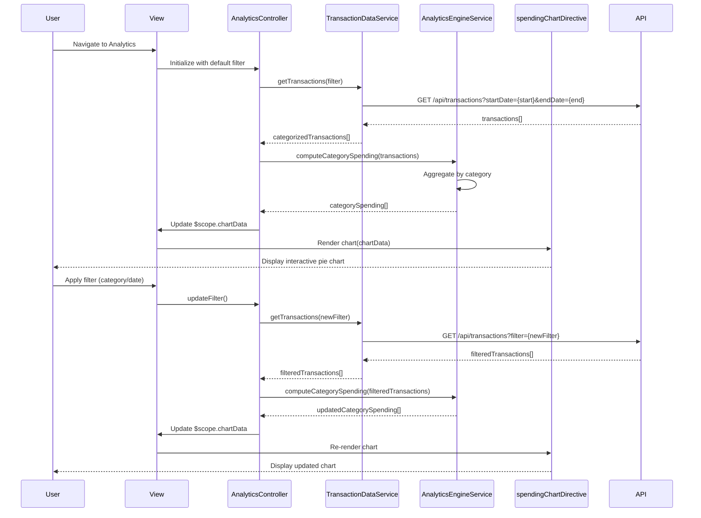

# Low-Level Design: QE-8765 - Transaction Analytics and Category-wise Spending Insights

## a. Architecture Mapping

**HLD Component → AngularJS Artifact:**
- User Interface → AngularJS Module: `creditCard.analytics`
- Analytics Module → Controller: `AnalyticsController`
- Transaction Data Service → Service: `TransactionDataService`
- Analytics Engine → Service: `AnalyticsEngineService`
- Charting Library → Directive: `spendingChartDirective` (wraps Chart.js)
- Transaction Repository → REST API endpoints

**Recommended Folder Structure:**
```
app/
├── modules/
│   └── analytics/
│       ├── controllers/
│       │   └── analytics.controller.js
│       ├── services/
│       │   ├── transaction-data.service.js
│       │   └── analytics-engine.service.js
│       ├── directives/
│       │   └── spending-chart.directive.js
│       ├── views/
│       │   ├── analytics-dashboard.html
│       │   └── transaction-list.html
│       └── analytics.module.js
```

## b. Component Specifications

| Component Name | Artifact Type | Responsibility | Key Dependencies |
|---|---|---|---|
| creditCard.analytics | Module | Root module for transaction analytics and insights | ngRoute, chart.js |
| AnalyticsController | Controller | Manages analytics view state, filters, and chart data binding | AnalyticsEngineService, TransactionDataService, $scope |
| TransactionDataService | Service | Fetches categorized transaction data from REST API | $http, $q, API_CONFIG |
| AnalyticsEngineService | Service | Aggregates transactions by category, computes spending patterns | $filter |
| spendingChartDirective | Directive | Renders interactive pie/bar charts using Chart.js library | Chart.js |
| AnalyticsDashboardView | HTML Template | Displays category-wise charts and spending breakdown | AnalyticsController |
| TransactionListView | HTML Template | Shows filterable transaction list with category tags | AnalyticsController |

## c. Data Model

**Transaction Object:**
```javascript
{
  transactionId: String,
  cardId: String,
  amount: Number,
  category: String,
  merchantName: String,
  transactionDate: Date,
  description: String
}
```

**CategorySpending Object:**
```javascript
{
  category: String,
  totalAmount: Number,
  transactionCount: Number,
  percentage: Number
}
```

**AnalyticsFilter Object:**
```javascript
{
  dateRange: { startDate: Date, endDate: Date },
  categories: Array<String>,
  cardIds: Array<String>
}
```

## d. Data Flow

User navigates to the analytics view, triggering AnalyticsController initialization. The controller invokes TransactionDataService.getTransactions(filter) with default date range (current month), which calls REST API GET /api/transactions?startDate={start}&endDate={end}. The service returns categorized transactions to the controller, which passes them to AnalyticsEngineService.computeCategorySpending(transactions). The engine aggregates amounts by category, calculates percentages, and returns an array of CategorySpending objects. The controller updates $scope.categoryData and $scope.chartData, which the spendingChartDirective consumes to render an interactive pie chart. User interactions (filter changes, category drill-down) trigger re-computation and chart updates via Angular's two-way binding.

## e. Primary Sequence Diagram



## f. Implementation Notes

- Use AngularJS 1.x module with Chart.js integration via custom directive; inject Chart.js as external library in index.html.
- Implement ES6 classes for services; use Array.reduce() in AnalyticsEngineService for category aggregation.
- Configure $http service with query parameter serialization for complex filters; use $q.all() for parallel API calls if fetching multiple card data.
- Apply Bootstrap responsive grid for chart and transaction list layout; use ng-repeat with filters for transaction list rendering.
- Implement client-side pagination (25 transactions per page) and lazy loading for 1000+ transactions to meet 1.5-second rendering NFR.

## g. Error Handling

HTTP interceptor captures API errors; service methods use try/catch with fallback to cached data; user notified via toastr on failures.

## h. Security Notes

Standard input validation and secure API calls assumed; category filters sanitized to prevent injection attacks.