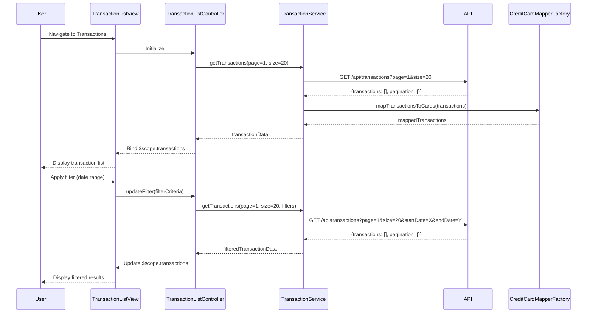

# Low-Level Design: Transaction Management and Monitoring
**Epic ID:** QE-8780

## a. Architecture Mapping

- **Transaction List Module** → AngularJS Module (`transactionModule`)
- **Transaction List Controller** → AngularJS Controller (`TransactionListController`)
- **Transaction Detail Controller** → AngularJS Controller (`TransactionDetailController`)
- **Transaction Service** → AngularJS Service (`TransactionService`)
- **Credit Card Mapper Service** → AngularJS Factory (`CreditCardMapperFactory`)
- **Authentication Interceptor** → AngularJS HTTP Interceptor (`AuthInterceptor`)
- **Transaction Filter Directive** → AngularJS Directive (`transactionFilter`)

**Recommended Folder Structure:**
```
/app
  /modules
    /transaction
      /controllers
      /services
      /directives
      /views
  /shared
    /interceptors
    /filters
```

## b. Component Specifications

| Name | Artifact Type | Responsibility | Key Dependencies |
|------|---------------|----------------|------------------|
| transactionModule | Module | Root module for transaction management features | ngRoute, ngResource |
| TransactionListController | Controller | Manages transaction list view, pagination, search/filter state | TransactionService, $scope, $filter |
| TransactionDetailController | Controller | Displays individual transaction details | TransactionService, $routeParams, $scope |
| TransactionService | Service | Handles API calls for transaction CRUD, pagination, filtering | $http, $q, API_CONFIG |
| CreditCardMapperFactory | Factory | Maps transactions to user's credit cards | $http, CreditCardService |
| AuthInterceptor | HTTP Interceptor | Injects auth tokens, handles 401 responses | $q, $window, AuthService |
| transactionFilter | Directive | Renders filter UI (date range, card, amount) | TransactionService |
| transactionPagination | Directive | Renders pagination controls | - |

## c. Data Model

**Transaction Object:**
```javascript
{
  transactionId: String,
  cardId: String,
  cardLastFour: String,
  merchantName: String,
  category: String,
  amount: Number,
  currency: String,
  transactionDate: Date,
  status: String, // 'posted', 'pending'
  description: String,
  isEncrypted: Boolean
}
```

**FilterCriteria Object:**
```javascript
{
  startDate: Date,
  endDate: Date,
  cardIds: Array<String>,
  minAmount: Number,
  maxAmount: Number,
  categories: Array<String>
}
```

**PaginationState Object:**
```javascript
{
  currentPage: Number,
  pageSize: Number,
  totalRecords: Number,
  totalPages: Number
}
```

## d. Data Flow

User authenticates and navigates to transaction view → TransactionListController initializes and calls TransactionService.getTransactions() with default pagination (page 1, size 20) → TransactionService sends GET request to /api/transactions with auth token via AuthInterceptor → API returns paginated, encrypted transaction data → CreditCardMapperFactory maps transactions to user's cards → Data is decrypted client-side and bound to $scope.transactions → View renders transaction list with ng-repeat → User applies filters via transactionFilter directive → Controller updates FilterCriteria and re-fetches data → TransactionService sends filtered request → Updated results render in view → User clicks transaction row → TransactionDetailController fetches full details via TransactionService.getTransactionById() → Detail view displays.

## e. Primary Sequence Diagram



## f. Implementation Notes

- Use AngularJS $http service with promise-based pattern for all API calls; leverage $q for chaining and error handling.
- Implement server-side pagination with query params (page, size); store pagination state in controller scope.
- Use AngularJS filters for client-side formatting (currency, date) and custom filters for search highlighting.
- Dependency Injection: All services/controllers use explicit array notation for minification safety.
- Real-time updates: Implement $interval polling (every 30s) or WebSocket via angular-websocket library for live transaction push.

## g. Error Handling

HTTP interceptor captures API errors (4xx/5xx), displays user-friendly notifications via toastr/angular-toastr, and logs errors to console; controller-level try/catch wraps critical operations.

## h. Security Notes

Requires token-based auth via existing SSO; all API calls include Authorization header; transaction data encrypted in transit (HTTPS) and sensitive fields masked in UI.