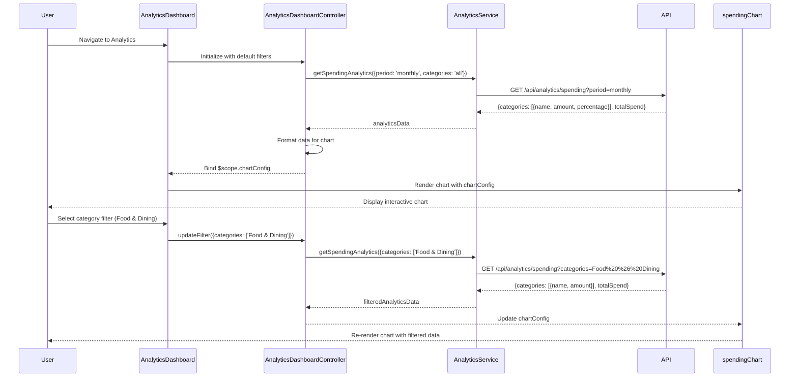

# Low-Level Design: Spending Analytics and Category Insights
**Epic ID:** QE-8781

## a. Architecture Mapping

- **Analytics Module** → AngularJS Module (`analyticsModule`)
- **Analytics Dashboard Controller** → AngularJS Controller (`AnalyticsDashboardController`)
- **Analytics Service** → AngularJS Service (`AnalyticsService`)
- **Chart Directive** → AngularJS Directive (`spendingChart`)
- **Category Filter Directive** → AngularJS Directive (`categoryFilter`)
- **Transaction Data Factory** → AngularJS Factory (`TransactionDataFactory`)
- **Analytics Engine Adapter** → AngularJS Service (`AnalyticsEngineAdapter`)

**Recommended Folder Structure:**
```
/app
  /modules
    /analytics
      /controllers
      /services
      /directives
      /views
  /shared
    /charts
    /filters
```

## b. Component Specifications

| Name | Artifact Type | Responsibility | Key Dependencies |
|------|---------------|----------------|------------------|
| analyticsModule | Module | Root module for analytics features | ngRoute, chart.js or angular-chart.js |
| AnalyticsDashboardController | Controller | Manages analytics view state, filter selections, chart data | AnalyticsService, $scope, $filter |
| AnalyticsService | Service | Fetches aggregated spending data from API | $http, $q, API_CONFIG |
| TransactionDataFactory | Factory | Retrieves raw categorized transaction history | $http, $q |
| AnalyticsEngineAdapter | Service | Processes and aggregates transaction data by category/card/month | - |
| spendingChart | Directive | Renders interactive chart (bar/pie/line) using Chart.js | AnalyticsService |
| categoryFilter | Directive | Renders category multi-select filter UI | - |
| cardFilter | Directive | Renders card selection filter | - |

## c. Data Model

**SpendingAnalytics Object:**
```javascript
{
  userId: String,
  period: String, // 'monthly', 'yearly'
  categories: Array<CategorySpend>,
  totalSpend: Number,
  currency: String
}
```

**CategorySpend Object:**
```javascript
{
  categoryName: String, // 'Food & Dining', 'Fuel', etc.
  amount: Number,
  percentage: Number,
  transactionCount: Number,
  cardBreakdown: Array<{cardId: String, amount: Number}>
}
```

**ChartConfig Object:**
```javascript
{
  type: String, // 'bar', 'pie', 'line'
  labels: Array<String>,
  datasets: Array<Object>,
  options: Object
}
```

## d. Data Flow

User navigates to analytics dashboard → AnalyticsDashboardController initializes with default filters (all categories, current month, all cards) → Controller calls AnalyticsService.getSpendingAnalytics(filters) → AnalyticsService sends GET request to /api/analytics/spending with filter params → API returns aggregated spending data by category → AnalyticsEngineAdapter processes response and formats data for charting → Controller binds data to $scope.analyticsData and $scope.chartConfig → spendingChart directive renders interactive chart using Chart.js → User selects category filter via categoryFilter directive → Controller updates filter state and re-fetches data → AnalyticsService sends updated request → New aggregated data returned → Chart updates reactively via $scope.$watch → User drills down into specific category → Controller fetches detailed breakdown and updates chart.

## e. Primary Sequence Diagram



## f. Implementation Notes

- Use Chart.js with angular-chart.js wrapper for declarative chart rendering; bind chart data via $scope with two-way binding for reactivity.
- Implement client-side aggregation fallback in AnalyticsEngineAdapter if API returns raw transaction data instead of pre-aggregated results.
- Use AngularJS $watch on filter objects to trigger automatic data refresh when user changes selections.
- Dependency Injection: All services use explicit array notation; chart directive uses isolate scope for reusability.
- Support drill-down by passing category selection to controller method that fetches detailed breakdown and updates chart type dynamically.

## g. Error Handling

HTTP interceptor handles API failures; display fallback message in chart area if data unavailable; controller-level try/catch for data processing errors with user notification.

## h. Security Notes

Standard input validation and secure API calls assumed; auth token included in all API requests via interceptor.