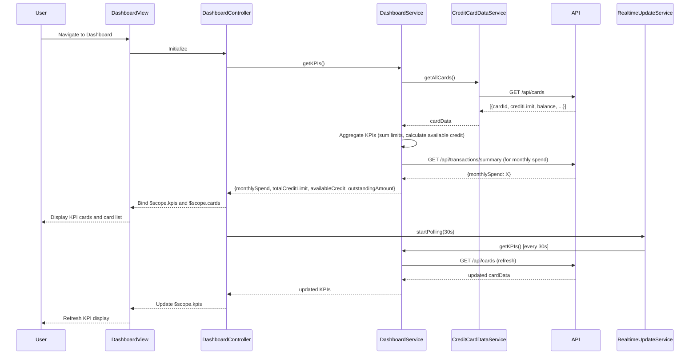

# Low-Level Design: Dashboard KPIs and Credit Card Overview
**Epic ID:** QE-8782

## a. Architecture Mapping

- **Dashboard Module** → AngularJS Module (`dashboardModule`)
- **Dashboard Controller** → AngularJS Controller (`DashboardController`)
- **Dashboard Service** → AngularJS Service (`DashboardService`)
- **Credit Card Data Service** → AngularJS Service (`CreditCardDataService`)
- **KPI Card Directive** → AngularJS Directive (`kpiCard`)
- **Credit Card List Directive** → AngularJS Directive (`creditCardList`)
- **Real-time Update Service** → AngularJS Service (`RealtimeUpdateService`)

**Recommended Folder Structure:**
```
/app
  /modules
    /dashboard
      /controllers
      /services
      /directives
      /views
  /shared
    /services
```

## b. Component Specifications

| Name | Artifact Type | Responsibility | Key Dependencies |
|------|---------------|----------------|------------------|
| dashboardModule | Module | Root module for dashboard features | ngRoute, ngResource |
| DashboardController | Controller | Manages dashboard state, KPI data, card list | DashboardService, RealtimeUpdateService, $scope |
| DashboardService | Service | Aggregates and formats KPI data from multiple sources | CreditCardDataService, $http, $q |
| CreditCardDataService | Service | Fetches card details, balances, limits, outstanding amounts | $http, $q, API_CONFIG |
| RealtimeUpdateService | Service | Polls API or listens to WebSocket for live KPI updates | $interval or WebSocket |
| kpiCard | Directive | Renders individual KPI widget (monthly spend, credit limit, etc.) | - |
| creditCardList | Directive | Renders list of user's credit cards with summary info | CreditCardDataService |

## c. Data Model

**DashboardKPI Object:**
```javascript
{
  monthlySpend: Number,
  totalCreditLimit: Number,
  availableCredit: Number,
  outstandingAmount: Number,
  currency: String,
  lastUpdated: Date
}
```

**CreditCard Object:**
```javascript
{
  cardId: String,
  cardName: String,
  cardType: String, // 'Visa', 'MasterCard'
  lastFourDigits: String,
  creditLimit: Number,
  availableCredit: Number,
  outstandingBalance: Number,
  monthlySpend: Number,
  status: String // 'active', 'blocked'
}
```

## d. Data Flow

User authenticates and navigates to dashboard → DashboardController initializes and calls DashboardService.getKPIs() → DashboardService calls CreditCardDataService.getAllCards() to fetch user's cards → CreditCardDataService sends GET request to /api/cards with auth token → API returns array of card objects with balances and limits → DashboardService aggregates data: sums credit limits, calculates total available credit, sums outstanding amounts, retrieves monthly spend from transaction summary endpoint → Aggregated KPI data bound to $scope.kpis → View renders KPI cards via kpiCard directive → creditCardList directive renders individual card summaries → RealtimeUpdateService initiates $interval polling (every 30s) or WebSocket connection → On update, DashboardService re-fetches and updates $scope.kpis → View updates reactively via Angular's digest cycle.

## e. Primary Sequence Diagram



## f. Implementation Notes

- Use AngularJS $http service for RESTful API calls; DashboardService aggregates data from multiple endpoints (/api/cards, /api/transactions/summary).
- Implement real-time updates via $interval polling (30-60s) or WebSocket using angular-websocket library; store interval reference for cleanup on $destroy.
- Use Bootstrap grid system (col-md-3, col-sm-6) for responsive KPI card layout; kpiCard directive uses isolate scope with @ binding for KPI value and label.
- Dependency Injection: All services/controllers use explicit array notation for minification safety.
- Cache KPI data in DashboardService for 30s to reduce redundant API calls if user navigates away and returns quickly.

## g. Error Handling

HTTP interceptor captures API errors and displays user-friendly notifications; if KPI fetch fails, display last known values with "stale data" indicator; controller logs errors to console.

## h. Security Notes

Requires token-based auth via existing SSO; all API calls include Authorization header; sensitive card data (full card number) never exposed in API response or UI.