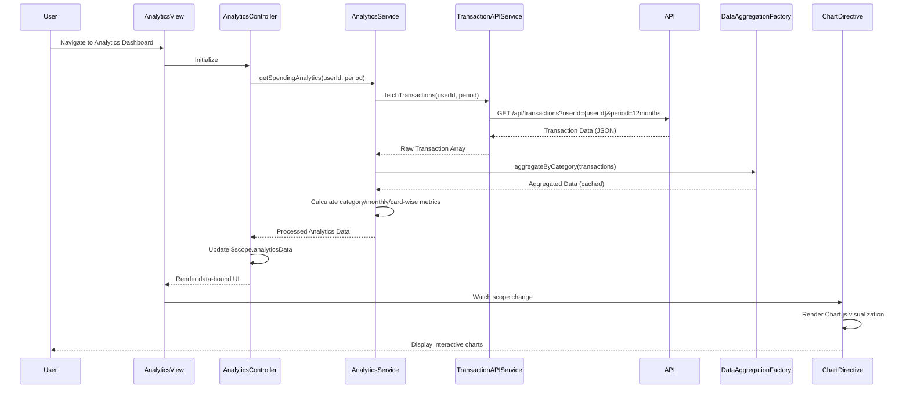

# Low-Level Design: QE-8813 - Spending Analytics and Insights

## a. Architecture Mapping

- **Analytics UI Component** → AngularJS Module (`analyticsModule`) + Controller (`AnalyticsController`) + Directives (`spendingChart`, `categoryBreakdown`)
- **Analytics Engine** → AngularJS Service (`AnalyticsService`) for data processing and categorization logic
- **Data Aggregation Layer** → AngularJS Factory (`DataAggregationFactory`) for transaction data aggregation and caching
- **Transaction Data Service Integration** → AngularJS Service (`TransactionAPIService`) for REST API calls
- **Dashboard Service Integration** → AngularJS Service (`DashboardAPIService`) for KPI data retrieval

**Recommended Folder Structure:**
```
app/
├── modules/
│   └── analytics/
│       ├── controllers/
│       │   └── analyticsController.js
│       ├── services/
│       │   ├── analyticsService.js
│       │   ├── transactionAPIService.js
│       │   └── dashboardAPIService.js
│       ├── factories/
│       │   └── dataAggregationFactory.js
│       ├── directives/
│       │   ├── spendingChart.js
│       │   └── categoryBreakdown.js
│       └── views/
│           └── analytics.html
```

## b. Component Specifications

| Component Name | Artifact Type | Responsibility | Key Dependencies |
|---|---|---|---|
| analyticsModule | Module | Root module for analytics feature, declares all controllers, services, directives | angular, ngRoute, chart.js |
| AnalyticsController | Controller | Manages analytics view state, coordinates data retrieval, handles user interactions | AnalyticsService, DataAggregationFactory, $scope |
| AnalyticsService | Service | Processes transaction data, applies categorization rules, calculates spending metrics | TransactionAPIService, $q |
| TransactionAPIService | Service | REST API integration for transaction data retrieval | $http, $q |
| DashboardAPIService | Service | REST API integration for KPI data | $http, $q |
| DataAggregationFactory | Factory | Aggregates and caches transaction data for performance optimization | $cacheFactory |
| spendingChart | Directive | Renders interactive monthly spend trend chart using Chart.js | AnalyticsService |
| categoryBreakdown | Directive | Renders category-wise spending visualization | AnalyticsService |

## c. Data Model

**Transaction Model:**
```javascript
{
  transactionId: String,
  cardId: String,
  amount: Number,
  category: String, // One of: Food & Dining, Fuel, Shopping, Travel, Entertainment, Utilities, Healthcare, Education, Miscellaneous
  merchantName: String,
  transactionDate: Date,
  description: String
}
```

**CategorySpending Model:**
```javascript
{
  category: String,
  totalAmount: Number,
  transactionCount: Number,
  percentage: Number
}
```

**MonthlyTrend Model:**
```javascript
{
  month: String, // YYYY-MM format
  totalSpend: Number,
  categoryBreakdown: Array<CategorySpending>
}
```

**CardWiseSpend Model:**
```javascript
{
  cardId: String,
  cardName: String,
  totalSpend: Number,
  categoryBreakdown: Array<CategorySpending>
}
```

## d. Data Flow

User navigates to the analytics dashboard; AnalyticsController initializes and calls AnalyticsService.getSpendingAnalytics(); AnalyticsService invokes TransactionAPIService to fetch transaction data via REST API (GET /api/transactions?userId={userId}&period=12months); DataAggregationFactory aggregates and caches the response; AnalyticsService applies categorization logic and calculates category-wise, monthly, and card-wise spending metrics; processed data is returned to AnalyticsController which updates $scope; spendingChart and categoryBreakdown directives watch scope changes and render interactive Chart.js visualizations; user interactions (filter, date range) trigger controller methods that re-aggregate data and update the UI.

## e. Primary Sequence Diagram



## f. Implementation Notes

- Use AngularJS 1.x MVC pattern with strict separation: controllers manage view logic, services handle business logic, factories manage data caching
- Leverage AngularJS Dependency Injection (DI) for all services, factories, and directives to ensure testability and modularity
- Integrate Chart.js via custom AngularJS directives (spendingChart, categoryBreakdown) with two-way data binding for reactive updates
- Implement $cacheFactory in DataAggregationFactory to cache aggregated data for 5 minutes, reducing API calls and meeting 3-second render NFR
- Use ES6 arrow functions, const/let, template literals, and Promise-based $http for cleaner, modern JavaScript code

## g. Error Handling

HTTP interceptor captures API errors; TransactionAPIService wraps calls in try/catch with $q.reject; AnalyticsController displays user-friendly error notifications via toastr or Bootstrap alerts.

## h. Security Notes

Requires token-based authentication via existing SSO; all API calls include Authorization header with JWT token; standard input validation applied to user filters and date ranges.