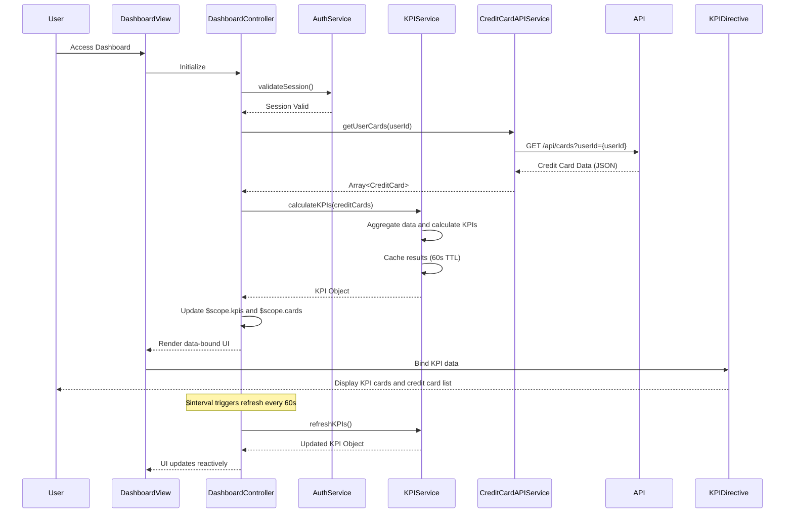

# Low-Level Design: QE-8814 - Credit Card Portfolio and KPI Dashboard

## a. Architecture Mapping

- **Dashboard UI Component** → AngularJS Module (`dashboardModule`) + Controller (`DashboardController`) + Directives (`kpiCard`, `creditCardList`)
- **User Authentication Service** → AngularJS Service (`AuthService`) for authentication and session management
- **Credit Card Data Service** → AngularJS Service (`CreditCardAPIService`) for REST API integration
- **KPI Calculation Engine** → AngularJS Service (`KPIService`) for client-side KPI calculation and caching

**Recommended Folder Structure:**
```
app/
├── modules/
│   └── dashboard/
│       ├── controllers/
│       │   └── dashboardController.js
│       ├── services/
│       │   ├── authService.js
│       │   ├── creditCardAPIService.js
│       │   └── kpiService.js
│       ├── directives/
│       │   ├── kpiCard.js
│       │   └── creditCardList.js
│       └── views/
│           └── dashboard.html
```

## b. Component Specifications

| Component Name | Artifact Type | Responsibility | Key Dependencies |
|---|---|---|---|
| dashboardModule | Module | Root module for dashboard feature, declares all controllers, services, directives | angular, ngRoute |
| DashboardController | Controller | Manages dashboard state, orchestrates data loading, handles user actions | KPIService, CreditCardAPIService, AuthService, $scope, $interval |
| AuthService | Service | Manages user authentication, session tokens, access control | $http, $window, $q |
| CreditCardAPIService | Service | REST API integration for credit card data retrieval | $http, $q |
| KPIService | Service | Calculates and caches KPI metrics (Monthly Spend, Total Credit Limit, Available Credit, Outstanding Amount) | CreditCardAPIService, $cacheFactory |
| kpiCard | Directive | Reusable UI component to display individual KPI with value and label | None |
| creditCardList | Directive | Displays consolidated list of all user credit cards with key details | None |

## c. Data Model

**CreditCard Model:**
```javascript
{
  cardId: String,
  cardNumber: String, // Masked (e.g., **** **** **** 1234)
  cardType: String, // Visa, MasterCard, Amex, etc.
  cardHolderName: String,
  creditLimit: Number,
  availableCredit: Number,
  outstandingAmount: Number,
  expiryDate: String, // MM/YY format
  status: String // Active, Blocked, Expired
}
```

**KPI Model:**
```javascript
{
  monthlySpend: Number,
  totalCreditLimit: Number,
  availableCredit: Number,
  outstandingAmount: Number,
  lastUpdated: Date
}
```

**User Model:**
```javascript
{
  userId: String,
  userName: String,
  email: String,
  authToken: String
}
```

## d. Data Flow

User accesses the dashboard; AuthService validates session token and redirects to login if invalid; DashboardController initializes and calls KPIService.getKPIs() and CreditCardAPIService.getUserCards(); CreditCardAPIService makes REST API call (GET /api/cards?userId={userId}) to retrieve credit card data; KPIService aggregates card data to calculate Monthly Spend, Total Credit Limit, Available Credit, and Outstanding Amount, then caches results; calculated KPIs and card list are returned to DashboardController which updates $scope; kpiCard and creditCardList directives render the UI with data binding; $interval triggers KPIService refresh every 60 seconds to meet real-time data refresh NFR; UI updates reactively via AngularJS two-way binding.

## e. Primary Sequence Diagram



## f. Implementation Notes

- Use AngularJS 1.x MVC architecture with controllers managing view state and services encapsulating business logic and API calls
- Leverage AngularJS Dependency Injection for all services and directives to enable unit testing and loose coupling
- Implement $cacheFactory in KPIService with 60-second TTL to optimize performance and meet 2-second load time NFR
- Use $interval service to auto-refresh KPI data every 60 seconds for real-time updates without full page reload
- Apply Bootstrap 3/4 grid system and responsive utilities for mobile-first, device-agnostic UI rendering

## g. Error Handling

HTTP interceptor captures API failures; services use $q.reject for promise-based error propagation; DashboardController displays Bootstrap alert modals with user-friendly error messages.

## h. Security Notes

Requires token-based auth via existing SSO; AuthService manages JWT tokens stored in sessionStorage; all API requests include Authorization header with bearer token.