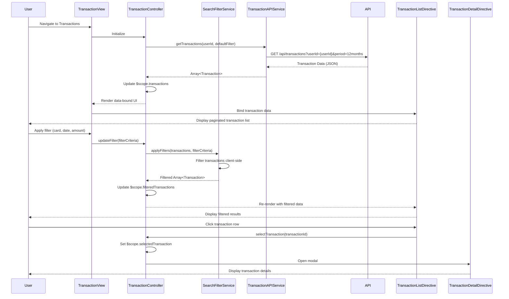

# Low-Level Design: QE-8815 - Credit Card Transaction Management

## a. Architecture Mapping

- **Transaction Management Module** → AngularJS Module (`transactionModule`) + Controller (`TransactionController`)
- **User Interface** → AngularJS Views (transaction.html) + Directives (`transactionList`, `transactionDetail`, `transactionFilter`)
- **Search and Filter Engine** → AngularJS Service (`SearchFilterService`) for client-side filtering and search logic
- **Transaction Data Service** → AngularJS Service (`TransactionAPIService`) for REST API integration
- **Credit Card Data Service** → AngularJS Service (`CreditCardAPIService`) for card-specific filtering

**Recommended Folder Structure:**
```
app/
├── modules/
│   └── transactions/
│       ├── controllers/
│       │   └── transactionController.js
│       ├── services/
│       │   ├── searchFilterService.js
│       │   ├── transactionAPIService.js
│       │   └── creditCardAPIService.js
│       ├── directives/
│       │   ├── transactionList.js
│       │   ├── transactionDetail.js
│       │   └── transactionFilter.js
│       └── views/
│           ├── transactions.html
│           └── transaction-detail.html
```

## b. Component Specifications

| Component Name | Artifact Type | Responsibility | Key Dependencies |
|---|---|---|---|
| transactionModule | Module | Root module for transaction management feature, declares all controllers, services, directives | angular, ngRoute |
| TransactionController | Controller | Manages transaction view state, handles search/filter actions, coordinates data retrieval | SearchFilterService, TransactionAPIService, CreditCardAPIService, $scope |
| SearchFilterService | Service | Implements search and filter logic for transactions (date range, card, amount, category) | None |
| TransactionAPIService | Service | REST API integration for transaction data retrieval | $http, $q |
| CreditCardAPIService | Service | REST API integration for card-specific transaction filtering | $http, $q |
| transactionList | Directive | Renders paginated list of transactions with sortable columns | SearchFilterService |
| transactionDetail | Directive | Displays detailed view of a single transaction in modal or separate view | None |
| transactionFilter | Directive | Provides UI controls for search and filter (date picker, card dropdown, amount range, category) | SearchFilterService |

## c. Data Model

**Transaction Model:**
```javascript
{
  transactionId: String,
  cardId: String,
  cardNumber: String, // Masked
  amount: Number,
  currency: String, // USD, EUR, etc.
  category: String,
  merchantName: String,
  merchantCity: String,
  transactionDate: Date,
  postingDate: Date,
  description: String,
  status: String // Posted, Pending, Declined
}
```

**FilterCriteria Model:**
```javascript
{
  cardId: String,
  startDate: Date,
  endDate: Date,
  minAmount: Number,
  maxAmount: Number,
  category: String,
  searchText: String
}
```

**PaginationConfig Model:**
```javascript
{
  currentPage: Number,
  pageSize: Number,
  totalRecords: Number
}
```

## d. Data Flow

User navigates to the transaction management view; TransactionController initializes and calls TransactionAPIService.getTransactions(userId, filterCriteria) with default 12-month date range; TransactionAPIService makes REST API call (GET /api/transactions?userId={userId}&startDate={startDate}&endDate={endDate}) to retrieve transaction history; response is returned to TransactionController which updates $scope.transactions; transactionList directive renders paginated transaction table with data binding; user applies filters via transactionFilter directive which updates $scope.filterCriteria; TransactionController invokes SearchFilterService.applyFilters(transactions, filterCriteria) for client-side filtering; filtered results update $scope.filteredTransactions and UI re-renders; user clicks transaction row to view details; TransactionController sets $scope.selectedTransaction and transactionDetail directive displays modal with full transaction details.

## e. Primary Sequence Diagram



## f. Implementation Notes

- Use AngularJS 1.x MVC pattern with controllers managing view logic and services handling business logic and API integration
- Leverage AngularJS Dependency Injection for all services and directives to ensure modularity and testability
- Implement client-side filtering via SearchFilterService using ES6 Array methods (filter, map, reduce) for sub-1-second response meeting NFR
- Use AngularJS $http service with promise-based API calls; implement pagination on server-side API to handle large transaction datasets efficiently
- Apply Bootstrap modals for transactionDetail directive and Bootstrap form controls for transactionFilter directive to ensure responsive, mobile-friendly UI

## g. Error Handling

HTTP interceptor captures API errors; TransactionAPIService wraps calls in try/catch with $q.reject; TransactionController displays Bootstrap toasts or inline alerts for user notification.

## h. Security Notes

Requires token-based auth via existing SSO; all API calls include Authorization header with JWT token; standard input validation and secure API calls assumed.